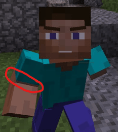

# 🦴 表情动作与更多关节

## 为什么表情动作不能有更多关节？

### 原因 1

带有多个关节动画的表情动作看起来<mark style="color:red;">**糟糕透顶**</mark>，它们破坏了Minecraft的感觉，让人想起那些令人尴尬的YouTube Minecraft动画，如下所示：

<figure><figcaption></figcaption></figure>

### 原因 2

当前的表情动作与基岩版的表情动作风格相同，遵循 Mojang 的风格指南。

### 原因 3

增加关节需要**完全重写**动画代码，耗时数周，并会增加服务器开销。
