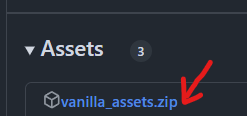
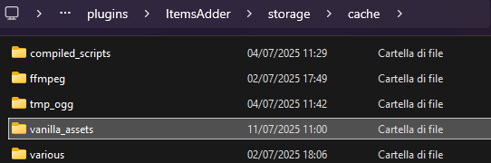

# 下载 Minecraft 资源失败

ItemsAdder 需要一些 Minecraft 资源才能工作，并会自动下载。不过，某些服务器环境可能会遇到下载问题（防火墙拦截、网络错误等）。

你可以手动下载这些资源来修复此问题。

#### 删除文件夹

删除文件夹 `ItemsAdder/storage/cache/vanilla_assets`

#### 下载资源

<figure><figcaption></figcaption></figure>

#### 解压 `vanilla_assets` 文件夹

将 `vanilla_assets` 文件夹解压到 `ItemsAdder/storage/`

<figure><figcaption></figcaption></figure>

#### 完成

启动服务器，运行 `/iazip` 重新生成资源包。
