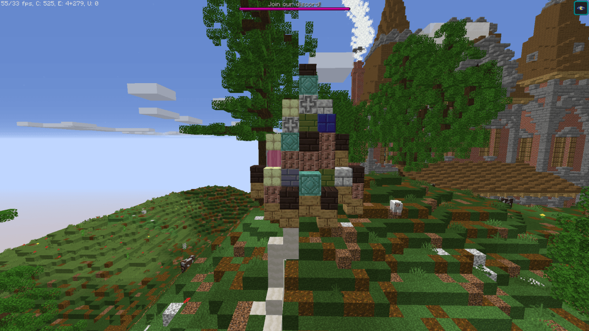

# 方块显示异常

这些都只是图形上的问题，不会导致复制漏洞或类似问题。

## `REAL_NOTE`（音符盒）

在安装 ItemsAdder 之前放置的音符盒可能会显示为自定义方块纹理。

### 如何修复

```yaml
blocks:
  fix-glitched-blocks:
    enabled: true
    only-new-chunks: false
```

## `REAL` 和 `REAL_TRANSPARENT`（蘑菇和紫颂植物）

如果使用 `REAL`、`REAL_TRANSPARENT` 类型创建自定义方块，这是正常现象。\
ItemsAdder 使用蘑菇方块和紫颂植株来创建它们。

这是因为游戏在游戏过程中生成它们以创建一些结构（例如：在主世界中的大蘑菇和末地中的紫颂植物），因此它们可能会生成一些特定的方块数据，这些数据会干扰 ItemsAdder 方块。



通常你应该避免使用 `REAL` 自定义方块类型（蘑菇），而使用更好的 `REAL_NOTE` 自定义方块类型，它使用 **音符盒** 来创建自定义方块，因此你不会遇到这个问题，因为它们不会自然生成在原版世界中。

### 如何修复

```yaml
  fix-glitched-blocks:
    enabled: true
    only-new-chunks: false
```

### Paper 上的高级修复

```yaml
block-updates:
  disable-noteblock-updates: true
  disable-tripwire-updates: true
```

**注意**

设置 `disable-tripwire-updates: true` 会完全阻止绊线更新。\
因此，绊线陷阱可能会失效。\\

设置 `disable-noteblock-updates: true` 也会产生相同的行为。\
也就是说，不再更新。因此，你将无法制作音乐红石电路。

## `REAL_TRANSPARENT`（紫颂植物）

### 方块破坏动画错误

这只是一个显示故障，在 **Spigot** 中无法修复。\
如果要彻底修复，必须安装 **Paper**。


#### 如何修复

```yaml
block-updates:
  disable-chorus-plant-updates: true
```

### 自动掉落物品拾取复制问题

如果使用自动拾取掉落物插件，在出现这类紫颂植物显示异常时，可能会有紫颂果随机进入物品栏。

要解决此问题，你必须删除自动掉落物品拾取插件，或要求其开发人员添加一个选项，以禁用某些物品（紫颂果）或某些方块（紫颂植物）的自动拾取。

## **树木方块有时会消失并变成空气方块**

这是创造模式下的已知问题，因为客户端不会向服务器发送某些数据包。\
请在生存模式下尝试。

## **`REAL_TRANSPARENT` 方块在水流动时会掉落**

我知道这个漏洞，但要修复它，会让服务器负载高得像烤箱一样。\
\
你应该知道，有些 Minecraft 功能本身并不支持自定义，无论是服主还是插件开发者都一样。因此，某些功能需要通过大量变通技巧才能实现，有时还不完全稳定。自定义方块就是其中之一。

要修复此流水漏洞，我必须监听水流动事件，并检查水周围的每个方块是否为自定义方块。中型服务器上会触发数千次此事件，我不想让插件变得繁重，从而导致卡顿。

## `TILE`

Tile 方块已属于旧版方式，因为它们从大约 1.21.6 开始就存在问题。\
安装 ItemsAdder 4.0.18 或更高版本可修复此问题。

