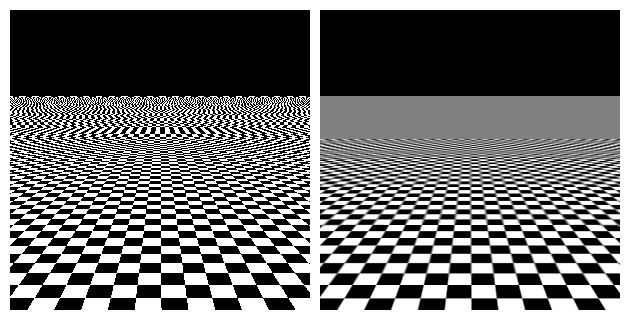

# 我看到远处的纹理不连贯！

如果你看到远处的纹理是点状而不是平滑的，这是资源包制作者的一个常见错误。\
Minecraft 有一个 bug，如果你设置的纹理大小不是 2 的幂，它会禁用 mipmap！

## **如何修复？**

很简单！只需按照以下步骤操作：

* 阅读本教程，了解[如何查看游戏日志](identify-why-textures-are-not-shown.md)（并非服务器日志）。
* 搜索这个文本 `limits mip level`
* 识别有问题的纹理，例如 `Texture mcicons:item/icon_toggle_off with size 30x30 limits mip level from 3 to 1`
* 修复纹理。\
  要修复它，你需要将其大小调整为：16x16、32x32、64x64、128x128、256x256 等。\
  你可以选择其中之一。
