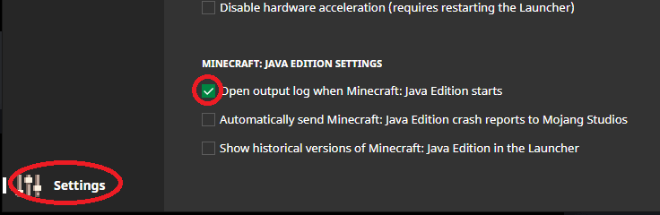
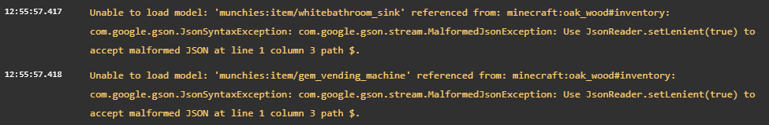

# 资源包未正确加载

**在寻求支持之前，请仔细阅读此页面。**

大多数情况下，通过阅读此页面可以轻松解决问题。

* 资源包完全没有加载
* 玩家加入时全屏显示错误
* 显示黑紫色纹理
* 模型无法正确加载
* 资源包加载失败
* 自定义声音无法播放
* 资源包无限加载的故障

## 如何查看服务器日志

* 执行命令 `/iazip`
* 等待命令执行完成
* 查看服务器控制台，或使用任意文本编辑器（例如 [VSCode](https://code.visualstudio.com/)）打开 `logs/latest.log` 文件
* 检查是否出现错误或警告，并仔细阅读；它们通常包含有用的信息

## 如何查看客户端日志（不是服务器日志）

#### 出现问题时，务必使用原版客户端！

寻求支持时，如有需要，通常会要求你提供游戏日志。\
精简、没有冗余内容的日志，更便于提供支持和找到解决办法。

#### 官方启动器

点击展开

启用输出日志

加入服务器并查看日志

你可以清楚地看到哪些文件加载失败以及原因。大多数情况下，错误信息都很明确。

本例中有两个损坏的文件：`gem_vending_machine` 和 `whitebathroom_sink`。\
错误提示这些 JSON 文件有问题，可能包含不正确的字符，或文件已损坏。

#### 任意启动器

点击展开

加入服务器，等待资源包加载。\
打开 Minecraft 游戏的日志文件，**不是服务器**日志。\
通常位于此处：`%appdata%\.minecraft\logs\latest.log`\
你可以清楚地看到哪些文件加载失败以及原因，大多数情况下错误信息都很明确。

## 常见问题 

* 务必按照资源包托管[教程](../plugin-usage/plugin-configuration/resourcepack-hosting.md)完成所有步骤。
* 如果使用 [`self-host`](../plugin-usage/plugin-configuration/resourcepack-hosting/self-hosting.md)，确保**端口**已开放。请向服务器托管商咨询。
* 确保物品**名称**、**命名空间**、**纹理**文件（`png`）和**模型**文件（`json`）中没有使用**大写字母**、**空格**或**特殊字符**。\
  例如，自定义物品 ID `CustomSword` 是错误的，应使用 `custom_sword`。
* 如果使用 **SkinsRestorer**，请[参阅此处](../compatibility-with-other-plugins/compatible/skinsrestorer.md)。
* 如果出现黑紫色纹理，且版本为 1.21.11 或更高，请[参阅此处](multiple-atlases-used-in-model.md)。
* 检查是否有其他插件使用**自定义资源包**。\
  **如**果有类似插件，请**禁用**其**资源包**功能，否则 **ItemsAdder** 将无法正确应用资源包。如果要同时应用两个资源包，请[参阅此处](../adding-content/merge-resourcepacks.md)。
* 确保 `server.properties` 文件中未设置任何资源包。
* **Minecraft** 对服务器资源包的**大小**有如下限制：**1.14** 为 **50MB**，**1.15+** 为 **100MB**，**1.18+** 为 **250MB**。\
  创建 zip 文件前，务必**压缩纹理**和**音乐**文件。
* 运行 `/iainfo` 命令，确保浏览器可以访问资源包 **URL**，并直接下载资源包 `.zip` 文件。\
  将链接粘贴到浏览器（Firefox/Chrome）后，应该立即开始下载。\
  如果出现带按钮的下载页面，则此 URL 无效。\
  请阅读资源包[托管教程](../plugin-usage/plugin-configuration/resourcepack-hosting.md)。

### 完全未发送资源包 

* 在服务器列表设置中启用资源包：[http://imgur.com/a/SG0AU](http://imgur.com/a/SG0AU)
* 确保玩家加入时不会打开任何物品栏界面（GUI）或书籍。\
  这可能导致资源包提示框消失，使玩家无法点击。\
  要修复此问题，可以使用免费插件 [ResourcePackBroadcast](https://www.spigotmc.org/resources/resourcepackbroadcast.88318/)。\
  它允许你在玩家接受资源包后立即执行命令（并提供其他多种功能）。
* 将 **ItemsAdder** 的 `config.yml` 中的 `delay-ticks` 增大到 `10` 或更高。
* 退出服务器，前往 `%appdata%/.minecraft/server-resource-packs` 并删除其中的所有内容，然后重新加入服务器。

### 下载原版资源时的错误

请阅读此处的教程。

[failed-to-download-minecraft-assets.md](failed-to-download-minecraft-assets.md)

## 执行 `/iazip` 后资源包未更新

如果使用 **Cloudflare**，确保使用 Cache Bypass（绕过缓存）、清除缓存，或创建自定义规则，强制资源包文件不使用缓存。来源见[此处](https://github.com/PluginBugs/Issues-ItemsAdder/issues/3894#issuecomment-2817017486)。
