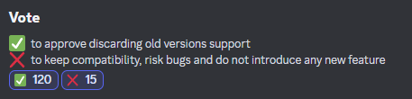

# ItemsAdder v4

## 介绍

维护对6个游戏版本的兼容性变得非常困难，这严重影响了产品质量和更新发布的延迟。

我决定放弃对1.15到1.20.4版本的兼容性，以提供更好的1.20.5+体验。

## 社区的看法

Discord社区投票决定放弃旧版本的兼容性，所以这个决定并不是凭空做出的。

<figure><figcaption></figcaption></figure>

## ViaVersion 乱象

ViaVersion 一旦使用不当，就会成为毒瘤。ViaVersion 的用途原本是让客户端连接到支持多版本的大厅，玩家可以在其中选择要加入的服务器。

每个服务器有各自的版本，例如生存服为 1.20.5，PVP 服为 1.8。这样，玩家便能连接到同一个大厅服务器，作为整个服务器社区的主枢纽。

服务器管理员滥用这种能力，允许玩家通过 1.8、1.9、1.13、1.18、1.20 客户端加入 1.20.x 生存服游玩。这会造成多种不兼容、不稳定、漏洞和显示故障。\
这是因为不同版本之间的客户端（和服务器）发生了大量变化，其中大部分变化都至关重要。

不同版本之间引入了大量变化，因此无法保证毫无问题的游戏体验。

[OriginRealms](https://originrealms.com) 就是一个成功且只允许单一版本加入的明确例子。它是自定义程度最高的 Minecraft 多人生存体验之一，这一点毋庸置疑。

一边允许过旧的游戏版本加入服务器，一边期待游戏体验稳定，或更进一步保留旧服务端、允许新版客户端加入，作者认为继续这样做没有道理。

ItemsAdder 编写了大量变通代码，用于检查客户端和服务器版本，再启用特殊修复，避免例如 1.18 客户端加入 1.20 服务器时发生崩溃/显示故障。我想停止维护这类技巧，因为它们并不稳定，只会给我和用户带来压力。

因此，请考虑停止允许多个版本加入你的生存服/游戏模式服务器。

## 为什么要放弃旧版本兼容？

* 减少变通代码，从而降低出现漏洞的可能性
* 更新更快，无需同时维护 6 个版本的实现
* 可以使用[物品展示实体](https://github.com/PluginBugs/Issues-ItemsAdder/issues/2458)等新功能，以及一些有趣的[物品堆](https://github.com/PluginBugs/Issues-ItemsAdder/issues/3536)功能
* 得益于近期的 [1.20.3+ 更改](https://github.com/PluginBugs/Issues-ItemsAdder/issues/3585)，资源包应用过程更加可靠
* 移除大量用于兼容旧版本的技巧，使插件更加稳定

## 最后的话

你真的应该考虑将你的古老服务器迁移到1.20.5，并停止**滥用**ViaVersion。玩家、管理员和我都没有任何优势使用ViaVersion来允许多个版本加入你的服务器，这只会带来大量的压力和挫折。

旧版本仍然可以下载，因此你可以继续使用旧版ItemsAdder，而不更新到新版本。

我只会在以下情况来继续修复多版本环境导致的兼容问题。

* 该问题是破坏性的，对正常游玩造成较大影响。
* 问题确实可以修复。作者并非 Mojang 员工，无法控制客户端代码变动，因此无法保证所有问题都可修复。

