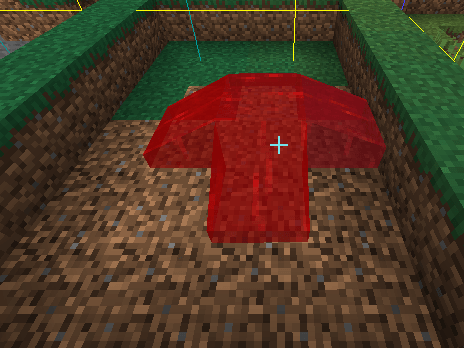
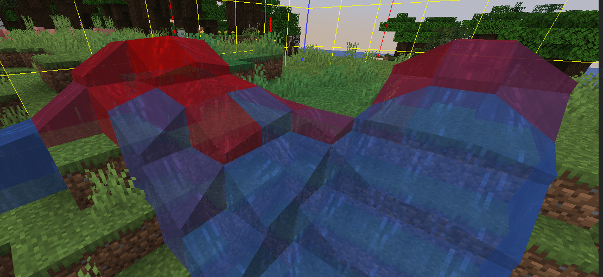
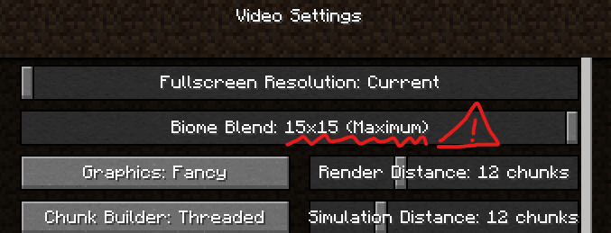
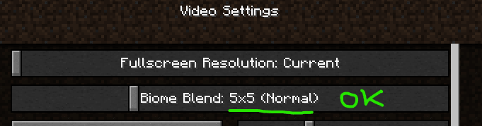

# 液体问题

这些都是我无法修复的 Minecraft 错误。这是游戏的工作方式。\
请不要报告这些问题。

## 液体不会像水一样流动！

这是为了避免延迟和故障而设计的。\
使用多个液体桶来创建更大的液体区域。

<figure><figcaption></figcaption></figure>

### 自定义液体颜色与水混合，或水的颜色与自定义液体混合

自定义液体有时不会完全染色，部分区域仍保留原版水的颜色。\
这是游戏工作方式的限制，我无法修复。

技术原因

Minecraft 将区块的生物群系存储在 int\[1024] 中。16x16x256=65536，远大于 1024。这意味着它以某种块状区域来存储（我自己也不确定这些区域的大小），因此遗憾的是，无法更改单个特定方块。颜色还会在生物群系之间渐变，因此更改小块区域总会显得奇怪，方块也无法呈现完整的颜色。

来源：[https://www.spigotmc.org/threads/how-to-create-custom-biomes.512105/page-2#post-4243330](https://www.spigotmc.org/threads/how-to-create-custom-biomes.512105/page-2#post-4243330)

### 完全看不到液体颜色，即使放到其他位置也一样

必须将生物群系过渡设为 `5x5` 或更低。

#### 错误设置

<figure><figcaption></figcaption></figure>

#### 正确设置

<figure><figcaption></figcaption></figure>
