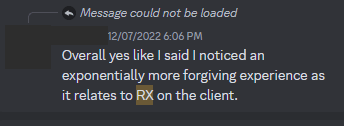
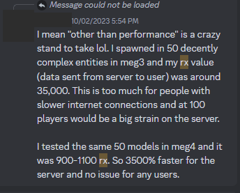
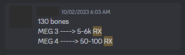

# ModelEngine 与 ItemsAdder

## 兼容性

[modelengine.md](../compatibility-with-other-plugins/compatible/modelengine.md)

## ItemsAdder 与 ModelEngine 的不同

如果发现此页的数据不正确，请联系我。我很愿意讨论并修正所报告的不一致之处。

### 免责声明

此页无意贬低 ModelEngine 的工作，也无意评判哪个插件更好。\
ModelEngine 让你能以合理的价格引入行为几乎与原版实体相同的自定义实体。\
以下只是我对 ModelEngine 的看法，可能还有一些功能被我遗漏了。\
因此，请审慎看待我的说法，也向其他人了解他们更喜欢哪个插件。

点击阅读 Ticxo 的旧版比较

Ticxo（ModelEngine 开发者）：

> 这绝不是为了证明哪个插件更好。ItemsAdder 的确是一款很有吸引力、功能丰富且价格非常合理的插件。以下均为我的观察，并不代表 ItemsAdder 的全貌。请审慎看待我的观察，并咨询其他人，看看哪个插件适合你！

<mark style="color:red;">⚠️</mark> Tocxo 的比较页面自 2022 年 11 月 26 日以来未再更新，可能无法反映插件的实际状况。

[点击此处](https://git.lumine.io/mythiccraft/modelengine/-/wikis/Comparison:-ItemsAdder)访问旧版差异页面。

***

| 功能 | ItemsAdder | ModelEngine v3 | ModelEngine v4 |
|:---------------------------------------------------------------|:---------------------------------------------------------------------------------------------------------------------------------------------------------------------------------------------------------------------------------------------------------------|:------------------------------------------------------------------------------------------------------------------------------------------------------------------------------------------------------------------------------------------------------------------------------------------------------------------------------------------------------------------------------------------------------------------------------|:-------------------------------------------------------------------|
| 动画之间的过渡 | ✅ | ✅ | ✅ |
| 异步 （不影响 TPS） | ✅ | ✅ | ✅ |
| Blockbench 插件 | ✅ | ✅ | ✅ |
| Citizens 集成 | ✅ | ✅ | ✅ |
| 社区制作的资源 | ~20 | ~200 | ? |
| 可配置的染色物品 | ❌ （默认使用 `POTION`，表情动作使用 `PLAYER_HEAD`） | ✅ （默认使用皮革马铠） （除头盔外的所有皮革盔甲、所有药水、药箭和已填写的地图） | 与 MEG v3 相同 |
| 价格 | €19.95 | v3: $18.99 （从 v3->v4 更新需要付费） | v4: $31.99 - 比 ItemsAdder 贵 52% - 比 MEG v3 贵 72% |
| 效果关键帧 （用于粒子和声音效果的关键帧） | ✅ | ✅* （[可编写脚本的关键帧](https://github.com/Ticxo/Model-Engine-Wiki/wiki/[Temporary-Wiki]-3.0-Features#scriptable-keyframes)） | 未知 |
| 手持物品显示 | ✅ | ✅ | ✅ |
| 头部位置 | 必须居中 | 可以在任意位置 | 与 MEG v3 相同 |
| 反向运动学 | ❌ | ✅* （仅分段式） | 与 MEG v3 相同 |
| 缩放关键帧 | ✅ | ❌ | ✅ |
| 模型伪装 | ✅ | ✅ | ✅ |
| 骨骼模型大小无限制 | ❌ | ❌ | ✅ |
| 玩家皮肤骨骼 | ✅* （仅限表情动作） | ❌ | ✅ |
| 展示实体支持 | ❌ | ❌ | ✅ |
| 模型导入 | 使用自定义 Blockbench 插件导入和导出 | 拖放 | 与 MEG v3 相同 |
| 实体旋转 （身体和头部骨骼的联动） | 与原版实体完全相同 | 玩家和实体风格+ [玩家] 头身夹角过大时，身体会旋转 [实体] 身体在一定延迟后旋转 模型朝向移动方向 可配置稳定角度、限制角度、旋转时长和延迟 非对称角度限制 | 与 MEG v3 相同 |
| 多个名称标签 | ❌ | ✅ | ✅ |
| 多个碰撞箱 | ❌ | ✅ | ✅ |
| MythicMobs 集成 | 6 种机制（1 种机制实现 6 项功能）： - 应用模型 - 播放和停止动画 - 覆盖默认动画 - 骑乘和离开模型 - 模型染色和附魔 - 显示和隐藏骨骼 [更多信息](../adding-content/entities/mythicmobs.md) | 30+ 种机制 - 应用和移除模型 - 播放和停止动画 - 覆盖默认动画 - 骑乘和离开模型 - 设置、显示和隐藏名称标签 - 模型染色和附魔 - 伪装玩家和取消伪装 - 合并、移除、显示和隐藏骨骼 - 切换骨骼父级 - 创建雕像 - 高级多碰撞箱配置 - 即时切换模型变体 - 10+ 种 VFX 相关机制 | 未知（需要核实） |
| 与实体模型无关的功能 | ✅（它是内容管理插件，支持添加的内容不止自定义实体） | ❌（仅允许向游戏添加自定义实体） | 与 MEG v3 相同 |
| 数据包数量 | 某些情况下使用较少的数据包，另一些情况下使用较多。 （参阅下方比较） | 与 ItemsAdder 相同 | 与 ItemsAdder 相同 |
| 程序化动画 （实时计算） | ❌ | ✅ | ✅ |
| 资源包生成 | ✅ | ✅ | ✅ |
| 多个资源包 | ✅* （[需要合并](../adding-content/merge-resourcepacks.md)） | ❌ | ❌ |
| 稳定性 | 实体系统于 2022 年 3 月发布 | 于 2020 年 6 月 13 日发布 | 于 2023 年 10 月 1 日发布 |
| VFX 模型 （用于投射物的轻量模型） | ❌ | ✅ | ✅ |

### 网络流量比较

这是两个插件的网络流量使用情况比较（**rx** 和 **traffic** 越低越好）。\
测试中使用了 25 个 `ninja_skeleton` 模型，可以在此下载：[ItemsAdder](https://www.spigotmc.org/resources/entity-ninja-skeleton-for-itemsadder.100468/)、[ModelEngine](https://mythiccraft.io/index.php?resources/modelengine-ninja-skeleton-model.214/)。

#### 无 AI（静止并播放待机动画）

| 插件 | 版本 | 模式 | Bundle | rx | 流量 | 视频 |
|:-------|:--------|:-------|:-------|:-----|:---------|:--------------------------------------|
| IA     | 3.6.2   | smooth | Y      | 5500 | 300KiB/s | [观看](https://youtu.be/lPHtIqBwx68) |
| IA     | 3.6.2   | smooth | N      | 6800 | 160KiB/s | [观看](https://youtu.be/-_GZ_SALruQ) |
| MEG    | R3.1.9  | A,A,C  | -      | 8200 | 200KiB/s | [观看](https://youtu.be/IuIxMatqSYo) |
| MEG    | R4.0.2  | -      | *Y*    | 8500 | 260KiB/s | [观看](https://youtu.be/r4fbzi_sQgc) |

| IA | MEG | rx 差异（a->b） | 流量差异（a->b） |
|:----------------|:----------|:--------------------------------------------------|:--------------------------------------------------|
| IA 3.6.2 bundle | MEG 3.1.9 | <mark style="background-color:green;">-49%</mark> | <mark style="background-color:red;">+33%</mark>   |
| IA 3.6.2        | MEG 3.1.9 | <mark style="background-color:green;">-20%</mark> | <mark style="background-color:green;">-25%</mark> |
| IA 3.6.2 bundle | MEG 4.0.2 | <mark style="background-color:green;">-54%</mark> | <mark style="background-color:red;">+13%</mark>   |
| IA 3.6.2        | MEG 4.0.2 | <mark style="background-color:green;">-25%</mark> | <mark style="background-color:green;">-62%</mark> |
| MEG 4.0.2       | MEG 3.1.9 | <mark style="background-color:red;">+3%</mark>    | <mark style="background-color:red;">+23%</mark>   |

#### 有 AI（四处游走）

| 插件 | 版本 | 模式 | Bundle | rx | 流量 | 视频 |
|:-------|:--------|:-------|:-------|:-----|:---------|:--------------------------------------|
| IA     | 3.6.2   | smooth | Y      | 7700 | 450KiB/s | [观看](https://youtu.be/Jow0Vhs2BSQ) |
| IA     | 3.6.2   | smooth | N      | 13k  | 350KiB/s | [观看](https://youtu.be/NiJRDJcVLTg) |
| MEG    | R3.1.9  | A,A,C  | N      | 10k  | 270KiB/s | [观看](https://youtu.be/1S5TXngOr0U) |
| MEG    | R4.0.2  | -      | *Y*    | 9000 | 280KiB/s | [观看](https://youtu.be/yz1ZuTvFBEg) |

| IA | MEG | rx 差异（a->b） | 流量差异（a->b） |
|:----------------|:----------|:--------------------------------------------------|:------------------------------------------------|
| IA 3.6.2 bundle | MEG 3.1.9 | <mark style="background-color:green;">-23%</mark> | <mark style="background-color:red;">+66%</mark> |
| IA 3.6.2        | MEG 3.1.9 | <mark style="background-color:red;">+30%</mark>   | <mark style="background-color:red;">+29%</mark> |
| IA 3.6.2 bundle | MEG 4.0.2 | <mark style="background-color:green;">-14%</mark> | <mark style="background-color:red;">+60%</mark> |
| IA 3.6.2        | MEG 4.0.2 | <mark style="background-color:red;">+44%</mark>   | <mark style="background-color:red;">+25%</mark> |
| MEG 4.0.2       | MEG 3.1.9 | <mark style="background-color:green;">-11%</mark> | <mark style="background-color:red;">+3%</mark>  |

### 动画质量比较

### ModelEngine v4“整体网络负载降低”的争议

MythicCraft 的[公告](https://web.archive.org/web/20231020161618/https://mythiccraft.io/index.php?threads/modelengine-4-is-out-now.23407/)宣传新版 ModelEngine v4“整体网络负载降低”。

MythicCraft Discord 服务器中有人讨论，称其 rx（发送到客户端的数据包）比 MEG 3 低得多。也有一些用户就此联系我，引起了我的好奇。\
不过，这些用户的说法具有误导性。

<figure><figcaption></figcaption></figure> <figure><figcaption></figcaption></figure> <figure><figcaption></figcaption></figure>

我决定使用客户端 F3 屏幕的数据进行分析，并为此制作了一个自定义 Spigot [插件](https://github.com/LoneDev6/IAMEGBenchmark)。\
这些用户展示的 rx 数值并不正确，原因在于客户端计算此数值的方式。\
MEG v4 使用捆绑数据包，允许客户端先等待，再处理某一间隔内接收到的一组数据包。

捆绑数据包的工作方式如下：

1. 服务器发送 `bundle start` 数据包
2. 服务器发送数据包（本例中，MEG 发送展示实体的传送数据，以及展示实体的大小 + 旋转数据
3. 服务器发送 `bundle end` 数据包

这意味着服务器总共发送 4 个数据包，但客户端显示的 rx 数值却是 1。\
这是因为游戏将捆绑的数据包视为单个数据包，因此若要比较 v3 与 v4，或 ModelEngine 与 ItemsAdder，F3 屏幕显示的数值并不可靠。

我使用 [EliteCreatures](https://a.devs.beer/elitecreatures-meg-comparison) 团队借给我的一个模型进行了测试：一个包含 35 根骨骼的船模型。

### 结论

✅ 实体静止、不四处走动时，IA 发送的数据包更少（当然，仍在播放当前动画）。\
❌ 对于在世界中四处走动的实体，IA（目前）比 MEG v3 发送[更多数据包](#user-content-fn-1)<a href="#user-content-fn-1">1</a>。\
❌ 与 MEG v3 相比，IA 缺少一些功能，但这不会给创建逼真的自定义实体带来困难。请参阅前面的比较表。

✅ 对于移动中的实体，MEG v3 比 IA 使用的数据包更少（-30%）。\
❌ 对于静止的实体，MEG v3 比 IA 使用的数据包更多（+20%）。\
❌ MEG v3 的实体行走/旋转看起来不够流畅，如**前面的视频**所示。

ModelEngine v3 与 ItemsAdder 的数据包数量差异对两者而言都可以忽略不计。

ModelEngine v4 引入了展示实体；得益于这类实体的工作方式，数据包使用量有所降低。

未来，ItemsAdder 可能会改用展示实体。

总之，你需要决定哪个最适合自己的服务器项目。

1 原因尚不十分明确，可能与 ItemsAdder 处理自定义实体头部/身体朝向的逻辑有关，其逻辑接近原版 Minecraft。

