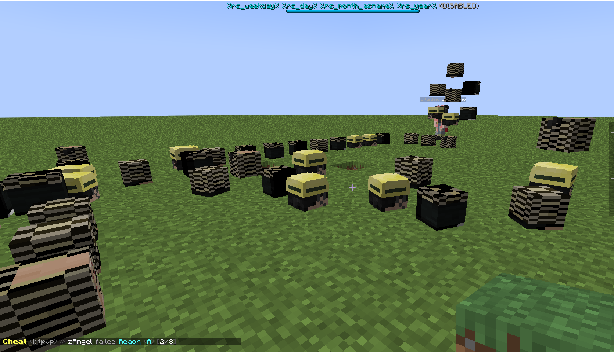

# 放置的头颅纹理出现故障

此漏洞在 ItemsAdder 4.0.10 及更高版本中较少出现，建议更新！

此问题由 ItemsAdder 的表情动作功能引起，目前除了禁用表情动作外没有其他修复办法。

当你面前有超过 1 个属于同一玩家的头颅时，就会出现此漏洞。\
如果面前的头颅属于不同玩家，或面前只有 1 个头颅，则不会发生此问题。

## 如何修复

唯一的修复办法是在 **ItemsAdder** 的 `config.yml` 中禁用表情动作系统。\
别忘了使用 `/iazip` 重新生成资源包。

