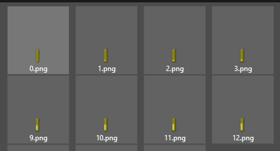
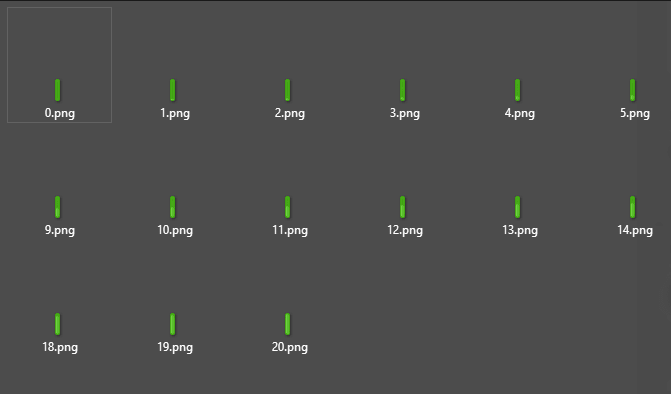

# 批量着色图片

## 一键更改多个PNG文件的颜色

使用这个非常好的工具。\
它允许您在不手动编辑每个文件的情况下为多个PNG图像着色。

## 示例

使用这个工具，我成功地自动为我的自定义HUD着色，而无需手动打开每个文件进行编辑。

<figure><figcaption></figcaption></figure>

<figure><figcaption></figcaption></figure>
