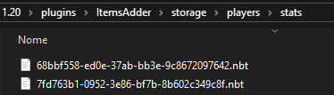
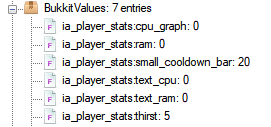

# 自定义玩家属性

## 什么是玩家属性？

它们是 ItemsAdder 添加的自定义属性，可通过特殊命令添加和读取：`/iaplayerstat`

之后可用 **PlaceholderAPI** 在各处显示，或将其绑定到 HUD。\
口渴和魔力就是这样实现的。示例见[默认配置](https://github.com/search?q=repo%3AItemsAdder%2FDefaultPack+player_stat_name\&type=code)。

### 例如：

`/iaplayerstat write LoneDev thirst 6`\
`/iaplayerstat read LoneDev thirst float`

## 保存玩家属性

### 自定义 NBT 文件

保存在由 ItemsAdder 管理的自定义 NBT 文件中，之后可以方便地删除。\
此文件保存在 `plugins\ItemsAdder\storage\players\stats\` 文件夹中。

```yaml
player_stats:
  save_type: CUSTOM_NBT
```

<figure><figcaption></figcaption></figure>

### player.dat 文件

保存在原版 `player.dat` 文件中。\
如果需要跨服务器同步，且已同步玩家 dat 文件，此方法会比较方便。

```yaml
player_stats:
  save_type: PLAYER_DAT
```

<figure><figcaption></figcaption></figure>
