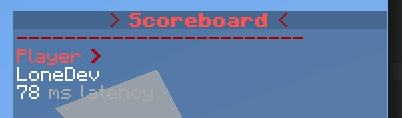
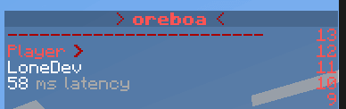

# 隐藏记分板背景和数字

## 隐藏记分板数字





### 1.20.3 及更高版本客户端

* 仅适用于 **Minecraft 1.20.3+** 客户端
* **仅适用于 Minecraft 1.20.3+ 服务器！**
* 不会编辑 `rendertype_text` 着色器文件，不涉及任何着色器

```yaml
effects:
  hide-scoreboard-numbers: true
```

切换此选项的开关状态时，无需运行 `/iazip`。\
您可以更改此值并简单地运行 `/iareload` 以应用更改。

### 任何客户端版本

* 此功能仅适用于 **Minecraft 1.17+** 客户端
* **服务器版本无关紧要**
* 编辑 `rendertype_text` 着色器文件

```yaml
effects:
  hide-scoreboard-numbers-old-clients: true
```

### 警告

此选项是持续性选项，无法在游戏中开启/关闭。\
您必须在 `config.yml` 中禁用它并重新生成包以启用/禁用它（使用 `/iazip`）。

## 隐藏背景

* **适用于所有 Minecraft 版本**
* **不编辑** `rendertype_text` **着色器即可工作。**

### 插件: AnimatedScoreboard

[animatedscoreboard.md](../compatibility-with-other-plugins/compatible/animatedscoreboard.md)

### 插件: Scoreboard-revision <mark style="color:orange;">(已过时)</mark>

[scoreboard.md](../compatibility-with-other-plugins/compatible/scoreboard.md)
