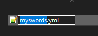

# 内容文件夹

## `contents` 文件夹

这是一个主文件夹，内部包含子文件夹。

每个子文件夹都包含一组文件，例如设置、模型、纹理或声音。子文件夹的名称表明这些文件属于哪个**命名空间**（类别或组）。

**重要**

记得始终让 **contents** 子文件夹保持有序！\
不要随意粘贴内容，不要创建过多子文件夹，也不要留下未使用的纹理/模型，否则会难以查找错误和疏漏。

### 配置

为了创建自定义物品、配方等，ItemsAdder 使用 `.yml` 文件。你可以使用多个配置文件来管理你的工作。

## 什么是 `namespace`？ <a id="what-is-a-namespace"></a>

ItemsAdder 使用 **`namespaces`** 识别它管理的大部分内容。\
**`namespace`** 是一**组**元素，这里指一组**物品、方块、生物等**。\
使用命名空间，你可以轻松了解特定 **物品**、**声音**、**方块** 等来自哪里。

不要创建过多命名空间。通常，一个服务器项目只需要 1-2 个命名空间。

另一方面，如果你是内容创作者，并计划分享作品，就会需要更多命名空间。

### 示例

所有 **realcraft** 物品都属于 `realcraft` 命名空间，因此使用 `/iaget` 命令时，可以看到所有物品 ID 都以 `realcraft:` 开头


## 如何定义自己的命名空间？

在以下位置创建子文件夹：`plugins/ItemsAdder/contents/`

本例中，我将创建一个**命名空间**，并将其命名为 `myitems`。

打开 `myitems` 文件夹并创建新文件，可以自行命名。\
例如: `contents/myitems/myswords.yml`



文件中也必须指定**命名空间**，因此打开新的 `myswords.yml` 文件，并粘贴以下内容：

```yaml
info:
  namespace: myitems
```

记住根据你的 **namespace** 进行更改。

你可以创建任意多的**命名空间**！这允许你轻松地管理你的物品包。

你也可以在相同的命名空间中创建任意多的 `.yml` 文件！这能够帮你更容易来管理内容。\
例如，我将剑、方块、食物和饮品分放在不同的 `.yml` 文件中。

**这些"嵌套"可能很无聊**，但可以降低错误，并更容易寻找内容。

## 为什么选择不同的文件夹结构？

**ItemsAdder** 允许你决定使用哪种文件夹结构来组织你的各种包。

这对管理员很有用，因为他们可以自由管理物品包，而不用担心过多嵌套。\
最容易使用的结构是 **结构 1**.

每个**命名空间**一次只能使用一种结构。\
**不要在同一个子包中混合使用它们！**

### 文件夹结构方法 1 - 最佳和最简单的方法

这是创建包含一些物品的简单内容包的较容易方法，无需创建过多子文件夹。

此结构会自动检测当前命名空间，本例中为 `myitems`。\
它免去了创建 `resourcepack`、`assets`、`<namespace>` 文件夹的步骤，让结构更简洁。

```bash
plugins
└── ItemsAdder
    └── contents
        └── myitems
            ├── configs
            │   ├── example.yml
            │   └── example_1.yml
            ├── models
            │   └── item
            │       └── example_item.json
            └── textures
                └── item
                    └── example_texture.png
```

**高级用户**

如果计划在内容文件夹中使用多个命名空间，例如 `minecraft` 和 `myitems`，请勿使用此结构，因为你将无法指定其他命名空间。请使用其他结构，它们不会自动检测纹理/模型文件夹的命名空间。

### 文件夹结构方法 2

此结构是默认的和最完整的。

```bash
plugins
└── ItemsAdder
    └── contents
        └── myitems
            ├── configs
            │   ├── example.yml
            │   └── example_1.yml
            └── resourcepack
                └── assets
                    └── myitems
                        ├── models
                        │   └── item
                        │       └── example_item.json
                        └── textures
                            └── item
                                └── example_texture.png
```

### 文件夹结构方法 3

此结构避免了你创建 `assets` 文件夹，该文件夹是隐含的，只会增加不必要的复杂性。

```bash
plugins
└── ItemsAdder
    └── contents
        └── myitems
            ├── configs
            │   ├── example.yml
            │   └── example_1.yml
            └── resourcepack
                └── myitems
                    ├── models
                    │   └── item
                    │       └── example_item.json
                    └── textures
                        └── item
                            └── example_texture.png
```

### 文件夹结构方法 4

此结构避免了你创建 `resourcepack` 文件夹，该文件夹是隐含的，只会增加不必要的复杂性。

```bash
plugins
└── ItemsAdder
    └── contents
        └── myitems
            ├── configs
            │   ├── example.yml
            │   └── example_1.yml
            └── assets
                └── myitems
                    ├── models
                    │   └── item
                    │       └── example_item.json
                    └── textures
                        └── item
                            └── example_texture.png
```

### 文件夹结构方法 5

此结构避免了你创建 `assets` 文件夹，该文件夹是隐含的，只会增加不必要的复杂性。

```bash
plugins
└── ItemsAdder
    └── contents
        └── myitems
            ├── configs
            │   ├── example.yml
            │   └── example_1.yml
            └── myitems
                ├── models
                │   └── item
                │       └── example_item.json
                └── textures
                    └── item
                        └── example_texture.png
```
