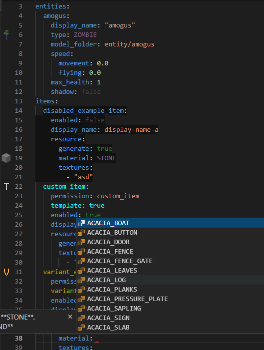
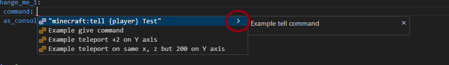
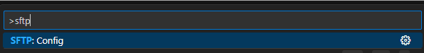
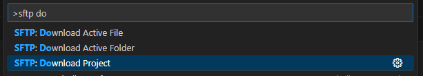

# 文件编辑器

## 如何安装

* [下载 Visual Studio Code (vs-code)](https://code.visualstudio.com/download)
* [下载扩展](https://marketplace.visualstudio.com/items?itemName=LoneDev.ia-vscode)

### 预览

<div align="left"><figure><figcaption></figcaption></figure></div>

### 启用字段和补全提示的说明

<figure><figcaption></figcaption></figure>

## FTP

[从此处](https://marketplace.visualstudio.com/items?itemName=Natizyskunk.sftp)下载 VSCode 的 FTP 扩展。

在电脑的任意位置创建空文件夹，例如 `Downloads` 文件夹中。\
此文件夹将存放服务器文件的副本，每次保存时都会同步。\
例如 `remote_itemsadder_contents`。

按 `CTRL+SHIFT+P` 并运行 **Config**。

<figure><figcaption></figcaption></figure>

更改 `host`、`port`、`username` 和 `password`（如有需要，还要更改 `protocol`）。\
`uploadOnSave` 允许保存时自动上传文件。

```json
{
    "name": "My Server",
    "host": "eux1.humbleservers.com",
    "protocol": "sftp",
    "port": 2022,
    "username": "username",
    "password": "password",
    "remotePath": "/plugins/ItemsAdder/",
    "uploadOnSave": true,
    "useTempFile": false,
    "openSsh": false
}
```

按 `CTRL+SHIFT+P` 并运行 **Download Project**。

<figure><figcaption></figcaption></figure>
