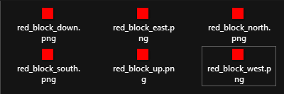
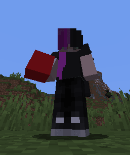
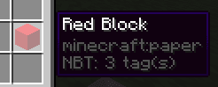
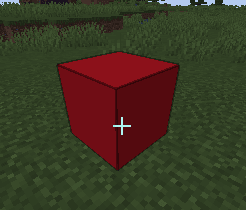

# 我的第一个方块

主教程使用面向 Minecraft 1.21.4+ 客户端的现代 `graphics` 配置。下方的可展开部分保留了适用于 ItemsAdder 4.0.17 及更旧版本的旧方法。

<details>

<summary>适用于 ItemsAdder 4.0.17 及更旧版本的教程</summary>

**资源包托管**

记得在**开始前选定**一种[**资源包托管**](../plugin-configuration/resourcepack-hosting.md)方法。\
我**建议**使用 **self-host**，它**更简单**且**更快**，不过也可以使用 **Dropbox** 等服务。

### 配置文件

这是一个示例方块（记得将 `myitems` 命名空间更改为你想使用的名称）。

例如，我创建了一个**文件**，用于存放所有**自定义方块**。\
我将其创建在以下文件夹：`contents/myitems/configs/`

我先在 `blocks.yml` 文件中创建一个名为 `red_block` 的简单方块**。**

```yaml
info:
  namespace: myitems
items:
  red_block:
    display_name: Red Block
    permission: red_block
    resource:
      material: PAPER
```

务必使用**无法放置**的原版**材质**，例如 **`PAPER`**。\
如果使用方块（例如 `STONE` 或 `DIRT`），放置时会有一些异常。

### 创建纹理文件

为此，你必须将 `.png` 纹理文件放到正确的文件夹中。

本例中，**命名空间**是 `myitems`，因此需要将它们放在此文件夹中：\
`contents/myitems/textures/block/`

<figure><figcaption>方块的每个面对应一个纹理文件。</figcaption></figure>

### 将纹理文件应用于物品

现在重新打开 `blocks.yml` 文件，像我一样添加 `resource` 部分。\
如你所见，我设置了 `generate: true`，并为物品指定了纹理。\
这会告诉插件使用你的纹理自动生成 3D 模型。

```yaml
info:
  namespace: myitems
items:
  red_block:
    display_name: Red Block
    permission: red_block
    resource:
      generate: true
      material: PAPER
```

### 每个面使用不同的纹理

**重要**：按照示例所示，保持方位顺序正确。

```yaml
info:
  namespace: myitems
items:
  red_block:
    display_name: Red Block
    permission: red_block
    resource:
      generate: true
      material: PAPER
      textures:
        - block/red_block_down.png
        - block/red_block_east.png
        - block/red_block_north.png
        - block/red_block_south.png
        - block/red_block_up.png
        - block/red_block_west.png
```

### 每个面使用相同的纹理

```yaml
info:
  namespace: myitems
items:
  red_block:
    display_name: Red Block
    permission: red_block
    resource:
      generate: true
      material: PAPER
      texture: block/red_block.png
```

### 添加方块放置功能

必须添加 `behaviours` 属性。

```yaml
info:
  namespace: myitems
items:
  red_block:
    display_name: Red Block
    permission: red_block
    resource:
      generate: true
      material: PAPER
      texture: block/red_block.png
    behaviours:
      block:
        placed_model:
          type: REAL_NOTE
          break_particles: ITEM
```

## 在游戏中获取方块

运行 `/iaget myitems:red_block` 获取物品。







## 方块战利品

```yaml
info:
  namespace: myitems
items:
  red_block:
    display_name: Red Block
    permission: red_block
    resource:
      generate: true
      material: PAPER
      texture: block/red_block.png
    behaviours:
      block:
        drop_when_mined: false # IMPORTANT! To avoid duplication
        placed_model:
          type: REAL_NOTE
          break_particles: ITEM
          

loots: # Here the custom loots list
  blocks:
    ruby_ore: # Here your custom block loot
      type: myitems:red_block
      biomes:
        - PLAINS
        - SUNFLOWER_PLAINS
        - MOUNTAINS
      items:
        drop1: # Here the dropped item
          item: DIAMOND
          min_amount: 1
          max_amount: 2
          chance: 100 # Percentage
```

</details>

### 配置文件

这是一个示例方块（记得将 `myitems` 命名空间更改为你想使用的名称）。

例如，我创建了一个**文件**，用于存放所有**自定义方块**。\
我将其创建在以下文件夹：`contents/myitems/configs/`

我先在 `blocks.yml` 文件中创建一个名为 `red_block` 的简单方块**。**

```yaml
info:
  namespace: myitems
items:
  red_block:
    name: Red Block
    permission_suffix: red_block
    graphics:
      texture: block/red_block.png
```

方块无需指定 `material`，插件会根据方块类型（稍后设置）自动处理。

### 创建纹理文件

为此，你必须将 `.png` 纹理文件放到正确的文件夹中。

本例中，**命名空间**是 `myitems`，因此需要将它们放在此文件夹中：\
`contents/myitems/textures/block/`

<figure><figcaption>方块的每个面对应一个纹理文件。</figcaption></figure>

### 每个面使用不同的纹理

**重要**：按照示例所示，保持方位顺序正确。

```yaml
info:
  namespace: myitems
items:
  red_block:
    name: Red Block
    permission_suffix: red_block
    graphics:
      textures:
        down: block/red_block_down.png
        east: block/red_block_east.png
        north: block/red_block_north.png
        south: block/red_block_south.png
        up: block/red_block_up.png
        west: block/red_block_west.png
```

### 每个面使用相同的纹理

```yaml
info:
  namespace: myitems
items:
  red_block:
    name: Red Block
    permission_suffix: red_block
    graphics:
      texture: block/red_block.png
```

### 添加方块放置功能

必须添加 `behaviours` 属性。

```yaml
info:
  namespace: myitems
items:
  red_block:
    name: Red Block
    permission_suffix: red_block
    graphics:
      texture: block/red_block.png
    behaviours:
      block:
        placed_model:
          type: REAL_NOTE
```

## 在游戏中获取方块

运行 `/iaget myitems:red_block` 获取物品。


## 下载完整示例


## 方块战利品

```yaml
info:
  namespace: myitems
items:
  red_block:
    name: Red Block
    permission_suffix: red_block
    graphics:
      texture: block/red_block.png
    behaviours:
      block:
        drop_when_mined: false # IMPORTANT! To avoid duplication
        placed_model:
          type: REAL_NOTE

loots: # Here the custom loots list
  blocks:
    ruby_ore: # Here your custom block loot
      type: myitems:red_block
      biomes:
        - PLAINS
        - SUNFLOWER_PLAINS
        - MOUNTAINS
      items:
        drop1: # Here the dropped item
          item: DIAMOND
          min_amount: 1
          max_amount: 2
          chance: 100 # Percentage
```
