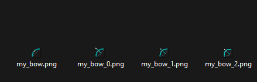
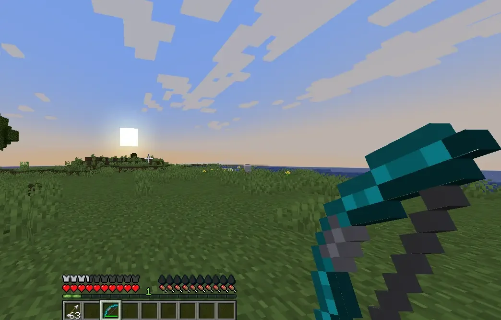
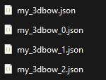
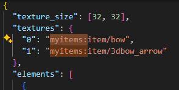
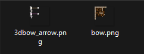
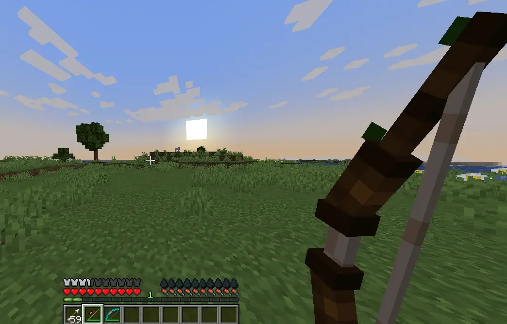

# 我的第一把弓

**资源包托管**

记得在**开始前选定**一种[**资源包托管**](../plugin-configuration/resourcepack-hosting.md)方法。\
对于 ItemsAdder 4.0.17+，`simple_self_host` 通常是最简单的选项。链接中的托管指南介绍了其他托管服务。

务必正确设置弓物品的纹理/模型，否则会出现纹理缺失。


## 面向 Minecraft 1.21.4+ 的现代配置

ItemsAdder 4.0.13+ 可以明确指定弓的每一种状态。这样无需依赖文件名后缀检测，普通模型和拉弓模型也能在配置中清楚呈现。

### 使用纹理制作的弓

```yaml
info:
  namespace: myitems
items:
  my_bow:
    enabled: true
    name: My Bow
    material: BOW
    graphics:
      textures:
        normal: item/my_bow
        pulling_0: item/my_bow_0
        pulling_1: item/my_bow_1
        pulling_2: item/my_bow_2
```

将 `my_bow.png`、`my_bow_0.png`、`my_bow_1.png` 和 `my_bow_2.png` 放入 `contents/myitems/textures/item/`。

### 使用 3D 模型制作的弓

```yaml
info:
  namespace: myitems
items:
  my_3dbow:
    enabled: true
    name: My 3D Bow
    material: BOW
    graphics:
      models:
        normal: item/my_3dbow
        pulling_0: item/my_3dbow_0
        pulling_1: item/my_3dbow_1
        pulling_2: item/my_3dbow_2
```

将四个模型文件放入 `contents/myitems/models/item/`。它们的纹理引用仍必须包含正确的命名空间，具体见下方旧版模型示例。

## 使用 `.png` 图片的旧版弓

### 配置文件

```yaml
info:
  namespace: myitems
items:
  my_bow:
    enabled: true
    name: My Bow
    resource:
      material: BOW
      generate: true
      texture: item/my_bow.png
```

### 纹理文件

拉弓时会播放动画，你可以为每种状态分别设置一张纹理。

`contents/myitems/textures/item/`

<div align="left"><figure><figcaption>普通纹理和三种拉弓状态的纹理。</figcaption></figure></div>

* `_0` - 第一种拉弓状态
* `_1` - 第二种拉弓状态
* `_2` - 第三种拉弓状态

<figure><figcaption>使用纹理制作的弓处于拉弓状态。</figcaption></figure>

## 使用 3D `.json` 模型的旧版弓

### 配置文件

```yaml
info:
  namespace: myitems
items:
  my_3dbow:
    enabled: true
    name: My 3D Bow
    resource:
      material: BOW
      generate: false
      model_path: item/my_3dbow
```

### 模型文件

`contents/myitems/models/item/`

<div align="left"><figure><figcaption>普通模型及三种拉弓状态的变体。</figcaption></figure></div>

* `_0` - 第一种拉弓状态
* `_1` - 第二种拉弓状态
* `_2` - 第三种拉弓状态

打开模型文件并更新纹理路径。如你所见，我更新了命名空间。

<figure><figcaption>弓模型文件中的纹理引用。</figcaption></figure>

将纹理移到正确的命名空间中，本例为 `myitems`。

`contents/myitems/textures/item/`

<figure><figcaption>自定义 3D 弓模型使用的纹理。</figcaption></figure>

<div><figure><figcaption>3D 弓处于拉弓状态。</figcaption></figure></div>
