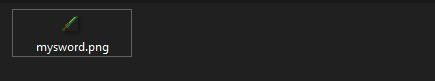
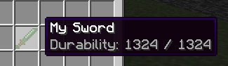
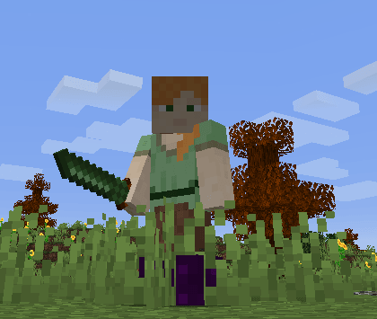

# 我的第一把剑

**资源包托管**

记得在**开始前选定**一种[**资源包托管**](../plugin-configuration/resourcepack-hosting.md)方法。\
对于 ItemsAdder 4.0.17+，`simple_self_host` 通常是最简单的选项。链接中的托管指南介绍了其他托管服务。

本教程使用现代 `graphics` 配置，ItemsAdder 4.0.13+ 为 Minecraft 1.21.4+ 客户端提供此配置。如果玩家使用更旧的客户端，请保留下方所示的旧版 `resource` 配置。

## 创建剑的配置文件

这是一把示例剑（记得将 `my_items` 命名空间改为你想使用的名称）。

例如，我创建了一个**文件**，用于存放所有**自定义剑**：\
`contents/my_items/configs/myswords.yml`

我在此文件（`myswords.yml`）中开始创建一把名为 `mysword` 的简单剑

```yaml
info:
  namespace: my_items
items:
  mysword:
    name: My Sword
    material: DIAMOND_SWORD
    permission_suffix: my_items.mysword
    graphics:
      texture: item/mysword
    durability:
      max_durability: 1324
```

## 物品纹理

### 创建纹理文件

现在开始有趣的部分，设置剑的纹理。\
为此，必须将剑的 `.png` 纹理文件放入正确的文件夹。

本例中，**命名空间**是 `my_items`，因此必须放在此处：

`contents/my_items/textures/item/mysword.png`



### 将纹理文件应用于物品

现在重新打开 `myswords.yml`，添加 `graphics` 部分。纹理路径相对于 `contents/my_items/textures/`，且无需填写 `.png` 扩展名。

```yaml
info:
  namespace: my_items
items:
  mysword:
    name: My Sword
    material: DIAMOND_SWORD
    permission_suffix: my_items.mysword
    graphics:
      texture: item/mysword
    durability:
      max_durability: 1324
```

<details>

<summary>适用于 Minecraft 1.21.3 及更旧客户端的旧版资源配置</summary>

旧方法使用 `resource`，设置 `generate: true`，并包含 `.png` 纹理路径。随后，ItemsAdder 会根据该纹理生成物品模型。

```yaml
info:
  namespace: my_items
items:
  mysword:
    name: My Sword
    permission_suffix: my_items.mysword
    resource:
      material: DIAMOND_SWORD
      generate: true
      texture: item/mysword.png
    durability:
      max_durability: 1324
```

所有旧版 `resource` 选项见[资源属性参考](../../adding-content/items/item-properties/resource.md)。

</details>

## 最后一步

现在，只需让插件加载刚刚添加的物品。\
为此，你需要：

* 加入服务器
* 确保接受了资源包
* 使用命令 `/iazip`
* （如果使用 **external-host**（**DropBox**），向下滚动并按照说明操作）
* 使用 `/iaget my_items:mysword` 获取物品





## 资源包托管教程

[资源包托管](../plugin-configuration/resourcepack-hosting.md)
