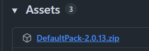
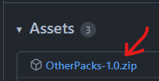

# 首次安装

**确保**所有插件和服务器软件都是最新的！\
**始终检查**你下载的ItemsAdder版本！

* <mark style="color:red;">**v3仅适用于1.20.4及以下版本**</mark>
* <mark style="color:red;">**v4仅适用于1.20.6及以上版本**</mark>

**安装插件和库**

点击此处阅读 v3 安装说明

* 停止服务器。
* 将 **ProtocolLib** JAR 放入 `plugins` 文件夹
  * 1.21.4 及更旧版本请[在此下载](https://github.com/dmulloy2/ProtocolLib/releases/)
* 将 [**LoneLibs**](https://www.spigotmc.org/resources/lonelibs.75974/) JAR 放入 `plugins` 文件夹（4.0.9 及更高版本不需要）
* 将 **ItemsAdder** JAR 文件放入 plugins 文件夹
* 启动服务器
* 等待 **ItemsAdder** 完成**全部内容**的加载

* 将 `ProtocolLib.jar` 放入 `plugins` 文件夹（[在此](https://github.com/dmulloy2/ProtocolLib/releases/download/dev-build/ProtocolLib.jar)下载）
* 将 `ItemsAdder.jar` 文件放入 `plugins` 文件夹
* 启动服务器
* 等待 **ItemsAdder** 完成**全部内容**的加载

**首次安装资源包**

**重要步骤**

如果未完成此步骤，内容将<mark style="color:red;">**无法正确显示**</mark>！

使用插件前，必须选定资源包托管方法。\
阅读[本教程](plugin-configuration/resourcepack-hosting.md)，选定资源包的托管方法。\
最佳方法是 `simple_self_host`。

**（推荐）安装 ItemsAdderAdditions**

**ItemsAdderAdditions** 插件会添加新的功能、动作和行为。你可以从 [Modrinth](https://modrinth.com/plugin/itemsadderadditions) 或 [SpigotMC](https://www.spigotmc.org/resources/itemsadderadditions.133918/) 下载

**（可选）添加 ItemsAdder 官方自定义内容**

**ItemsAdder**自带大量已创建的自定义内容。\
这些内容不会自动包含在下载的插件中，因为有些人可能不希望每个物品/功能自动添加到他们的服务器中。

<figure><figcaption></figcaption></figure>

* 将内容解压到 `ItemsAdder` 文件夹，如提示覆盖文件，请选择覆盖。
* 运行 `/iazip` 命令。
* 如果未使用 **self-host**，请按照你的[托管方法](plugin-configuration/resourcepack-hosting.md)操作。

**（可选）添加其他 ItemsAdder 自定义内容**

**在此下载其他内容包：**

