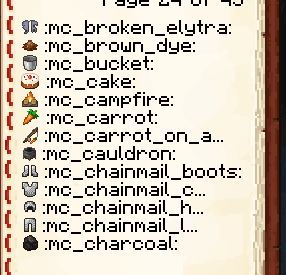
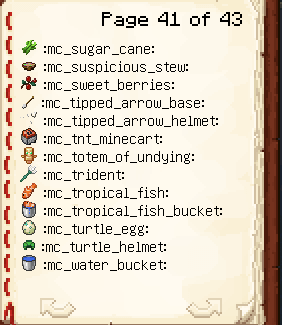

# iaimage

此命令会列出所有可用于聊天/命令/告示牌/书籍的字体图片（例如表情符号）。

## 书籍自定义

您可以自定义该命令显示的书籍的某些部分。

### 将书籍字体改为 Minecraft 默认字体（插件默认选项）

```yaml
  iaimage-book:
    max-line-length: 18
    placeholder-font: "minecraft:default"
```

建议设置 `max-line-length: 18`，这允许长文本使用整个可用的行空间。

<figure><figcaption></figcaption></figure>

### 将书籍字体更改为 Minecraft 细字体

```yaml
  iaimage-book:
    max-line-length: 22
    placeholder-font: "uniform"
```

建议设置 `max-line-length: 22`，这允许长文本使用整个可用的行空间。\
插件应避免过长的文本溢出并转到下一行，但如果发生这种情况，您必须将长度值减少到 `20` 或更低。

<figure><figcaption></figcaption></figure>

