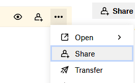
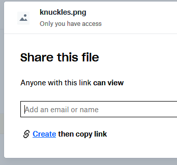

# DropBox

**不推荐。**

## 文字教程

* 打开 [DropBox](https://dropbox.com/)，注册/登录。
* 使用命令 `/iazip`（**这很重要**，因为 `/iazip` 会重载配置并更新 **generated.zip** 文件）
* 打开文件夹：`plugins/ItemsAdder/output/`。
* 将 **generated.zip 拖放**到 **DropBox** 上，或从服务器主机将该文件复制粘贴到其中。
* 点击 **Share**。



* 点击 **Create**。



* 点击 **Copy link**（例如会得到 `https://www.dropbox.com/blablabla?dl=1`）
* 打开 **ItemsAdder** 的 `config.yml`。

```yaml
resource-pack:
  apply-on-join: true
  kick-player-on-decline: false
  delay-ticks: 1
  self-host:
    enabled: false
  external-host:
    enabled: true
    url: 'https://www.dropbox.com/blablabla?dl=1'
```

* **这非常重要**：**更改** `config.yml` 中的内容后，**使用命令** `/iareload` **重载插件**（本例中用于重载资源包下载链接）
* 在游戏中**使用命令** `/iatexture`，刷新当前游戏纹理；或使用 `/iatexture all` 为所有玩家刷新

**每次**编辑**纹理**、3D **模型**、**声音**等内容后，都请使用 `/iazip`，然后将资源包**重新上传**到 **Dropbox**，再使用 **/iareload**，否则将看不到所做的更改。

**每次上传新版资源包**时，都要**更改文件名**，以**强制**游戏**重新下载新版**。\
如果**重新上传 zip** 文件时保持相同名称和**相同 URL**，则**不会**为每位玩家更新。

## 但这样太慢了！需要反复上传到 DropBox！

是的，所以应改用自托管功能，而非 **DropBox**。不过，有些廉价托管方案不支持开放端口，此时就必须使用 **DropBox**。

[self-hosting.md](self-hosting.md)

## 如有需要，继续安装

[first-install.md](../../first-install.md)
