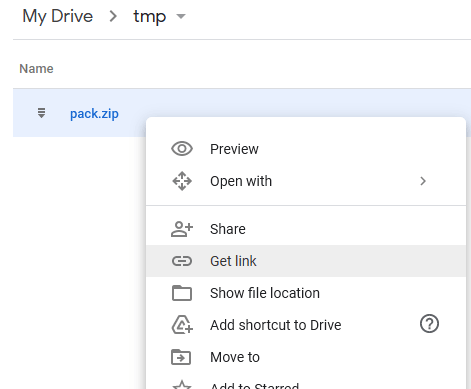
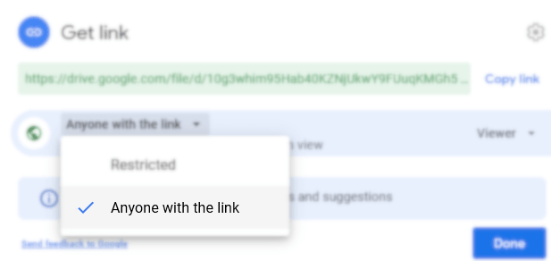
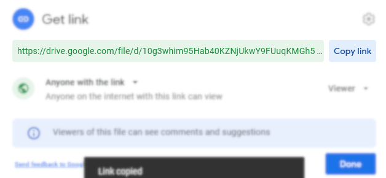
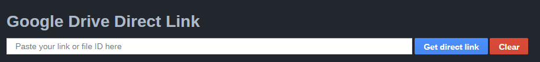
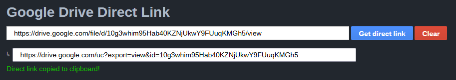
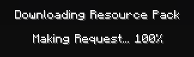

# Google Drive

**不推荐。**

由于 Minecraft 的漏洞，此方法在某些电脑上的 1.17 之前版本中存在问题。更多信息见：[https://bugs.mojang.com/browse/MC-143768](https://bugs.mojang.com/browse/MC-143768)

Mojang 已修复此问题，因此此方法在 Minecraft 1.17.1 及较新的版本中应该可以正常使用。

### 步骤 1

右键点击资源包 zip 文件，选择“Get link”（获取链接）。



### 步骤 2

重要：将权限设为“Anyone with the link”（知道链接的任何人）。



点击“复制链接”



### 步骤 3

访问这个网站：[http://a.devs.beer/gdrive-direct](http://a.devs.beer/gdrive-direct)

粘贴链接并点击“获取直接链接”



### 步骤 4

网站会自动将生成的链接添加到你的剪贴板中。



你现在可以将链接粘贴到 **ItemsAdder** 配置文件 `config.yml` 中，然后使用 `/iareload` 命令。

```yaml
external-host:
  enabled: true
  url: 'http://drive.google.com/uc?export=view&id=10g3whim95Hab40KZNjUkwY9FUuqKMGh5'
```

### 完成！

你现在可以看到资源包已被游戏正确加载。

## 常见问题

### 长时间停留在“正在请求... 100%”

### 

这是正常现象。因为 Google Drive 在授权下载资源包之前会进行一些操作。

这种情况只会在玩家第一次下载资源包时发生，通常需要 5 到 10 秒。

### 资源包完全无法加载

由于 Minecraft 的漏洞，此方法在某些电脑上的 1.17 之前版本中存在问题。更多信息见：[https://bugs.mojang.com/browse/MC-143768](https://bugs.mojang.com/browse/MC-143768)

此方法在 Minecraft 1.17.1+ 上 100% 可用。

## 如有需要，继续安装

[first-install.md](../../first-install.md)
