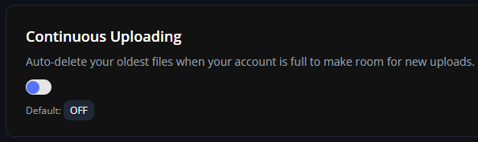

# LobFile 托管

**推荐。**

### 警告

此托管方法的文件大小限制为 100MB。订阅 LobFile 可获得更高的限额。

将资源包自动上传到**免费的在线服务**，该服务在世界各地均设有服务器。\
非常感谢 [LobFile](https://lobfile.com/) 向我们提供平台，免费托管文件！


## 有哪些优点？

* 下载速度。
* 可用性。
* 安全性：不会暴露服务器 IP 地址。
* 不会占用大量带宽。

## 我已经在使用 `self-host`，这个更好吗？

视情况而定。

如果正在制作资源包，需要不断运行 `/iazip`，最好使用 [self-host](self-hosting.md)，以免浪费时间（更多信息见[此处](../../beginners/fast-resourcepack-tips.md)）。

完成资源包制作后，就可以放心改用另一种托管功能来替代 `self-host`，本例为 **LobFile**。\
这样，资源包就不再托管于你的服务器，可以降低服务器流量。\
如果玩家全都来自同一国家，可以继续使用 `self-host`。

## 设置

#### 步骤 1

[在此注册 LobFile](https://lobfile.com/sign-up) 账户。

#### 步骤 2

打开[账户设置](https://lobfile.com/dashboard/general)，启用 _**“Continuous Uploading”**_（持续上传）

<figure><figcaption></figcaption></figure>

#### 步骤 3

在 [Account Info](https://lobfile.com/dashboard/account-info) 面板中，点击 API key，将其复制到剪贴板。

<figure><figcaption></figcaption></figure>

#### 步骤 4

在 `config.yml` 中启用 `lobfile`，并禁用所有其他托管方法。

```yaml
lobfile:
  enabled: true
```

打开 `secret.yml`，粘贴你的 `API Key`。

```yaml
lobfile:
  api_key: xxxxxxxxxx
```

#### 步骤 5

运行 `/iazip.`

等待隐私政策消息出现。\
运行 `/acceptprivacy` 接受政策（仅首次询问）。

### 完成

**插件**会**自动将其上传**到网上。\
无需其他操作，即可使用**免费的自动资源包托管**。

## 陌生人能在网上找到我的资源包吗？

2023-12-21:\
你的资源包不会被 Google 索引，也不会发布在资源包列表中。\
只有知道链接的人才能下载资源包。

我不承担任何责任，此产品按原样提供，我也不是 LobFile 的所有者。
