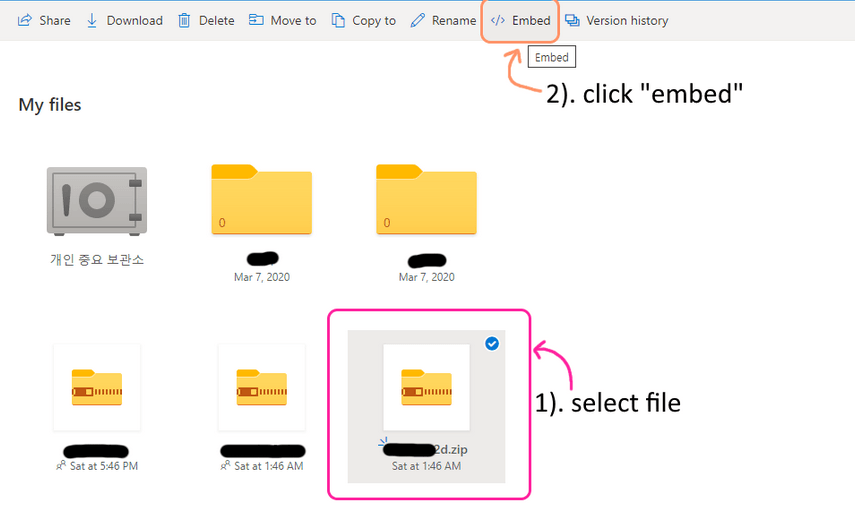
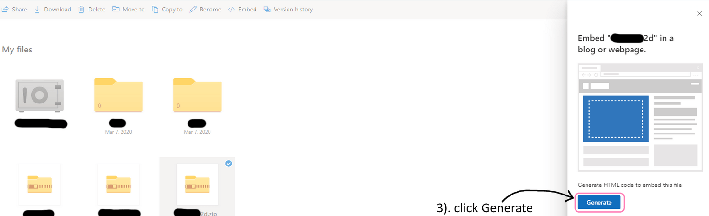
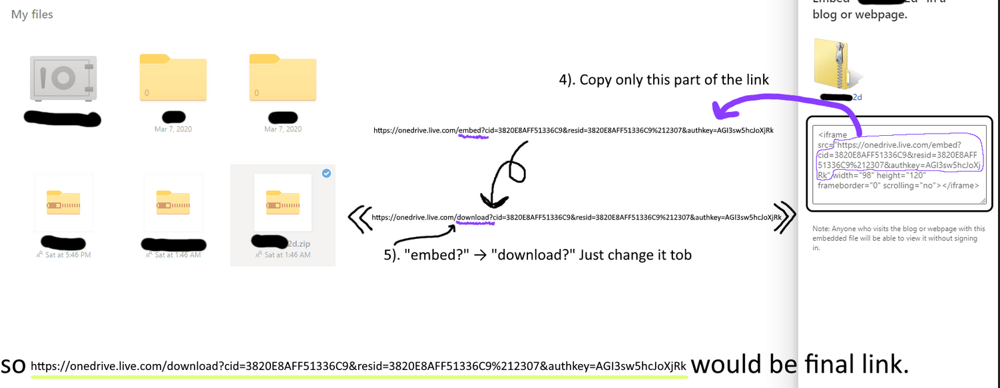

# OneDrive

**不推荐。**

### 步骤 1



### 步骤 2



### 步骤 3



### 步骤 4

打开 **ItemsAdder** 的 `config.yml` 文件，并为你的新 URL 启用 `external-host` 选项。

```yaml
    external-host:
      enabled: true
      url: 'https://onedrive.live.com/yoururl.....'
      skip-url-file-type-check___DONT_ASK_HELP_IF_SET_TRUE: true
```

这非常重要。将其设置为 true。

```yaml
skip-url-file-type-check___DONT_ASK_HELP_IF_SET_TRUE: true
```

请记住，这有点“冒险”，因为服务器无法确保 URL 有效。

如果 URL 无效或 OneDrive 不提供直接下载（有时会发生），这可能会导致您的玩家卡在登录阶段。

## 如有需要，继续安装

[first-install.md](../../first-install.md)
