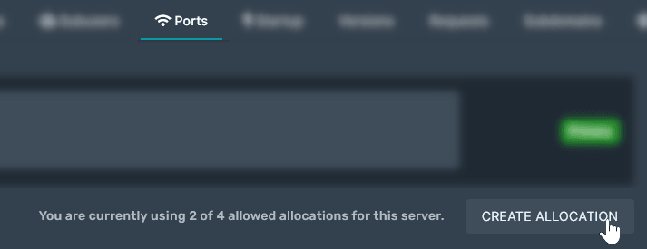
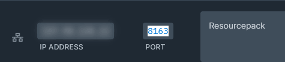
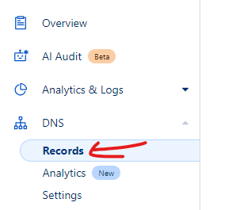
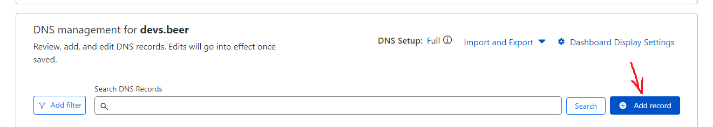
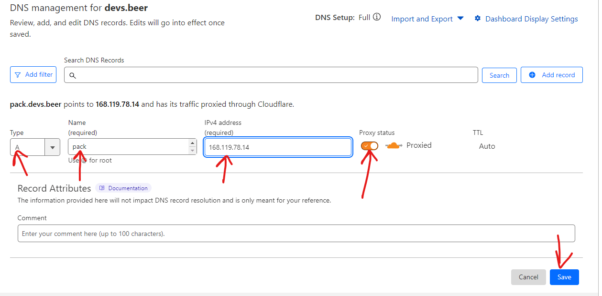
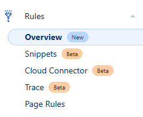
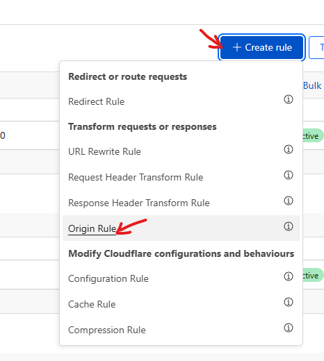
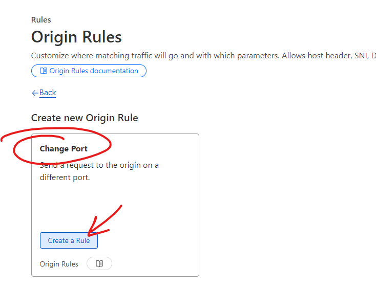
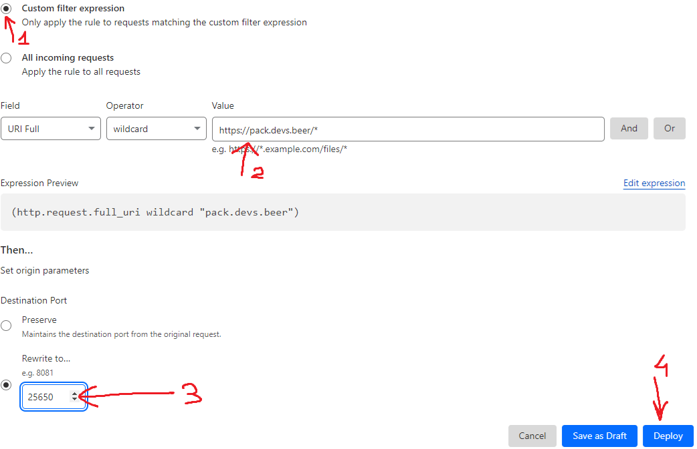

# 自托管

**推荐。**

**托管服务必须允许你为服务器获取额外端口。**

如果托管服务不提供额外端口，必须使用一种[其他托管方法](../resourcepack-hosting.md)。

### self-host 与其他方法有什么区别？

区别在于，使用 self-host 时可以直接从服务器下载资源包，无需每做一点小改动就重新上传到网站。

在电脑上的测试服务器中配置资源包时，`self-host` 很有用。\
只需使用命令 `/iazip`，几乎立即就能在游戏中看到更改。

## 配置


* 在**托管服务面板**中检查能否获取额外端口；如果不行，请向托管商客服申请。

例如，在 **Pterodactyl** 中：





* 获得**新端口**后，打开 `config.yml`，按如下方式设置：

```yaml
  self-host:
    enabled: true
    server-ip: '127.0.0.1'
    pack-port: 8163
```

* 必须将 `127.0.0.1` 替换为**服务器 IP**
* 将 `8163` 替换为获得的新端口。

例如，我的 IP 是 `123.456.789.0`，额外端口是 `8163`，就会这样设置：

```yaml
  self-host:
    enabled: true
    server-ip: '123.456.789.0'
    pack-port: 8163
```

**`pack-port`** 与服务器端口（玩家连接时使用的端口）不同。

`127.0.0.1` 表示“**本机**”。\
**因此，如果在自己的电脑上测试插件**，可以**保留默认配置**，插件会直接在你的电脑上查找资源包 zip。

**每次**编辑**纹理**、3D **模型**或**声音**时，别忘了使用 `/iazip`，否则显然看不到任何变化。

### 最后一步

配置完 `config.yml` 文件后，只需运行 `/iazip` 命令更新 zip 文件并启动托管。

### 如有需要，继续安装

[first-install.md](../../first-install.md)

## （可选）Cloudflare 配置

本指南不会隐藏服务器 IP，因为你已通过 SRV 规则暴露该地址，而且免费版 Cloudflare 不支持保护非标准端口的流量。

由于 Cloudflare 会自动缓存请求，本指南可能降低流量，应用此方法后资源包请求的负载可能会减轻。

### 创建新的 `DNS record`

<figure><figcaption></figcaption></figure>

<figure><figcaption></figcaption></figure>

* type：`A`
* name：`pack`（示例）
* IPv4 address 填写托管资源包（运行 ItemsAdder）的服务器 IP
* Proxy status：`Proxied`
* 点击 **Save**

<div><figure><figcaption></figcaption></figure></div>

### 创建新的 `Origin rule`

<figure><figcaption></figcaption></figure>

<figure><figcaption></figcaption></figure>

选择“Change Port”和“Create a Rule”。

<figure><figcaption></figcaption></figure>

选择“Custom filer expression”，按截图填写，并根据自己的环境修改数值。

<figure><figcaption></figcaption></figure>

### 配置 ItemsAdder

* 将 `server-ip` 设为新的资源包地址
* 将 `pack-port` 设为资源包端口
* 将 `append-port` 设为 false
* 尝试访问

```yaml
self-host:
  enabled: true
  server-ip: 'https://pack.devs.beer'
  pack-port: 25650
  append-port: false
```
