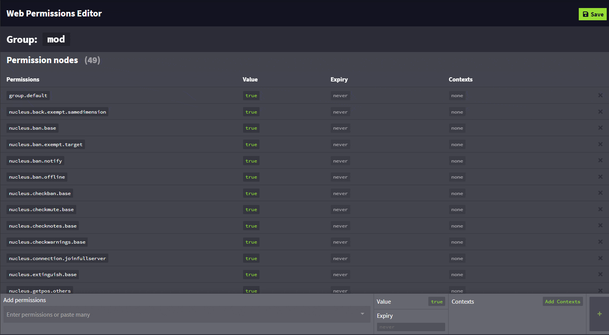

上下文是 LuckPerms 工作方式的基础。它可能是整个插件最重要的概念，正确使用时能发挥很大作用。

___

**上下文**最基本的含义，就是**某项设置生效的条件**。

一个“上下文”由 `key` 和 `value` 组成，表示为 `key=value`。结合示例会更容易理解。

<a id="example"></a>
### 示例
如前所述，上下文就是某项设置生效的条件。例如，假设我想设置一个权限，但**只希望它在 "world_nether" 世界生效**。为此，可以在设置权限时提供上下文，指定该权限应在哪里生效。

在这个例子中，上下文的**键**是 `"world"`，**值**是 `"world_nether"`。在 LuckPerms 中，它表示为 `world=world_nether`。

要实现这一效果，可以使用类似命令：`/lp user Luck permission set test.permission world=world_nether`，在命令末尾指定上下文。

<a id="setting-contexts"></a>
### 设置上下文

为权限设置上下文有两种方式：在设置权限的命令中指定，或使用网页编辑器。

* 使用命令时，只需按照上方示例操作。在命令末尾添加 `<key>=<value>`，例如 `world=nether`、`server=lobby`，或其他可用的上下文及其值。完整命令例如 `lp user Luck permission set minecraft.command.gamemode true server=lobby world=nether`。

* 使用编辑器时，点击 `Add Context`，然后填写键和值即可。与命令一样，`key` 是上下文的类型，`value` 是其值。示例如下：


___

多个上下文可以组合成所谓的“上下文集合”，也就是一组上下文键值对。

上下文集合存在于两个地方：

* LuckPerms 会在内部计算**玩家**的“当前上下文集合”，也就是玩家目前满足的上下文。如果玩家位于 `world_nether` 世界，其当前上下文集合就会包含 `world=world_nether`。  
离线玩家没有上下文集合。可以使用 `/lp user <user> info` 命令，查看输出底部的 "Has contextual data"（是否有上下文数据）项来确认。

* **每项权限、父级或权限组、前缀、后缀及元数据设置**也都有自己的上下文集合，用来指定玩家需要满足哪些上下文，相应的权限、父级或元数据值才会生效。

关键在于，要让某个权限、父级或元数据值生效，玩家必须在该值要求的上下文中，满足**每种类型中的至少一个**。如果设置了三个世界上下文（world、world_nether 和 world_the_end）以及一个服务器上下文（survival），那么权限会在该服务器的这三个世界中的任意一个生效。如果只设置三个服务器上下文，那么权限会在这三个服务器中的任意一个生效。当你希望权限在若干地方生效、在其他地方不生效时，这一点很有用，因为无需创建多个重复节点，再分别为它们设置一个上下文。

___

<a id="contexts-provided-by-luckperms"></a>
### LuckPerms 提供的上下文
上下文系统在设计上支持扩展，不应（也确实没有！）局限于少数几种上下文。

LuckPerms 自身默认提供五种上下文。其他插件也可以通过 API 注册 `ContextCalculator`，提供自己的上下文。

| 上下文键 | 说明 | 示例 |
|-------------|-------------|---------|
| `server`    | 玩家当前所在的服务器。此值由 LuckPerms 配置文件最上方的 **server** 设置决定。 | `server=survival` |
| `world`    | 玩家当前所在的世界，直接从服务器获取。LuckPerms 在 BungeeCord/Velocity 代理端上运行时，世界上下文的值指的是玩家当前连接的子服务器。 | `world=world_nether` |
| `gamemode`    | 玩家当前的游戏模式。 | `gamemode=creative` |
| `dimension-type`    | 玩家当前所在世界的维度类型。 | `dimension-type=the_nether` |
| `proxy`    | 仅当 LuckPerms 在安装了 RedisBungee 的 BungeeCord 代理端上运行时，才会应用此上下文。它表示玩家当前连接的代理端。 | `proxy=redisbungee1` |

___

<a id="defining-your-own-contexts"></a>
### 定义自己的上下文
除 LuckPerms 提供的上下文外，还可以添加自己的额外上下文。

上下文可以**静态**或**动态**提供。

* **静态上下文**会以相同方式提供给所有玩家，即所有玩家都满足相同值的这一上下文。（例如 "server" 上下文，所有玩家获得的键和值都相同。）静态上下文可以在专用配置文件中定义，也可以通过 API 定义。
* **动态上下文**根据特定因素提供，必须由插件通过 API 注册。

<a id="defining-static-contexts"></a>
#### 定义静态上下文
静态上下文可以在 `contexts.json` 文件中定义，该文件位于 `/LuckPerms/` 插件目录下。（与主配置文件位于同一文件夹。）

该文件包含两个属性，但这里我们只关注名为 `static-contexts` 的属性。

例如，如果想添加一个名为 `"server-type"` 的上下文，在服务器名称（LuckPerms 已经提供）之外额外标明服务器类型，只需添加：

```json
{
  "static-contexts": {
    "server-type": "skyblock"
  },
}
```

添加后，就可以在定义权限、父级或元数据时使用 `server-type` 上下文，将这些值限定到特定服务器类型。例如：`/lp user Luck parent add donor server-type=skyblock`。

可以在此文件中添加任意数量的上下文。

<a id="default-contexts"></a>
### 默认上下文
默认上下文用于指定：命令末尾没有附加上下文时，命令应应用哪些上下文，例如 `/lp user Luck permission set example.permission`。可以在与主配置文件同一文件夹中的 `contexts.yml` 文件里定义。

例如，要在文件中添加默认上下文，只需在 static-contexts 部分下方添加：

```json
{
 "default-contexts": {
    "world": "world_nether",
    "server": "survival"
  }
}
```

这样，在添加了此默认上下文的服务器上，执行 `/lp` 命令时，除非另行指定，否则所有支持上下文的命令都会使用 `world=world_nether,server=survival`。

<a id="extracontexts"></a>
### ExtraContexts

ExtraContexts 是另一个插件，用于提供 LuckPerms 本身未包含的更多上下文功能，例如 WorldGuard 上下文、PlaceholderAPI 上下文等！

更多信息见[此处](https://github.com/LuckPerms/ExtraContexts)。
