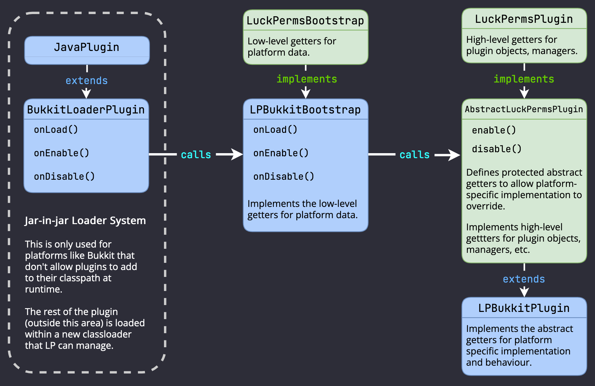

你好！

本指南帮助开发者搭建环境，开始参与 LuckPerms 代码的开发。

除下方说明外，我们还设有专门的 Discord 频道，用于讨论 LuckPerms 开发和拉取请求。欢迎[加入并选择 #contributors 频道](https://discord.gg/luckperms)。遇到问题时请直接提问，我们很乐意提供帮助。

## 开始使用

LuckPerms 使用 **Gradle** 管理依赖和构建项目。

有关如何将代码克隆到本机，详见 [README.md](https://github.com/LuckPerms/LuckPerms/blob/master/README.md) 文件。

建议使用 IntelliJ IDEA 这一 Java IDE 开发 LuckPerms。它对 Gradle 的支持很好，自动补全功能也很出色。通常只需让 IntelliJ 从 Git 仓库克隆 LuckPerms，再等它完成其余配置即可（但愿一切顺利！）。

## 项目结构

项目分为几个独立模块。

* **API**（`/api`）- 面向其他插件的公共 API，用于与 LuckPerms 集成并从中获取数据。此模块本身基本不包含实现，具体实现由插件提供。
* **Common**（`/common`）- 公共模块，包含所有 LuckPerms 实现（插件）共用的抽象代码，目的是减少各个受支持平台之间重复的逻辑。公共模块依赖 API。
* **插件**（例如 `/bukkit`）- 各平台均利用公共模块，实现针对特定服务器平台的“LuckPerms 插件”。插件依赖公共模块。
* **插件加载器**（例如 `/bukkit/loader`）- 位于实际插件之前的额外模块，充当加载引导程序。它用于在原生不支持运行时注入依赖 jar 的平台上，实现 jar-in-jar 和依赖加载。

## 抽象分层

LuckPerms 使用了较多抽象，以减少重复代码，并分隔不同的逻辑组件。刚接触这套代码时，理解这些结构可能有些困难，但这对于保持代码易于维护非常重要。

下图展示了这种抽象分层。

这里以 Bukkit 为例，其他平台也有类似的类。

### 底层加载器

`class BukkitLoaderPlugin extends JavaPlugin`

引导加载器插件负责在平台上加载并启动 LuckPerms。它的代码很精简，大多数情况下无需关注。

不过，仍有必要了解它，因为它才是插件的实际入口点（在 Bukkit 上，它就是 `extends JavaPlugin` 的那个类）。

并非每个平台都有加载器；只有那些不允许插件控制自身类加载器的平台才需要它。在这种情况下，LuckPerms 采用 "jar-in-jar" 系统，由一个精简的加载器插件创建子类加载器，再在其中引导启动主插件。

例如，参见 [`BukkitLoaderPlugin`](https://github.com/LuckPerms/LuckPerms/blob/master/bukkit/loader/src/main/java/me/lucko/luckperms/bukkit/loader/BukkitLoaderPlugin.java) 类。

这个类只负责设置一个特殊的类加载器，然后将 onEnable/onDisable 等方法调用委托给引导程序。下面介绍引导程序。

### 底层引导程序

`class LPBukkitBootstrap implements LuckPermsBootstrap`

[`LuckPermsBootstrap`](https://github.com/LuckPerms/LuckPerms/blob/master/common/src/main/java/me/lucko/luckperms/common/plugin/bootstrap/LuckPermsBootstrap.java) 是与服务器平台集成的底层接口。它负责日志记录、任务调度等工作，并提供平台底层对象的信息（例如在线玩家等）。

例如，参见 [`LPBukkitBootstrap`](https://github.com/LuckPerms/LuckPerms/blob/master/bukkit/src/main/java/me/lucko/luckperms/bukkit/LPBukkitBootstrap.java) 类。

此类不包含任何逻辑，只为 LuckPerms 插件提供所需内容。

### 高层插件

`class LPBukkitPlugin extends AbstractLuckPermsPlugin implements LuckPermsPlugin`

[`LuckPermsPlugin`](https://github.com/LuckPerms/LuckPerms/blob/master/common/src/main/java/me/lucko/luckperms/common/plugin/LuckPermsPlugin.java) 是 LuckPerms 的主接口。[`AbstractLuckPermsPlugin`](https://github.com/LuckPerms/LuckPerms/blob/master/common/src/main/java/me/lucko/luckperms/common/plugin/AbstractLuckPermsPlugin.java) 提供了它的抽象实现，各平台再继承该类，实现各自的平台集成。

[`LuckPermsPlugin`](https://github.com/LuckPerms/LuckPerms/blob/master/common/src/main/java/me/lucko/luckperms/common/plugin/LuckPermsPlugin.java) 只是一个接口。它主要通过大量 getter 方法，定义“LuckPerms 插件”由哪些部分组成。项目中的其他类经常接收这个接口（作为构造函数依赖注入），让不同组件能够相互访问。如果需要访问日志记录器或调度器等底层组件，也可以从该接口获取 [`LuckPermsBootstrap`](https://github.com/LuckPerms/LuckPerms/blob/master/common/src/main/java/me/lucko/luckperms/common/plugin/bootstrap/LuckPermsBootstrap.java)。

[`AbstractLuckPermsPlugin`](https://github.com/LuckPerms/LuckPerms/blob/master/common/src/main/java/me/lucko/luckperms/common/plugin/AbstractLuckPermsPlugin.java) 是主要的插件类，定义了 LuckPerms 各插件共用的大量逻辑。例如，任何一个 LuckPerms 插件启用时，都需要执行类似的步骤，如设置存储、注册监听器和命令。因此，应尽可能将这些逻辑抽象出来，以减少重复。

[`AbstractLuckPermsPlugin`](https://github.com/LuckPerms/LuckPerms/blob/master/common/src/main/java/me/lucko/luckperms/common/plugin/AbstractLuckPermsPlugin.java) 提供启用和禁用插件的高层逻辑，同时还定义了若干 protected 抽象方法，允许各插件实现提供自己的自定义逻辑或类，供插件使用。

接着，每个平台都会分别继承这个抽象插件类并覆写相应内容，例如 [`LPBukkitPlugin`](https://github.com/LuckPerms/LuckPerms/blob/master/bukkit/src/main/java/me/lucko/luckperms/bukkit/LPBukkitPlugin.java) 类。子类定义自定义行为，并提供插件在特定平台上使用的自定义对象（例如，`BukkitContextManager` 是 `ContextManager` 的一个实现，由 `LPBukkitPlugin` 提供）。

## 其余代码

如前文所述，[`LuckPermsPlugin`](https://github.com/LuckPerms/LuckPerms/blob/master/common/src/main/java/me/lucko/luckperms/common/plugin/LuckPermsPlugin.java) 是插件的“根”，再由它扩展到其他包和类。

例如：

* `UserManager` 负责 LuckPerms 用户的内存存储
* `GroupManager` 负责 LuckPerms 权限组的内存存储
* `TrackManager` 负责 LuckPerms 晋升路线的内存存储
* `LuckPermsConfiguration` 负责插件配置文件
* `Storage` 是所有与插件存储提供者交互的操作所使用的根接口
* `CommandManager` 负责所有 LuckPerms 命令及其调用
* `DependencyManager` 负责运行时依赖的加载和解析
* `ContextManager` 负责玩家上下文的查询和缓存
* ……还有更多内容，希望这些名称和 JavaDoc 足以说明各自的用途。

## 代码风格

保持一致并*合理*执行的代码风格，对项目源代码的可读性和可维护性非常重要。

有人可能认为，偶尔的疏忽无伤大雅，纠结代码风格不过是维护者过于执着——某种程度上或许确实如此。但另一方面，这些小问题会随时间积累，长远来看，及时把关会更好。

总体原则：

1. **尽可能沿用现有代码的风格**。不论参与哪个项目，这种做法*始终*适用，而且比照着“风格指南”逐条执行更容易。
2. **尽量减少空白字符的改动**，并在提交拉取请求供审查前**检查自己的差异**。大多数 IDE 还会标记修改、添加或删除的行，并提供按钮，用于回退不必要的行级更改。

我们乐意在最后帮忙整理提交，但如果边写边整理，就能省下很多时间！
