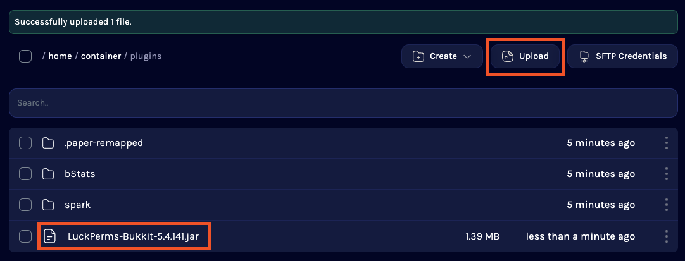
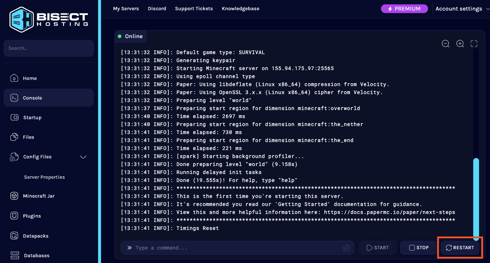
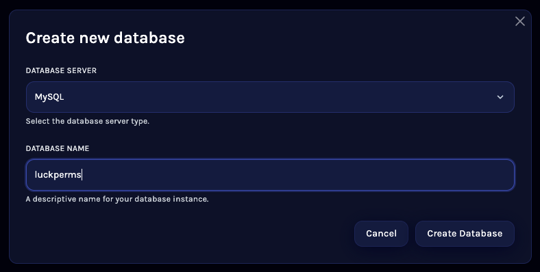
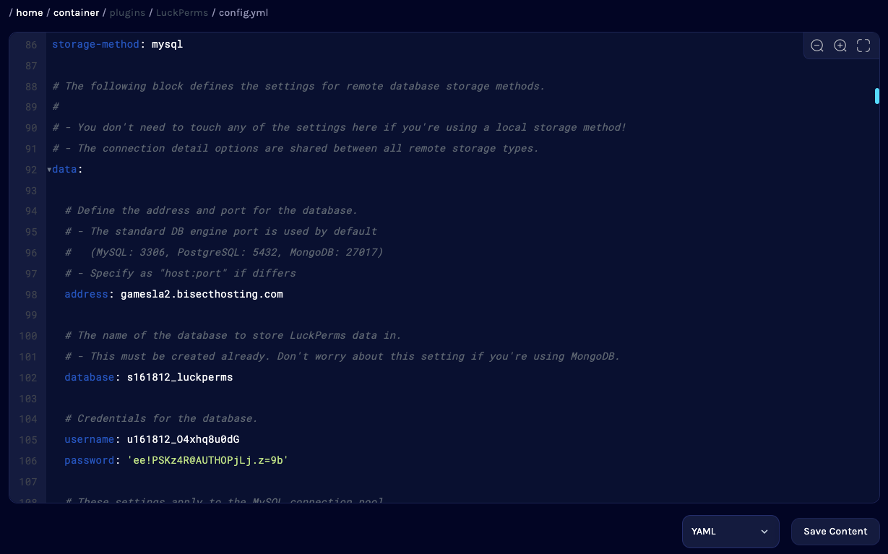
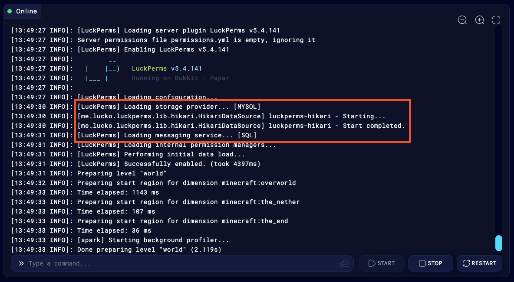

## 第 1 步：下载 LuckPerms jar 文件

首先需要下载 LuckPerms。我们的[下载页面](https://luckperms.net/download)上始终提供所有受支持平台的最新版 LuckPerms。

点击相应的下载链接，并将文件保存到方便找到的位置即可。

* 如果你运行的是 Minecraft：Java 版的 _非模组_ 服务器，建议使用 [Paper](https://papermc.io/) 作为服务端。
* 如果你运行的是 Minecraft：Java 版的 _模组_ 服务器，建议使用 [Fabric](https://fabricmc.net/) 或 [NeoForge](https://neoforged.net/) 作为服务端。
* 如果你运行的是 Minecraft：基岩版服务器，建议使用 [Nukkit](https://cloudburstmc.org/) 作为服务端。
* 如果你通过代理端连接多台 Minecraft 服务器，建议使用 [Velocity](https://velocitypowered.com/) 或 [Waterfall](https://papermc.io/downloads#Waterfall)（BungeeCord）作为代理端。
* 如果你运行的是 Hytale 服务器，那么（目前）选择并不多！使用原版服务端就可以。

如果还没有找到托管服务器的地方，可以看看我们的合作伙伴 [BisectHosting](https://bisecthosting.com/luck)。LuckPerms 用户购买他们的任何游戏服务器托管方案，都可享受价格优惠 25%。

## 第 2 步：将 LuckPerms jar 放入服务器的 `plugins` 或 `mods` 文件夹

接下来，将 LuckPerms 安装到服务器上。请确认已选择并安装正确的服务端 jar，且服务器至少成功启动过一次，以便生成必要的文件夹。

进入托管面板的“文件管理器”，打开 `plugins` 文件夹（Bukkit、Paper 等）或 `mods` 文件夹（Forge、Fabric、Sponge 或 Hytale）。

进入 plugins 或 mods 文件夹后，点击上传，并按提示选择第 1 步下载的 LuckPerms jar，再点击“上传”。

如果之前安装过旧版 LuckPerms，请删除已有的旧 jar 文件。

## 第 3 步：完整重启服务器

进入服务器控制台，点击“重启”或输入 `stop`。

服务器重新启动时，LuckPerms 会启用并生成默认配置文件。留意控制台，确认 LuckPerms 已正常启动并启用。

LuckPerms 现已安装完成，可以立即开始使用！接下来请阅读 Wiki 的[入门指南](usage.md)，了解后续操作。

## 第 4 步：配置 LuckPerms

要自定义 LuckPerms，可以修改其配置文件。

回到“文件管理器”，打开 `plugins`/`mods` 文件夹，或 `config` 文件夹（Sponge、Fabric 或 Forge），然后打开其中的 `LuckPerms` 文件夹。

这里有多个文件，其中重要的文件有：

* `config.yml` 或 `luckperms.conf` - LuckPerms 的配置文件。
* `luckperms-h2-v2.mv.db` - LuckPerms 用来存储权限数据的数据库文件（不要删除！）

点击 `config.yml` 或 `luckperms.conf` 文件即可查看或编辑。

## 第 5 步（可选）：设置 LuckPerms 使用 MySQL 数据库或 .yml 文件存储数据

默认情况下，LuckPerms 使用名为“H2”的文件型数据库存储全部数据。这种方式效率高，也让用户无需额外配置就能开始使用 LuckPerms。

不过，如果更希望将 LuckPerms 数据存储在**可读、可编辑的 .yml 文件**中，请打开 `config.yml`/`luckperms.conf`，向下找到“Storage Settings”（存储设置）部分，将 `storage-method` 设为 `yaml`，然后重启服务器。

如果你运行着一个由多台服务器组成的群组服（或计划以后这样做），就需要设置 **MySQL** 等远程数据库，供 LuckPerms 存储数据。

大多数服务器托管商都免费提供数据库！找到“数据库”菜单，点击“创建数据库”。如果出现提示，将数据库类型选为“MySQL”，并填写一个合适的名称。

创建数据库后，应当会显示以下信息：主机名、数据库名称、用户名和密码。

取得这些信息后，将其记下（或复制当前标签页），然后在文件管理器中回到 LuckPerms 的 `config.yml`/`luckperms.conf` 文件并打开它。

向下找到“Storage Settings”（存储设置）部分，将 `storage-method` 设为 `mysql`，再在 `data:` 部分填写数据库信息。

点击保存，然后重启服务器。

之后可以在控制台确认 MySQL 是否设置正确。如果出现 `Loading storage provider... [MYSQL]`，并且之后没有报错，就说明一切运行正常！

记住，群组服中的所有服务器都需要完成这些步骤。

## 常见问题

### 应该在哪里安装 LuckPerms？
* 如果你运行的是群组服，应当在每一台需要使用 LuckPerms 的服务器的插件文件夹中安装 LuckPerms。
* 如果还想使用 LuckPerms 管理 Velocity/BungeeCord 代理端上的权限，也应当将 LuckPerms-Velocity.jar 或 LuckPerms-Bungee.jar 放入代理端的 plugins 文件夹。
* 如果只在代理端安装 LuckPerms，它不会影响任何后端服务器上插件执行的权限检查。如果需要这项功能，也必须在那些服务器上安装 LuckPerms。

### 只在代理端安装 LuckPerms 可以吗？
* Velocity/BungeeCord 使用的权限系统与后端服务器使用的权限系统完全独立。
* **可以**只在代理端安装，但后端 Bukkit/Sponge 插件或 Fabric/Forge 模组执行的权限检查将不会由 LuckPerms 处理。

## 运行要求
LuckPerms 有几项运行要求。*绝大多数*服务器已经满足这些要求。

* 需要 Java 11 或更高版本
* 首次加载 LuckPerms 时，服务器需要能够连接互联网

---

### Java 11
服务器必须运行 **Java 11** 或更高版本。LuckPerms 不支持更旧的 Java 版本。

某些平台或 Minecraft 版本要求使用更新的 Java（例如 Java 21），LuckPerms 也支持这些版本。

---

### 互联网连接
LuckPerms 使用了一些[外部库](external-connections.md)，其中部分库会[在运行时自动下载](external-connections.md#downloading-libraries)。

如果服务器没有互联网连接，可以先在本地有互联网连接的环境中安装 LP，再将 `/LuckPerms/libs/` 目录的内容复制到另一台服务器上。

## 兼容性
下方列出了一些已知的兼容性问题。这些问题都不在我们的控制范围内，无法通过修改 LuckPerms 本身来解决。🙁

部分兼容性问题已在较新的服务端版本中解决，但修复没有移植到旧版。

### 其他权限插件
要让 LuckPerms 完整工作并处理所有权限检查，它必须是服务器上安装的唯一权限插件（除非你要执行自动迁移）！

---

### 较旧的 Minecraft 版本
LuckPerms 的主要发行版本不兼容 Minecraft：Java 版 1.8.8 之前的版本。

适用于 1.7.10 的 Bukkit 版 LuckPerms 可以在我们的[下载页面](https://luckperms.net/download/)找到。
