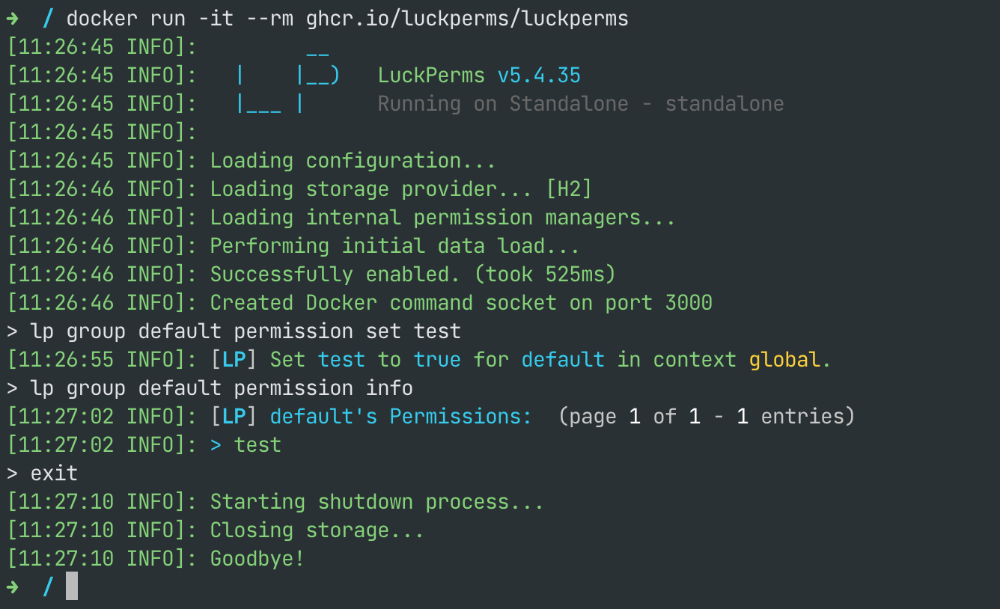

除了作为 Minecraft 服务器内的插件或模组运行，LuckPerms 还可以作为独立应用运行。目前主要有两个用途：

1. 让服务器管理员无需启动 Minecraft 服务器，就能快速启动 **LuckPerms CLI**，对远程数据库执行命令！
2. 让小型独立扩展（例如 **REST API**）作为单独的应用运行。

<a id="luckperms-as-a-standalone-app"></a>
## 将 LuckPerms 作为独立应用运行

独立版“插件”属于 LuckPerms 主代码库，位于名为 [`standalone`](https://github.com/LuckPerms/LuckPerms/tree/master/standalone) 的模块中。

运行独立应用最简单、也是推荐的方式是使用 Docker。

只需确认机器上已安装 Docker，然后执行以下命令！

```
docker run -it --rm ghcr.io/luckperms/luckperms
```

这样就会启动一个 CLI，可以像操作 Minecraft 服务器一样使用它。

<p>
  
</p>

可以通过[环境变量](configuration.md#environment-variables)配置数据库主机、用户名和密码。

也可以使用 Docker Compose。创建一个名为 `docker-compose.yml` 的文件：

```yml
version: "3.8"
services:
  luckperms:
    image: ghcr.io/luckperms/luckperms
    # Uncomment if your database is running on the same host
    #extra_hosts:
    #  - "database:host-gateway"
    environment:
      LUCKPERMS_STORAGE_METHOD: mysql
      LUCKPERMS_DATA_ADDRESS: database:3306
      LUCKPERMS_DATA_DATABASE: minecraft
      LUCKPERMS_DATA_USERNAME: root
      LUCKPERMS_DATA_PASSWORD: passw0rd
```

* 启动应用：`docker compose up -d`。
* 查看控制台：`docker compose logs -f luckperms`
* 发送命令：`docker compose exec luckperms send <command>`
* 停止应用：`docker compose down`

<a id="luckperms-rest-api-for-developers"></a>
## LuckPerms REST API（面向开发者）

LuckPerms REST API 是一个可以在独立应用（如上所述）中运行的“扩展”。

它让其他程序、应用或脚本无需直接操作数据库，就能方便地读取、修改和写入 LuckPerms 数据。

有关更多信息及 API 使用说明，请参阅：
* GitHub 上的 [LuckPerms/rest-api](https://github.com/LuckPerms/rest-api) 仓库及其自述文件
* [API 规范](https://petstore.swagger.io/?url=https://raw.githubusercontent.com/LuckPerms/rest-api/main/src/main/resources/luckperms-openapi.yml)

<a id="extensions-within-the-standalone-app-for-developers"></a>
## 独立应用中的扩展（面向开发者）

还可以为独立应用创建自己的“类似插件的”Java 扩展，并在启动时加载它们！

步骤很简单：

1. 在 JAR 根目录中创建名为 `extension.json` 的文件，内容如下：
    ```json
    {"class": "com.example.extension.MainClass"}
    ```
    （替换为你自己的主类！）
2. 创建一个继承 `import net.luckperms.api.extension.Extension` 的主类。
    它应具有无参构造方法，或仅接受一个 `net.luckperms.api.LuckPerms` 实例的构造方法。

完成后，将 JAR 放入 extensions 文件夹即可。
