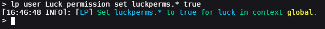
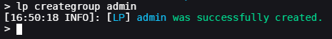
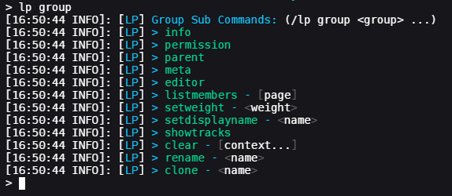
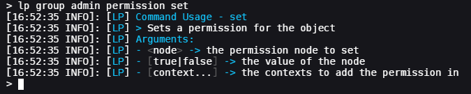
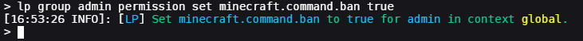
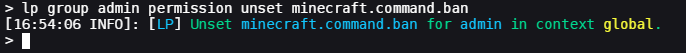
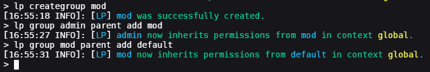
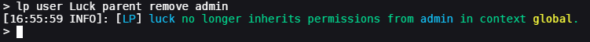

### 目录
* [关键概念](usage.md#key-concepts)
* [开始使用](usage.md#getting-started)
  * [授予 LuckPerms 的完整使用权限](usage.md#granting-full-access-to-luckperms)
  * [创建第一个权限组](usage.md#creating-the-first-group)
  * [将用户加入权限组](usage.md#adding-a-user-to-a-group)
  * [让一个权限组继承另一个权限组](usage.md#making-a-group-inherit-another-group)
  * [移除父级权限组](usage.md#removing-parent-groups)
  * [查找权限](usage.md#finding-permissions)
  * [网页编辑器](usage.md#web-editor)

如果你已经了解 LuckPerms 及其作用，可以直接跳到更适合快速查阅的[命令用法与权限](command-usage.md)部分。

否则，请继续阅读！先来了解几个关键概念……

# 关键概念

### 权限
服务器中存在各种**功能和命令**。其中一些由服务器自带，另一些则由“插件”或“模组”添加。这些操作大多**有对应的权限**，因此你可以控制哪些用户能够使用各项功能或命令。

**权限就是一个字符串**（一串字母或数字），用句点分隔各个部分。例如，“minecraft.command.ban” 就是 Minecraft 的 /ban 命令对应的权限。

表示某个权限的字符串，有时也称为“权限节点”，简称“节点”。

权限节点可以有**三种值**：`true`、`false` 和 `undefined`。
- `true` 表示玩家*拥有该权限*，会获得该权限对应的功能或操作权限。
- `false` 表示玩家*不拥有该权限*，会被*禁止*使用该权限对应的功能或操作。
- `undefined` 表示该权限在 LuckPerms 中*未被明确设置*。这**通常**意味着它的默认效果与 `false` 相同。极少数情况下，插件会让 `undefined` 的权限默认为 `true`，这时你需要**明确将它设为 `false`**。

### 权限组
不必逐个给每位用户分配权限，可以将**多个权限放入权限组**，再把整个权限组**分配给用户**。

例如，可以在 "admin" 权限组中添加使用 /ban 和 /unban 命令的权限，再将用户加入 admin 权限组。这样，他们就会拥有 "admin" 的所有权限，以及自身单独拥有的权限。

### 继承
用户和权限组可以**相互继承权限**。例如，默认情况下，所有用户都会继承 "**default**" 权限组的权限。你可以为服务器设置自己的权限组和继承关系，搭建适合自己的体系。

例如，我可能有 3 个权限组："default"、"moderator" 和 "admin"。我希望 moderator 继承 default 的权限，admin 再继承 moderator 的权限。

  

在上面的示例中，用户 "Bob" 继承 "admin" 权限组，后者又继承 "moderator"，以此类推。在 LuckPerms 中，当用户或权限组继承另一个权限组时，我们将被继承的权限组称为“**父级**”权限组。

### 上下文
使用 LuckPerms 时，你会经常遇到“上下文”这个词。

**上下文**最基本的含义，就是**某项设置生效的条件**。例如，利用上下文，可以为用户或权限组授予只在特定服务器、世界、游戏模式等条件下生效的权限。

上下文是插件的基础组成部分，因此有[单独的 Wiki 页面](context.md)专门介绍其用法。:)

# 开始使用
如果尚未安装 LuckPerms，请先参阅[安装指南](installation.md)。

然后，请先阅读[选择存储类型](storage-types.md)部分，再继续操作。虽然以后也可以更改这些选项，但最好一开始就选好。

## 授予 LuckPerms 的完整使用权限
首先，要给自己授予插件的完整使用权限。刚安装 LuckPerms 时，任何人都没有使用 LP 命令的权限。

为此，请先登录服务器，再打开服务器控制台。

然后输入 `lp user <your username> permission set luckperms.* true`。（这条命令的用法稍后会解释。）

结果应该类似下图：   

> 如果运行的是“内置服务器”（服务器在游戏客户端内运行），你可能没有可用的控制台，但不用担心！你应该已经自动拥有所有权限。

上面的操作实际上是给你的用户授予 `luckperms.*` 权限（也就是为该用户将其设为 true）。你会注意到，权限字符串末尾有一个 `*` 字符。这叫作通配符，会让用户获得**所有**以 "luckperms" 开头的权限。

完成后，既可以在游戏中继续配置，也可以继续在控制台输入命令。

## 创建第一个权限组
可以使用 creategroup 命令创建新的权限组。这里创建一个名为 admin 的权限组，再给它授予一个权限。

首先，执行 `lp creategroup admin`。这会创建一个名为 "admin" 的空权限组。

接下来，为 admin 权限组添加权限。修改权限组的命令是 `lp group <group>`。执行此命令后，会列出所有子命令。

因为要添加权限，所以需要使用 "permission" 子命令。它可以修改权限组拥有的权限。同样，执行 `lp group admin permission` 会列出可用的子命令。

这里又会看到更多可用命令。第一个仍然是 "info" 命令。由于它是 "permission" 的子命令，这个 info 命令会返回权限组所拥有的权限信息。而下一个命令是 "set"。

还记得前面用它为用户授予 "luckperms.*" 权限吗？这里的用法相同。

只执行命令而不提供任何参数，就会显示用法说明。例如：    

例如，我想让 admin 权限组拥有 "minecraft.command.ban" 权限，只需执行 `lp group admin permission set minecraft.command.ban true`。

这条命令为 `admin` 授予 `minecraft.command.ban` 权限。末尾的 true 是赋给该权限的值。权限可以设为 `true` 或 `false`。设为 true 会为用户或权限组授予该权限，设为 false 则会否定该权限（明确禁止其使用）。

如果以后不想让 admin 继续拥有这个权限，只需使用 unset 命令将其移除，即执行 `lp group admin permission unset minecraft.command.ban`。

> `minecraft.command.ban` 只是一个示例。如果使用其他平台（例如并非 Minecraft 服务器），封禁命令对应的权限会不同，但概念是一样的！

## 将用户加入权限组
可以使用 "parent" 命令将用户加入权限组。（只需把前面命令中的 "permission" 换成 "parent"。）

例如，要将我自己加入 admin 权限组，就执行 `lp user Luck parent add admin`。

这条命令将用户 `Luck` 加入 `admin` 权限组。这意味着，admin 拥有的任何权限，我也都会通过继承获得。

## 让一个权限组继承另一个权限组
除了用户，权限组也可以继承其他权限组。

例如，假设有以下配置。（这些权限并不存在，仅用于举例。）

| Admin       | Mod          | Default     |
|-------------|--------------|-------------|
| example.ban | example.mute | example.fly |
|             |              | example.say |

我希望 `admin` 权限组中的用户同时拥有 `mod` 和 `default` 的权限，也希望 `mod` 权限组中的用户拥有 `default` 的权限。

为此，可以设置权限组之间的继承关系。

命令 `lp group admin parent add mod` 会让 admin 继承 moderator 的所有权限。然后可以对 mod 做同样的操作，执行 `lp group mod parent add default`。

继承是递归的：虽然 admin 现在只直接继承 mod，但 mod 又继承 default。这意味着，admin 同时拥有 mod **和** default 中的权限。

  

## 移除父级权限组
移除父级权限组的命令与前面的命令非常相似。

要将我自己从 admin 移除，只需执行 `lp user Luck parent remove admin`。

## 查找权限

到目前为止，我们使用的都是虚构的示例权限。但在实际服务器上，你需要使用确实对应某项功能或操作（例如命令）的权限。

可以通过以下几种方式查找：

* 查看游戏服务器软件的**文档**
* 查看其他插件或模组的**文档**
* 使用 **[`/lp verbose`](verbose.md)** 命令！
* 使用**自动补全**（命令和网页编辑器中都可以）
    * 注意：自动补全列表并不完整！它只包含 LuckPerms 自服务器启动以来“遇到过”的权限。即使某个权限没有列出来，也仍然可以使用。

### Verbose 命令

[Verbose](verbose.md) 命令可以让服务器管理员实时监视发生的权限检查！这是查找权限，以及弄清权限为何未按预期生效的最可靠方式。

最简单的用法：

* 执行 `/lp verbose record <test user>`，其中 `<test user>` 是将要执行待测命令的用户名
* 让测试用户执行待测命令
* 执行 `/lp verbose paste`，关闭详细记录模式，并生成已检查权限的报告
* 查看输出，了解检查了哪些权限。

示例：

也可以使用 `/lp verbose on <test user>`，直接将输出显示在聊天栏或控制台中；完成后再使用 `/lp verbose off` 关闭。

更高级的用法见 Verbose 的 [Wiki 页面](verbose.md)。

## 网页编辑器

觉得命令输入起来太费事？LuckPerms 提供了一个在线[网页编辑器](web-editor.md)，可以在交互式网页中方便地编辑权限配置。

只需执行 `/lp editor`，再打开给出的链接即可开始。

更多信息见此 [Wiki 页面](web-editor.md)。
