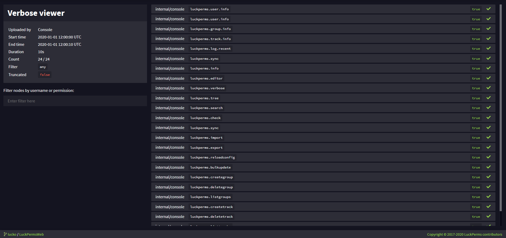
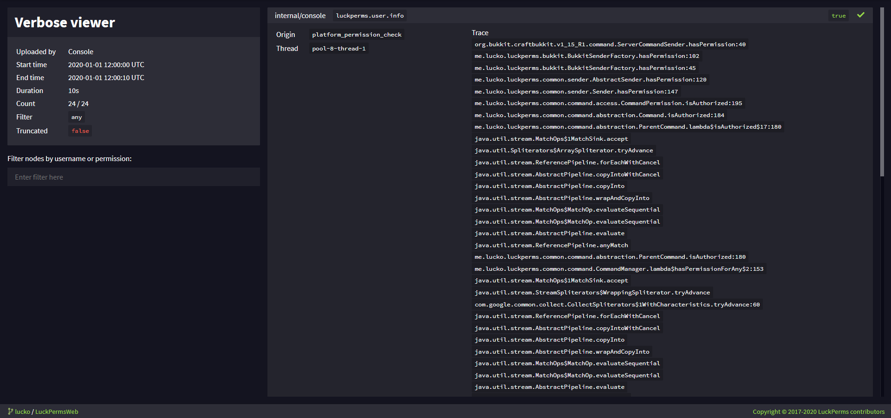

你是否遇到过这样的情况：需要找到某条命令或某项功能的权限，却找不到相关文档？

也许文档已经过时，或没有包含所需信息。也许你想排查玩家未获得正确权限的问题，或只是想知道插件究竟在检查哪些权限。

详细权限检查日志系统可以让你实时监控权限检查！😄 

## 使用方法
命令用法如下：

### `/lp verbose <on/record|off/upload> [filter]`
第一个参数用于启用或禁用系统，第二个参数用于设置筛选条件。

| 选项     | 说明 |
|----------|-------------|
| `on`     | 启用系统，并在匹配筛选条件时通过聊天消息提醒你。 |
| `record` | 与“on”相同，但不会通过聊天消息提醒。 |
| `off`    | 仅禁用系统，并清除内存中的所有匹配记录。 |
| `upload`  | 与“off”相同，但会将结果上传到网页查看器，便于分析，并向你提供链接。 |

### `/lp verbose command <name> <command>` 的功能：

`/lp verbose command` 命令可以直接在游戏内检查某条命令所需的权限，不必面对聊天刷屏，也无需打开网页查看器。只需执行 `/lp verbose command <name> <command>`，LuckPerms 就会迅速完成以下几个步骤。

1. 为指定用户开启详细权限检查日志，并将筛选条件设为该用户。
2. 强制该用户执行你指定的命令。
3. 关闭详细权限检查日志。

这一连串快速操作会让本次检查的权限出现在聊天栏中，又不会像通常那样刷屏。如果某条命令缺少完整文档，而你需要找到它的权限，这个功能尤其有用。

此命令会对用户执行 sudo，也就是强制该用户以自己的身份运行命令。因此，使用这项功能需要额外权限。具体权限可在[权限页面](permissions.md)找到。这些权限包含在 `luckperms.*` 通配符权限中，但不包含在常规的详细权限检查日志权限中。

##### 开启详细权限检查日志后客户端卡顿？
如果执行 `/lp verbose on` 后客户端出现卡顿，很可能是因为正在处理的权限检查太多，客户端无法应付这么多消息。通常最好改用 `lp verbose record`。`record` 命令会将权限检查发送到网页端的详细权限检查日志查看器，而不是以聊天消息的形式发送给客户端。要结束权限检查记录并打开网页查看器，只需执行 `lp verbose upload`。

也可以定义下文介绍的筛选条件，作为在线查看器的替代方式，或配合在线查看器使用。

#### 筛选条件
筛选条件是一条表达式，用于匹配权限条目，并忽略不需要的条目。它可以只是一个玩家名称，也可以是复杂得多的表达式。

筛选字符串会匹配所检查权限的开头，或用户的完整名称。可以使用 `&`（且）、`|`（或）和 `!`（非/取反）来组成表达式，也支持括号 `(  )`。

##### 示例
* `Luck & (essentials | worldedit)` - 匹配针对“Luck”的检查，且权限以“essentials”或“worldedit”开头
* `Luck & !anticheat` - 匹配针对“Luck”的检查，且权限不以“anticheat”开头
* `anticheat & !anticheat.check` - 匹配针对所有用户的检查，且权限以“anticheat”开头，但不以“anticheat.check”开头

## 网页查看器
网页查看器提供的信息与游戏内相同，但在需要处理大量检查记录时，更便于分析。

点击任意条目，就能查看有关这次检查的更多详细信息：

