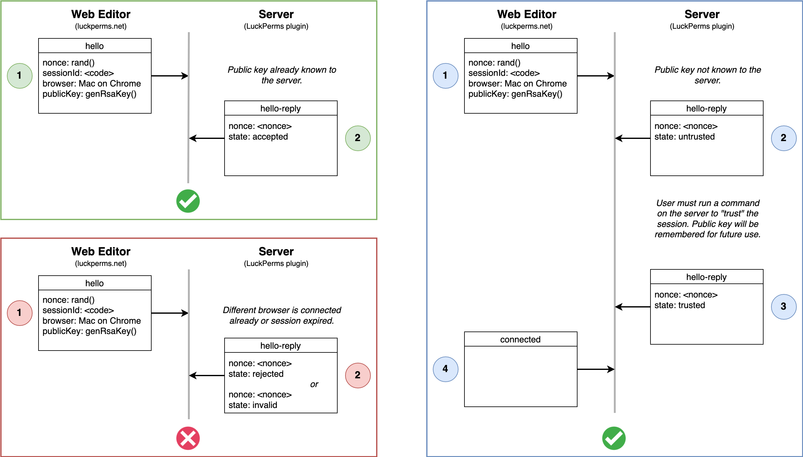
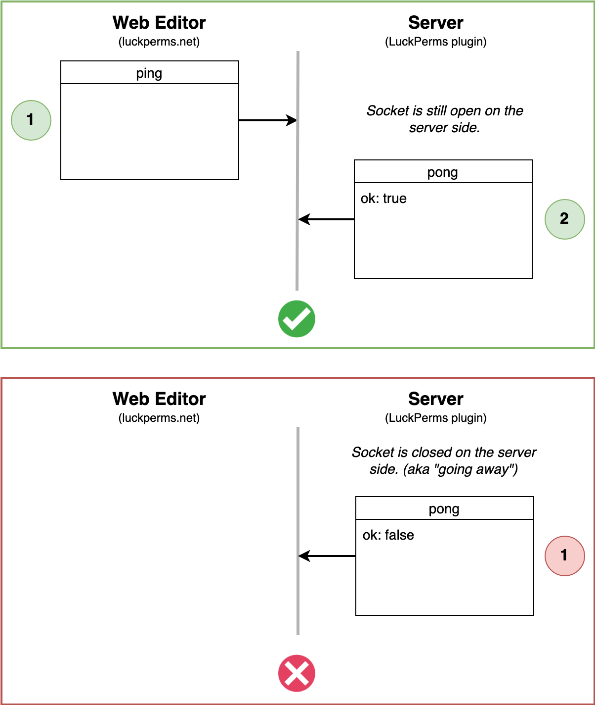
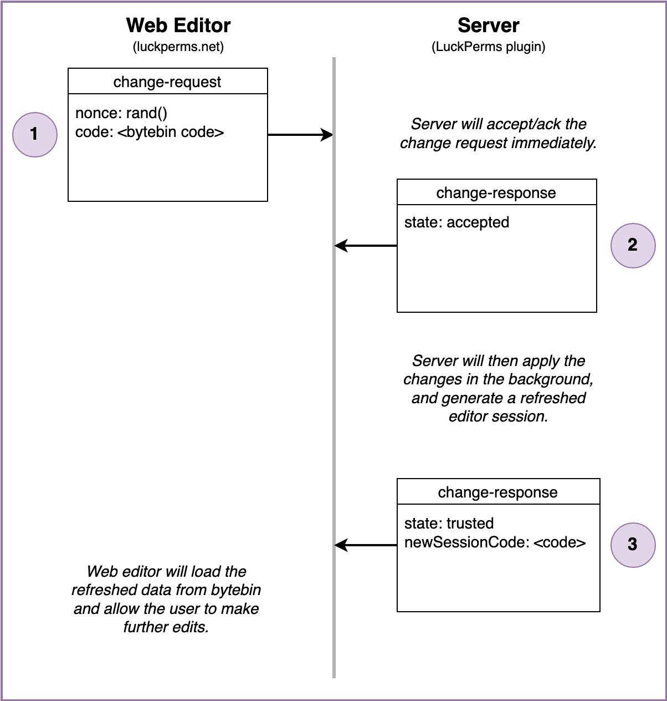

LuckPerms 网页编辑器是一个在浏览器中运行的专用应用，让服务器管理员可以通过易用的界面编辑权限。

面向用户的使用文档见[网页编辑器](web-editor.md)页面。本页主要介绍技术细节。

<a id="communicating-with-the-server"></a>
## 与服务器通信
网页编辑器应用统一托管在 luckperms.net 上，但需要能够与运行在用户服务器上的 LuckPerms 插件通信。

应用本身不保存状态，而是通过两个专用服务与服务器交换数据。

* [bytebin](https://github.com/lucko/bytebin) - 通过 HTTP GET/POST 请求交换数据载荷
* [bytesocks](https://github.com/lucko/bytesocks) - 通过 WebSocket 交换“实时”消息

LuckPerms 插件（运行在 Minecraft 服务器上）和 LuckPerms 网页编辑器（运行在浏览器中）都会与这些“中间”服务通信，并借助它们互相交换数据和指令。


<a id="websocket-protocol"></a>
## WebSocket 协议
服务器和网页编辑器都会连接到 bytesocks 服务（见上文）提供的一个 WebSocket“频道”，并在频道中互相交换安全的消息（经过密码学签名）。

有关安全性的更多细节，见引入此功能的[拉取请求](https://github.com/LuckPerms/LuckPerms/pull/3303)说明。

<a id="message-packet-format"></a>
### 消息（数据包）格式
WebSocket 消息使用可读的 JSON 格式。

```json
{
    "msg": "string",
    "signature": "string",
}
```

上面所示的外层消息“框架”包含两个字段。
* `msg` 字段以明文（未加密）形式包含经过 JSON 编码的数据包
* `signature` 字段包含根据消息生成的 SHA256withRSA 签名，并以 base64 编码。

<a id="connect"></a>
### 连接

创建初始会话时（用户在服务器上执行 `/lp editor` 命令），插件会为该会话创建一个新的 bytesocks 频道，并立即加入。bytesocks 频道的 ID 和插件公钥会包含在初始 bytebin 数据载荷中。bytebin 载荷 ID 会作为参数，包含在用户打开的 URL 中。

网页编辑器只会接受频道中使用插件或服务器公钥签名的消息。

连接流程从网页编辑器向频道发送 `hello` 消息开始（此时服务器应当已经连接，并在频道中“监听”）。

`hello` 消息包含：
* nonce - 用于标识会话的随机短字符串
* sessionId - 打开网页编辑器时使用的 bytebin ID
* browser - 对当前所用操作系统和浏览器的简短描述
* publicKey - 编辑器的公钥。服务器借此确认后续收到的编辑器消息未被篡改。

连接过程中，Minecraft 服务器（LuckPerms 插件）会确认以下条件至少满足其一：
* 之前的会话中已记录过该编辑器公钥
* 用户执行命令，明确信任该编辑器。此过程使用 nonce，确保在连接数 >1 时信任的是正确的编辑器！

服务器会返回 `hello-reply` 消息，将处理结果告知编辑器。

<p>
  
</p>

连接建立后，服务器只会接受使用该编辑器密钥签名的传入消息。

<a id="ping"></a>
### 心跳（Ping）

网页编辑器会定期发送 `ping` 消息；如果服务器仍在监听，就会回复 `pong`。

这有两个作用：
* 保持 WebSocket 频道活跃。有些中间 Web 代理会强制检查连接是否保持活跃，如果一段时间内没有发送消息，就会使 WebSocket 连接超时。
* 让网页编辑器知道服务器是否仍在监听，从而判断是否还能通过 WebSocket 发送更新。

<p>
  
</p>

服务器也会使用 `pong` 消息通知编辑器，它正在断开 WebSocket 连接。这可能由多种原因引起：
* Minecraft 服务器已停止
* 创建会话的用户已不再连接到服务器
* 超时
* 意外错误

<a id="request-changes"></a>
### 请求变更

用户在网页编辑器中点击“应用”按钮时，会触发此流程。

网页编辑器会将变更上传到 bytebin，并获取载荷 ID，然后通过 WebSocket 将载荷 ID 发送给服务器。

服务器应用变更后，会将刷新后的状态上传到 bytebin，再通过 WebSocket 将此载荷 ID 返回给网页编辑器。

<p>
  
</p>

