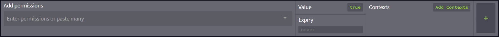
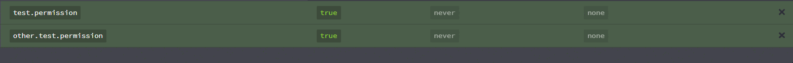
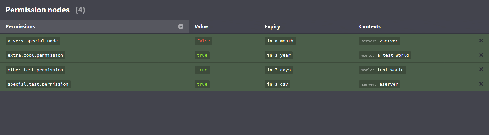
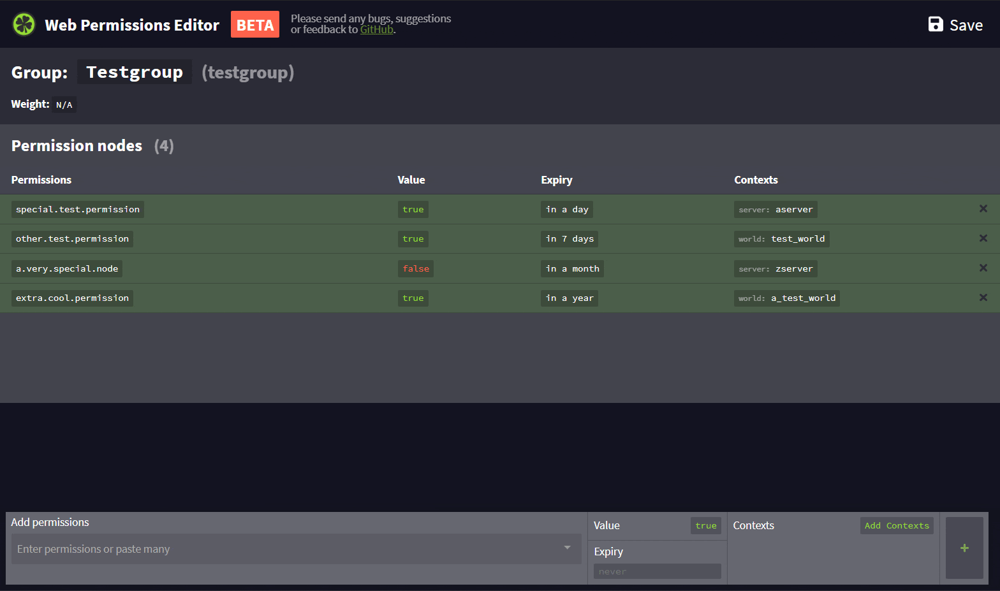
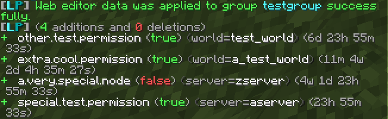

LuckPerms 提供网页编辑器，可以在浏览器中通过友好的界面修改权限数据。它安全、可靠，也容易使用。无需自行托管页面，而且适用于所有存储类型！

有关技术细节的更多信息，请参阅[技术说明页面](web-editor-technical-details.md)。

___

### 开始使用

首先，在服务器上执行命令以创建编辑器会话。
不同命令可以打开不同范围的会话：

| 范围                                           | 命令                                                |
|------------------------------------------------|-----------------------------------------------------|
| **所有权限组，以及在线或非默认用户：**         | `/lp editor` 或 `lp editor all`                     |
| **所有权限组：**                               | `/lp editor groups`                                 |
| **所有在线用户和非默认用户：**                 | `/lp editor users`                                  |
| **所有在线用户：**                             | `/lp editor online`                                 |
| **某个特定权限组：**                           | `/lp group <group> editor`                          |
| **某个特定用户：**                             | `/lp user <user> editor`                            |
| **仅拥有特定权限的用户：**                     | `/lp editor users <filter>` 或 `lp editor <filter>` |

> 如果要对 BungeeCord/Velocity 版 LP 执行命令，记得使用 `/lpb` 或 `/lpv`，而不是 `/lp`。

> 带用户权限筛选条件的命令只会将直接设置了与筛选条件匹配的权限的用户加载到编辑器中。

执行命令后，服务器会开始创建新会话。通常只需约一秒，具体取决于连接速度。

会话准备好后，你会收到一个链接。

要继续操作，点击该网址，然后按“**是**”。

默认浏览器随后会打开刚刚创建的编辑器会话。

___

### 使用编辑器

创建并打开会话后，就可以使用界面修改用户或权限组的数据。

### 编辑器中的上下文

除了在游戏内操作，也可以在编辑器中添加上下文。添加权限前点击“Add Contexts”（添加上下文）按钮，或直接在权限后面的 `key` 和 `value` 字段中填写合适的键和值，例如 `world` 和 `nether`，或 `server` 和 `hub`。

注意，一条权限记录同时只能有一个世界上下文和一个服务器上下文。要让同一权限在多个世界或服务器中生效，必须使用其他上下文再次设置这项权限。

#### 添加权限

要添加权限，在“Add Permission”（添加权限）输入框中输入要添加的节点，然后按回车。对于所有希望使用相同属性添加的权限，都可以重复此操作。  
输入时，编辑器会列出与当前输入匹配的建议项。可以用方向键或鼠标指针选择，再按回车或点击该项，将其加入输入框。
输入完权限后，点击“+”按钮添加。

可以一次添加多个权限！只需在输入框中输入或复制粘贴这些权限，再照常添加即可。

#### 编辑现有数据

要编辑表格中的任意值，点击它即可。

#### 数据排序

要更改排序设置，点击希望用于排序的列标题。

#### LuckPerms 节点

编辑器可以通过节点，为权限组和玩家添加或修改权重、父级等属性。

| 功能                                    | 节点                         |
| --------------------------------------- | ---------------------------- |
| **指定用户或权限组的父级：**            | `group.<parentgroup>`        |
| **设置权限组的显示名称：**             | `displayname.<name>`         |
| **设置权限组的权重：**                 | `weight.<weightnumber>`      |
| **添加前缀：**                         | `prefix.<priority>.<prefix>` |
| **添加后缀：**                         | `suffix.<priority>.<suffix>` |
| **添加元数据：**                       | `meta.<key>.<value>`         |

___

### 保存修改

完成数据修改后，需要将修改保存回服务器。

点击“Save”（保存）按钮，或使用 `CTRL + S` 快捷键保存。编辑器会生成一条命令，必须在游戏内或控制台中执行该命令，修改才会生效。点击这条命令即可将其复制到剪贴板。

执行命令时，会显示本次修改的摘要。

