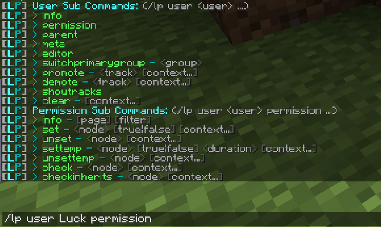
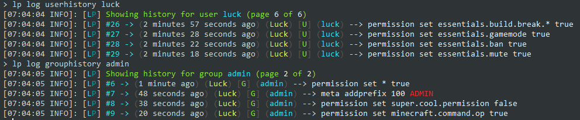

**你好！** 👋

欢迎了解 LuckPerms 项目，很高兴见到你！

本页旨在解答大家初次接触本项目时常有的一些疑问，并说明我们为什么建议你使用 LuckPerms。

先从几个常见问题说起。

___

#### 又一个权限插件？
是的。我们认为现有的权限插件仍有改进空间！

LuckPerms 的特点：

* **快速** - 编写时充分考虑了性能和可扩展性。
* **可靠** - 受到数以千计的服务器管理员，以及规模最大的群组服的信赖。
* **易用** - 可以用命令、直接编辑配置文件，或通过网页编辑器设置权限。
* **灵活** - 支持多种数据存储方式，并能在许多不同类型的服务端上运行。
* **设置丰富** - 提供大量自定义选项和设置，可按服务器需要调整。
* **免费** - 下载和使用均不收费，并采用宽松的许可证，让它能够一直保持免费。

#### 我已经用了 [x] 插件很多年，而且用得很好！为什么要费心更换？
大多数其他权限插件都已有多年历史，且越来越多的插件被原作者放弃，不再提供更新、支持或错误修复。LuckPerms 仍在积极维护，我们努力及时回应所有错误报告、问题和功能请求。

#### LuckPerms 看起来很庞大、很复杂，我只想要一个简单轻量的插件。
虽然插件有许多自定义选项，但默认值已经适合大多数用户。
LuckPerms 的游戏内界面和在线界面用起来都很直观，本 Wiki 还提供了大量资料和设置指南供你阅读！🎉

#### 我运营着大型群组服，很看重性能。LuckPerms 的性能如何？
插件在编写和持续改进时一直考虑着大型服务器的需求，已经证明了自身的速度和可靠性。目前，LuckPerms 运行在社区中的多个知名群组服上。

LuckPerms 在设计上几乎所有操作都会利用多线程。权限检查和元数据查询都有缓存，内部数据结构也经过设计，尽可能提高查询速度和效率。

___

本页接下来会介绍 LuckPerms 的一些实用功能，其中也许有你从未见过或尚不了解的功能！

### 网页编辑器
除了游戏内和控制台的命令界面，LuckPerms 还提供网页编辑器，可用于修改权限数据。

任何人都可以使用这个编辑器，开箱即用，无需额外设置！

编辑器非常容易上手。可以体验[演示会话](https://luckperms.net/editor/demo)，或查看编辑器的 [Wiki 页面](web-editor.md)。

___

### 详细权限检查日志
LuckPerms 提供[详细权限检查日志](verbose.md)系统，可以实时监控其他插件发起的权限检查。

你可以精确追踪权限检查的来源，甚至定位到触发检查的那一行代码！

详细权限检查记录可以在专用的网页应用中查看，便于分析和阅读。可以在[此处查看演示记录](https://luckperms.net/verbose/demo)。

___

### 权限树
LuckPerms 可以将服务器已知的所有权限[构建为“权限树”](general-commands.md#lp-tree-scope-player)。树中的数据来自插件向服务器注册的权限。

随着服务器上的插件不断检查权限，这些权限也会加入树中，使权限树不断增长。

权限树可以根据某个玩家是否拥有各项权限，用不同颜色标记。这样就能直观看出玩家拥有哪些权限。

权限树可以在专用的网页应用中查看，便于浏览和理解。可以在[此处查看演示权限树](https://luckperms.net/treeview)。

___

### 命令界面与 Tab 补全
命令系统很容易使用和理解。除了查阅[本 Wiki 中的文档](command-usage.md)，也可以在游戏内查看命令用法和命令列表。

所有 LuckPerms 命令都完整支持 Tab 补全，完成操作时可以少打很多字！

___

### 操作日志
LuckPerms 会详细记录所有修改。如果有管理人员试图违规给自己授予权限，无需翻查服务器日志文件，直接搜索他们执行的操作即可！

还可以查看特定用户、权限组或晋升路线的历史记录，或查看某个用户执行过的操作。

___

### 支持多个版本和平台
LuckPerms 的代码设计让我们能够方便地支持多种服务端类型和版本。

你随时都可以在[下载页面](https://luckperms.net/download)获取受支持平台的最新版本！
