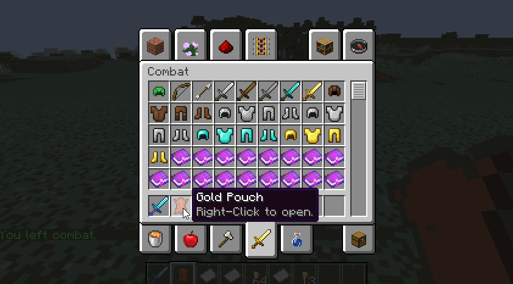

# MythicMobs {#🧌-mythicmobs}

我们的大多数生物功能和自定义滴都与MythicMobs相关，这是最好的生物创建插件。另外**最重要的功能之一**，为了通过MMOCore创建你自己的技能，你将利用MythicMobs来制作你想要的任何技能。更多信息[此处](../skills/intro.md#custom-skills)。

MythicMobs还为任务系统添加了更多选项：你可以设置任务，其中玩家必须杀死MythicMobs中的 X 个小怪，更多信息[此处](../features/quests.md)。

击杀 MythicMobs 的生物时，玩家也可以获得主职业经验，详见[此页](../profession/intro.md)。

## MythicMobs下降物品 {#mythicmobs-drop-items}

MMOCore在MythicMobs掉落表中添加了新的掉落物品类型，列表如下：

|掉落物品|用途 |描述 |
| --- | --- | --- |
| 金袋 | `gold_pouch{min=10;max=100}` | 金袋内含 MIN 和 MAX 之间随机数量的 $$ |
| 金币 | `gold_coin{}` | 掉落一枚价值 $1的金币 |
| 注意 | `note{minw=20;maxw=30}` | 掉落具有随机值的音符。 |

## 金袋 {#gold-pouches}

金袋是皮革件，你可以右键单击以打开2行GUI，其中包含随机生成的金币和纸币。玩家不能在那里放置任何物品，如果他们的物品栏中还有一些空间，他们只能从中取出物品。袋子**在完全清空后从玩家物品栏** 上取下。

---

原文：[🧌 MythicMobs](https://docs.phoenixdevt.fr/mmocore/compatibility/mythic) · 原文归档：2026-10-19
