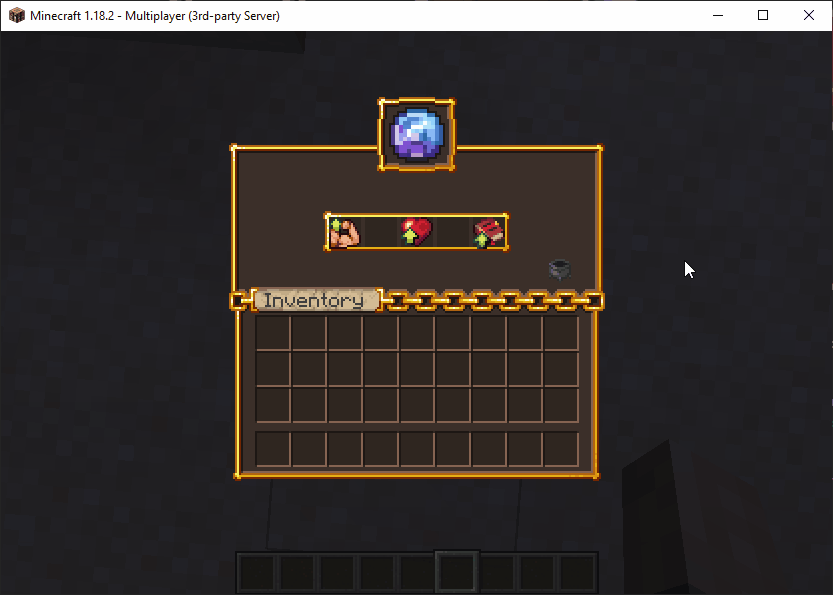

# 资源包插件 {#💎-resource-pack-plugins}

通过资源包插件，我们指的是自动为你的服务器创建和部署资源包的插件，最流行的是：

- [ItemsAdder](https://www.spigotmc.org/resources/%E2%9C%A8itemsadder%E2%AD%90emotes-mobs-items-armors-hud-gui-emojis-blocks-wings-hats-liquids.73355/)
- [Nexo](https://polymart.org/product/6901/nexo)
- [Oraxen](https://www.spigotmc.org/resources/%E2%98%84%EF%B8%8F-oraxen-custom-items-blocks-emotes-furniture-resourcepack-and-gui-1-18-1-21-8.72448/)

只需很少的努力，你就可以使用这些插件之一将自定义 UI 纹理应用到MMOCore中的任何物品栏。事实上，你不需要任何这些插件来为MMOCore提供自定义 UI 纹理，但使用其中一个会更容易一些。

## 自定义GUI纹理 {#custom-gui-textures}

以下示例使用Oraxen将自定义纹理应用到 [基础属性](../features/attributes.md)GUI。以下语法片段将在`gui/attribute-view.yml`配置文件中使用。

```yml
# GUI display name
name: '&f%oraxen_shift_16%%oraxen_shift_2%%oraxen_mmocore_attr%'

#.......
```

`%oraxen_<glyph_id>%`占位符具有将默认GUI纹理与新配置的字形纹理重叠的效果。使用`shift`占位符你还可以纠正单独使用字形占位符时可能出现的小水平偏移（尝试一下并查看）​​。



---

原文：[💎 Resource Pack Plugins](https://docs.phoenixdevt.fr/mmocore/compatibility/rp-plugins) · 原文归档：2026-10-19
