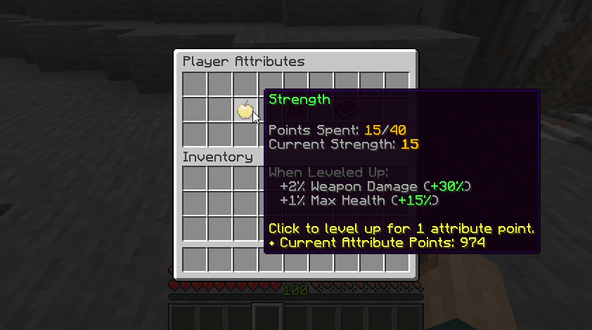
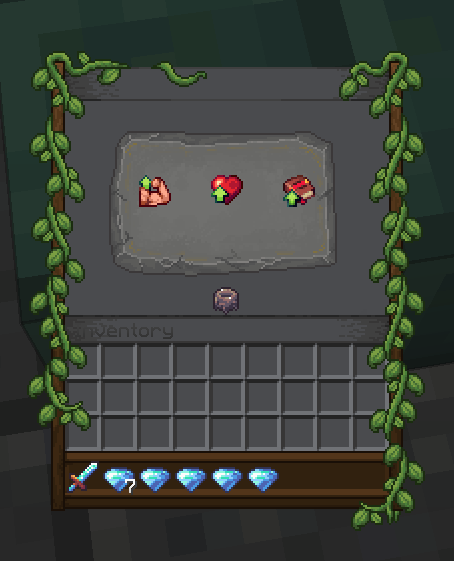

# 基础属性 {#💪-attributes}

基础属性是超级经典的RPG“属性”，其中玩家可以与等级一起解锁新的福利。这些福利包括额外的属性（最大生命值、伤害、冷却时间减少...）以及使用某些物品的能力。这个非常经典的RPG功能为你的服务器添加了更多理论制作材料。



MMOCore的基础属性与 **MMOItems** 完全集成，允许你为物品设置**基础属性要求**。这意味着你可以配置 MMOItem，以便玩家仅在特定MMOCore基础属性中至少具有一定数量的点时才能装备或使用它。例如，你可以制作一把传奇剑，需要 **15力量** 才能使用，或者神秘法杖需要 **20智力** 才能使用。这创建了一个自然的进展系统，其中玩家需要投资正确的基础属性来解锁更强大的装备。

**基础属性还可以授予完全自定义的特权** - 例如，他们可以在升级时运行命令、发送消息或解锁技能。使用 PAPI占位符你还可以获得玩家的基础属性的当前值，并在任何需要的自定义条件中使用这些值（MythicMobs技能、MythicLibs 脚本......）。

## 基础属性菜单 {#attribute-menu}

使用`/attributes`打开基础属性菜单。玩家可以查看其属性的当前值，将积分花费到基础属性的等级上，或重新分配其基础属性点（也称为 *respec*）。

需要一个 *基础属性点* 到等级最多一次基础属性。

要重新分配你的基础属性点，请单击*重新分配技能积分*按钮。需要一个 *基础属性重新分配点*，你可以使用 [管理命令](../general/commands.md)] 将其提供给玩家。

<details markdown="1">

<summary>菜单的其他外观</summary>

查看 [此 wiki 页面](../compatibility/rp-plugins.md)以了解自定义GUI纹理。这是相同GUI的更好看的版本。


这是使用另一种自定义纹理的相同GUI的另一种外观。



</details>

## 默认基础属性& 想法 {#default-attributes-ideas}

本节介绍默认MMOCore基础属性配置文件中提供的基础属性。我们鼓励你根据自己的喜好编辑和平衡它们，因为这应该作为你的参考/灵感。默认的MMOCore基础属性分别是力量、敏捷和智力，灵感来自游戏*流放之路*。

- **力量**基础属性旨在由战士、坦克、圣骑士升级，因为它提供额外的 **武器伤害** 和 **最大生命值** 额外的坦克性和生存能力。
- 战士、盗贼或射手可能会专注于升级来提高他们的**敏捷度**，因为它会提高他们的移动速度（要么为盗贼或射手等较轻的职业逃跑，要么为战士奔跑）、射手的**射弹伤害**以及他们的**物理伤害**（物理技能和武器）。
- **智力**主要针对法师、法师，因为它会增加魔法技能造成的伤害。它还减少了技能的冷却时间，这可以证明在该基础属性上花费一些点是合理的，即使对于面向非技能的职业也是如此。

作为参考，*上古卷轴 Online* 有三个“基础属性”，分别是 *生命值*、*耐力* 和 *Magicka*。生命值增加最大生命值，耐力增加最大耐力（用于施放以耐力为资源的技能），而 Magicka 相当于魔力（用于施放以魔法为资源的技能）。根据所选的职业，你需要关注生命值（坦克职业或猛男战士，重型护甲）、耐力（中/轻型护甲、DPS职业）和 Magicka（DPS职业，中/轻度护甲，爆发魔法伤害）。

## 默认配置文件 {#default-config-file}

默认配置文件名为`default_attributes.yml`，位于文件夹`MMOCore/attributes`中。你可以在主基础属性文件夹中添加任意数量的YAML配置文件和子文件夹，以实现干净的文件组织。

```yml
# Attribute ID
strength:

  name: Strength

  # Maximum amount of points players 
  # may spend in this attribute.
  max-points: 40

  # Buffs given every 1 attribute point spent
  # in this specific attribute.
  buff:
    weapon_damage: 2
    max_health: 1%

dexterity:
  name: Dexterity
  max-points: 40
  buff:
    physical_damage: 1.5
    projectile_damage: 1
    attack_speed: 0.5%

intelligence:
  name: Intelligence
  max-points: 40
  buff:
    magical_damage: 2
    cooldown_reduction: 1
```

每个配置部分对应一个玩家基础属性。请记住，你可以添加任意数量的内容（每个基础属性一个配置部分），并且你也可以删除默认的部分。

你需要指定基础属性名称，该名称将用于在 GUI 内显示基础属性、你可以在该特定基础属性中花费的最大金额 **基础属性点** 以及基础属性给出的属性增益效果。这些增益效果对应于 **在该基础属性中花费的每个基础属性点给予玩家的属性。**

## **虚拟基础属性（不保存到玩家数据）** {#virtual-attributes-that-don-t-save-to-player-data}

基础属性还有最后一个用例。你可能想要创建基础属性来重现1-to-1现有的属性。在以下示例中，每个 *生命值*基础属性点授予1%或最大生命值提供给玩家。如果你不希望基础属性通过玩家升级而仅使用属性增益效果功能，则可以关闭`save-to-player-data`选项。这纯粹是可选的，可以减少数据库混乱。

```yml
health:
  name: Health
  save-to-player-data: false
  # (Not needed) max-points: 40
  buff:
    max_health: 1%
```

## **禁用基础属性** {#disabling-attributes}

如果你不打算使用MMOCore基础属性系统，你可以禁用它，而且非常简单。

- 清空`MMOCore/attributes`文件夹（不要删除，否则会重新生成）
- 注释掉/删除`commands.yml`文件内的`/attributes`命令

## 编辑基础属性GUI {#editing-the-attributes-gui}

`/attributes`文件夹用于定义基础属性及其增益效果。但是，你还需要编辑`/gui/attribute-view.yml`配置文件，以确保玩家可以看到你在之前的配置文件中定义的基础属性并与之交互。

> **提示**
>
> 我们建议在阅读本节其余部分时使用侧面的文本编辑器打开此文件。

首先，请参考这个[wiki页面](../../mythiclib/misc/ui-syntax.md)来了解一般的MMOCoreUI语法。

在`items`配置部分下，每个基础属性应该有一个配置部分。默认情况下，它们的名称分别为`dex`、`str`和`int`，分别代表*敏捷*、*力量*和*智力*。每个都对应于GUI内的可点击物品，如上面的 GIF 所示。

### 添加新的基础属性 {#adding-a-new-attribute}

要添加新的基础属性：

1. 如前面部分所述，在`/attributes`文件夹内的配置文件中添加新的配置部分，
2. 在`attribute-view.yml`GUI配置中添加新的配置部分，并确保将物品函数设置为`attribute_<attribute_id>`（例如，`attribute_vigour`对于 ID 为`vigour`的基础属性），以便MMOCore可以应用正确的占位符中的物品描述并使物品在单击时行为正确。

> **警告**
>
> 如果你忘记了第二步，你的基础属性将存在，但玩家将无法在基础属性菜单中看到或与其交互。

### 将增益效果添加到基础属性 {#adding-a-buff-to-an-attribute}

要将增益效果添加到现有的基础属性中：

1. 将增益效果添加到`/attributes`文件夹中的基础属性config 部分，
2. （可选）更新`attribute-view.yml`文件中与基础属性对应的物品的描述以显示新的增益效果。如果你不这样做，玩家将获得增益效果但不会意识到这一点。你可以以某种方式将其显示在其他地方，但大多数用户希望将其显示在此处。

### 描述占位符的常见问题 {#common-issue-with-lore-placeholders}

描述占位符`{buff_xxx}`和`{total_xxx}`仅为基础属性提供的属性集合定义。如果这些占位符似乎无法正确解析，请仔细检查你的基础属性是否为该属性提供了增益效果。

例如，以下配置匹配：

<details markdown="1">

<summary>示例1</summary>

```yml
# attributes/default_attributes.yml
intelligence:
  #...
  buff:
    magical_damage: 2
    cooldown_reduction: 1
```

```yml
# gui/attribute-view.yml
items:
  #...
  int:
    #...
    lore:
    ...
    - '&8When Leveled Up:'
    - '&7  +{buff_magic_damage}% Magic Damage (&a+{total_magic_damage}%&7)'
    - '&7  +{buff_cooldown_reduction}% Cooldown Reduction (&a+{total_cooldown_reduction}%&7)'
```

</details>

但这两者不匹配，在`attributes.yml`配置中注册了射弹伤害增益效果，但没有将其添加到物品描述中，因此玩家无法知道该基础属性会授予额外的射弹伤害。插件不会失败，但是玩家会混乱。

<details markdown="1">

<summary>示例2</summary>

```yml
# attributes/default_attributes.yml
dexterity:
  # [...]
  buff:
    physical_damage: 1.5
    projectile_damage: 1
    attack_speed: 0.5%
```

```yml
# gui/attribute-view.yml
items:
  # [...]
  int:
    # [...]
    lore:
    ...
    - '&8When Leveled Up:'
    - '&7  +{buff_physical_damage}% Physical Damage (&a+{total_physical_damage}%&7)'
    - '&7  +{buff_attack_speed} Attack Speed (&a+{total_attack_speed}&7)'
```

</details>

这两个也不匹配。`{buff_projectile_damage}`占位符不存在，因为射弹伤害未从 *Dexterity*基础属性定义为增益效果。该插件在解析占位符时将失败。

<details markdown="1">

<summary>示例3</summary>

```yml
# attributes/default_attributes.yml
dexterity:
  #...
  buff:
    physical_damage: 1.5
    attack_speed: 0.5%
```

```yml
# gui/attribute-view.yml
items:
  #...
  int:
    #...
    lore:
      #...
      - '&8When Leveled Up:'
      - '&7  +{buff_physical_damage}% Physical Damage (&a+{total_physical_damage}%&7)'
      - '&7  +{buff_projectile_damage}% Projectile Damage (&a+{total_projectile_damage}%&7)'
      - '&7  +{buff_attack_speed} Attack Speed (&a+{total_attack_speed}&7)'
```

</details>

---

原文：[💪 Attributes](https://docs.phoenixdevt.fr/mmocore/features/attributes) · 原文归档：2026-10-19
