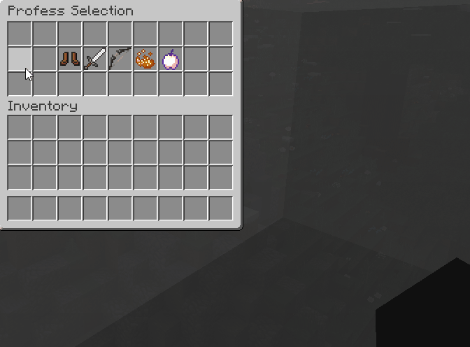

# 职业 {#🧙‍♂️-classes}

自定义职业系统是 MMOCore 应玩家需求加入的主要功能之一。这里介绍职业的主要功能及配置方法。

职业系统的目标是让服主自行创建外观和功能都符合需求的职业，并继续完善其他同类插件停止维护后留下的功能。

## 选择职业 {#choosing-a-class}

使用`/class`命令打开职业选择菜单。



## 职业点数 {#class-points}

选择新职业或切换职业需要一个技能点，可以通过管理员命令获得。服主可以自行决定何时发放职业点数，例如玩家升级时，或使用绑定了命令的特殊物品时。

```
/mmocore admin class-points <player> 10
```


## 默认职业 {#default-class}

玩家首次登录时，默认使用临时的 *Human* 职业。这个职业可以获取经验并升级，但没有技能，属性也较低，因此只适合作为过渡。获得第一个职业点数后，就应该切换到其他职业。默认提供 Mage、Marksman、Paladin、Rogue 和 Warrior。

如果不打算使用 MMOCore 的职业系统，可以删除 *Human* 以外的所有职业。MMOCore 至少需要保留一个职业；只剩一个职业时，玩家就无法切换职业。

## 职业配置概述 {#class-configuration-overview}

每个职业使用独立的配置文件。可以创建任意数量的职业，也可以修改或删除默认职业，但至少要保留一个。创建新职业时，复制默认配置的格式，再按自己的设想修改即可。

> **提示**
>
> 创建新职业时，可以复制 *Mage* 的职业配置文件。这个模板比较简单，而且大多数功能都已明确写在配置中，适合作为起点。

接下来介绍职业配置。选一个职业配置文件并打开，对照下文查看各项设置。

## 显示选项 {#display-options}

打开职业配置文件后，首先会看到显示选项，用于设置该职业在职业菜单中的外观。

```yml
display:
  name: 'Mage'
  lore:
    - 'The Mage has mastered the power of the'
    - 'Arcanes, taking down any enemy on his path'
    - 'using powerful magic & ranged abilities.'
  attribute-lore:
    - '&a+ &7Mana Regeneration'
    - '&a+ &7Health Regeneration'
    - '&a+ &7Max Mana'
    - '&c- &7Max Health'
    - ''
    - '&8&lStrength'
    - '&7  Attack Damage: &c1 &7(+&c0&7)'
    - '&7  Attack Speed: &c4 &7(+&c0&7)'
    - '&7  Max Health: &c18 &7(+&c0&7)'
    - ''
    - '&8&lDexterity'
    - '&7  Knockback Resistance: &a0% &7(+&a0%&7)'
    - '&7  Movement Speed: &a20 &7(+&a0&7)'
    - '&7  Speed Malus Reduction: &a0% &7(+&a0%&7)'
    - ''
    - '&8&lIntellect'
    - '&7  Max Mana: &927 &7(+&91.2&7)'
    - '&7  Health Regen: &90.13 &7(+&90&7)'
    - '&7  Mana Regen: &90.2 &7(+&90.04&7)'
  item: BLAZE_POWDER:10 #10 is the custom model data
```

`name` 是职业名称，用于占位符和信息界面。`lore` 与 `attribute-lore` 是玩家通过 /class 选择职业时显示的职业描述。

> **警告**
>
> 修改职业描述**不会**修改实际属性，这些设置只影响显示内容！

`item` 是同一界面中显示的图标。可以使用自定义模型数据修改职业图标，格式如下：

```yml
display:
  ...

  # Format: <material>:<custom-model-data>
  item: 'BLAZE_POWDER:1'
```

以下写法也有效。

```yml
display:
  item:
    # More icon options
    item: BLAZE_POWDER
    custom-model-data: 10
    custom-model-data-string: 'whatever'
    item-model: 'minecraft:dirt'
    texture: 'base64skulltexture' # Requires 'item' to be 'PLAYER_HEAD'
```

## 最高等级 {#maximum-level}

此选项设置该职业能达到的最高等级。达到上限后，玩家无法继续升级。

```yml
# Players cannot go higher than Lvl 100
max-level: 100
```

## 经验曲线 {#experience-curve}

经验曲线决定该职业每次升级需要多少经验。配置方法见[此页](../level/curves.md)。

每个职业只能使用一条经验曲线。职业配置中的 `exp-curve` 必须与一条现有经验曲线的 ID 一致。

```yml
# Must match an existing exp curve filename from the 'exp-curves' folder
exp-curve: levels
```

## 经验表 {#experience-tables}

经验表定义玩家主职业升级时发生的事情：获得属性、技能点、基础属性点或技能树点数，还是解锁新技能、新传送点？

> **提示**
>
> [经验曲线](classes.md#experience-curve)决定**何时升级**，经验表决定**升级后发生什么**。

与副职业相同，每个职业只能使用一张经验表。`exp-table` 必须与一张现有经验表的 ID 一致。配置方法见[此页](../level/tables.md)。

```yml
# MMOCore/class/mage.yml

# The class exp table
exp-table: class_exp_table
```

## 附加选项 {#additional-options}

以下职业选项用途各不相同，但都很重要。

```yml
options:
  default: false
  display: true
  off-combat-health-regen: false
  off-combat-mana-regen: false
  off-combat-stamina-regen: false
  off-combat-stellium-regen: false
```

|选项 |描述 |默认 |
| --- | --- | --- |
| default | 新玩家初始使用的职业 | false |
| display | 是否在 /class 中显示此职业 | true |
| off-combat--regen | 是否仅在脱离战斗时恢复资源值 | false |
| needs-permission | 解锁此职业需要 `mmocore.class.<class_id>` 权限 | false |

## 职业属性 {#class-stats}

职业属性是玩家升级时获得的属性，是 RPG 服务器的主要功能之一。

```yml
stats:
  max-health:
    base: 18
    per-level: 0
  max-mana:
    base: 27
    per-level: 1.2
  mana-regeneration:
    base: .2
    per-level: .04
  health-regeneration:
    base: 0.13
    per-level: 0
  ...
```

各项属性会随职业等级变化。根据玩家等级，属性的计算公式如下：

```
stat_value = base + player_level * per_level
```

> **信息**
>
> 如果职业配置中没有指定数值，MMOCore 会先使用 `MMOCore/stats.yml` 中的值，再使用 `MythicLib/stats.yml` 中的值。

还可以设置最小值和最大值，限制过强的属性。

```yml
stats:
  max-health:
    base: 18
    per-level: 3
    max: 80 # Cannot go above 80 max health
    min: 20 # Cannot go under 20 max health
```

除了上面的线性公式，还可以按以下语法使用复杂数学公式。支持 PlaceholderAPI 和 `{level}` 占位符。

```yml
stats:
  max-health: 'min(100, 19 + {level} * {level})'
```

以下写法也有效。

```yml
stats:
  max-health:
    formula: 'min(100, 19 + {level} * {level})'
    papi: false # Disable PAPI placeholder checks
    failsafe: 20 # In case the formula goes wrong, fallback to 20
```

## 魔力显示选项 {#mana-display-options}

每个职业都可以使用不同的魔力条，例如法师显示魔力、战士显示怒气。`char` 是聊天消息中用来组成魔力条的字符，`color` 配置节设置魔力条的颜色，`icon` 则是动作栏上显示的魔力图标。

```yml
mana:
  char: '♦'
  icon: '&c♦'
  color:
    full: DARK_RED
    half: RED
    empty: WHITE
  name: 'Rage'
```

## 进阶职业 {#subclasses}

进阶职业只有在玩家达到指定等级后才可选择，可以为现有职业增加不同的发展路线和玩法。

```yml
subclasses:
  ARCANE_MAGE: 10
```

只需填写职业 ID 和进阶职业的解锁等级。玩家有可选的进阶职业时，执行 `/classes` 会打开略有不同的菜单。除此之外，进阶职业的显示、基础属性和技能等配置方式都相同。需要为进阶职业单独创建配置文件，再将其引用填入 `subclasses` 配置节。

如果希望玩家必须先提升前置职业或进阶职业的等级，才可选择后续进阶职业，可以使用上面的 `display: false` 选项，避免它直接出现在 `/classes` 的职业列表中。

## 技能 {#skills}

每个职业有各自的技能，详见[此页](../skills/config.md)。

## 技能槽位 {#skill-slots}

每个职业有各自的技能槽位，详见[此页](../skills/binding.md#skill-slots)。

## 为职业关联技能树 {#linking-a-skill-tree-to-a-class}

玩家可使用哪些[技能树](skill-trees.md)，取决于当前职业。按以下语法即可为职业关联技能树：

```yml
# Skill trees of the Mage class
skill-trees:
  - 'general'
  - 'mage-arcane-mage'
```

## 施放模式粒子 {#casting-mode-particles}

此选项设置玩家处于[施法模式](../skills/casting.md)时显示的粒子。目前无法修改粒子轨迹，即围绕玩家旋转的螺旋形状；只能更换用于绘制轨迹的粒子。

```yml
cast-particle:
  particle: SPELL_INSTANT
```

部分粒子需要指定颜色，例如 Minecraft 1.21 中名为 `DUST` 的红石粒子。可以按以下格式设置颜色。

```yml
cast-particle:
  particle: REDSTONE
  color:
    red: 255
    green: 100
    blue: 0
```

部分粒子需要指定方块，例如 1.21 中的 `BLOCK`、`FALLING_DUST` 和 `DUST_PILLAR`。格式如下：

```yml
cast-particle:
  particle: BLOCK_BREAK
  material: DIRT
```

> **提示**
>
> 删除或注释 `cast-particle` 配置节，可以关闭施法模式粒子。

## 职业脚本 {#class-scripts}

可以为使用特定职业的玩家定义脚本，用于实现复杂的自定义技能行为、职业被动技能或其他功能。

与技能相同，职业脚本也有关联的触发器，决定脚本何时运行。可用触发器类型见[此页](../../mythiclib/skills/triggers.md)；MMOLib 自定义脚本的编写方法见[此页](../../mythiclib/scripts/intro.md)。

下面是 *Warrior* 职业的脚本示例：将造成的物理伤害的 10% 转为怒气点，每次最多转化 10 点怒气。

```yml
scripts:
  ATTACK:
    conditions:
      - 'has_damage_type{types=PHYSICAL}'
    mechanics:
     - 'mana{amount="min(10, 0.1 * <attack.damage>)"}'
  DAMAGED: {...}
```

如果名为 `some_script_id` 的脚本已在其他位置定义，也可以使用以下格式。

```yml
scripts:
  ATTACK: some_script_id
```

## 关闭 MMOCore 职业系统 {#disabling-mmocore-classes}

如果想在 MMOCore 中完全关闭职业、升级，或同时关闭两者，可以按以下方式设置：

- 清空 `/class` 文件夹中的内容，但保留文件夹本身，否则它会自动重新生成。这样会同时关闭职业和升级功能。
- 在`commands.yml`配置文件中，删除`/class`和`/skills`命令。
- 编辑`/gui/player-stats.yml`UI，使其不再显示职业信息。

如果你想保留职业但禁用升级，请从`/class`和/或`/profession`文件夹中删除对经验表的所有引用。职业和/或副职业将被粘到等级1。不要忘记还编辑`/gui/player-stats.yml`UI，以便它不再显示有关升级的信息。

---

原文：[🧙‍♂️ Classes](https://docs.phoenixdevt.fr/mmocore/features/classes) · 原文归档：2026-10-19
