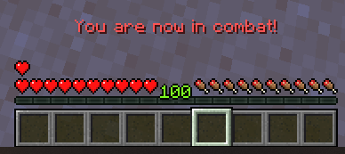

# 战斗 {#⚔️-combat}

## 战斗记录 {#combat-logging}

战斗记录是一项有用的功能，可以让玩家知道他们何时进入或退出战斗。战斗日志通过聊天消息处理。它本身是一个非常简单的功能，但**它与技能** 等其他机制紧密结合。



例如，built-inMMOCore技能可以使玩家在进入战斗时造成更高的近战伤害。使用`%mmocore_since_enter_combat%`占位符，你还可以想象技能根据玩家的战斗时间来增加造成的伤害。

## 资源再生 {#resource-regeneration}

战斗日志还规定了玩家何时应该能够重新生成其[资源](../misc/resources.md)（生命值、魔力和耐力）。

例如，可以让*战士*职业按固定数值恢复生命值，并在**脱离战斗时**，每秒额外恢复相当于已损失生命值 10% 的生命值。此功能适用于任意职业和资源；可以关闭脱战限制，让百分比随玩家等级变化，也可以让恢复量根据玩家**已损失的**生命值计算。

## 占位符 {#placeholders}

MMOCore具有多个 [PlaceholderAPI占位符](../general/placeholders.md#combat)，你可以使用它们来检查玩家是否处于战斗中，在 [PvP模式](combat.md#pvp-mode)，自上次击中以来的时间，到目前为止的战斗时间...

## 友军火力 {#friendly-fire}

每个人都知道友军火力的概念：通过攻击意外或故意伤害盟友的能力。在MMOCore中，这个概念扩展到所有玩家交互，而不仅仅是破坏技能。

这些规则被称为“交互规则”。它们定义了玩家何时以及如何与另一个玩家“交互”，无论是通过技能还是武器攻击。例如，你可能希望阻止玩家对同一公会、派系或队伍的成员使用伤害性的技能，同时仍允许他们互相施放治疗或增强技能。简单地禁用所有技能是行不通的，因为支持技能也很重要。

> **提示**
>
> 简而言之，MMOCore中的交互规则为任何技能或攻击、进攻或支持定义了“友军火力”。

### 配置 {#configuration}

让我们观察以下配置语法片段，你可以在`MythicLib/config.yml`的底部找到它。

```yml
interaction_rules:

  # When enabled, apply PvP interaction rules for skills, melee attacks,
  # projectile hits, MythicMobs mob/skill damage.....
  # This option is voluntarily disabled by default to reduce confusion.
  enabled: true

  # When disabled, support-based skills (buffs or heals)
  # may only be applied onto players.
  support_skills_on_mobs: true

  # Interaction rules
  #
  # {world_pvp} returns true if PvP is enabled world-wide, either using
  # the 1.21.9+ gamerule or server setting on older versions
  # {flag_pvp} returns true if the WorldGuard/Residence Pvp flag is
  # allowed. You can write custom formulas and use !, && or ||
  rules:

    # Ability to heal self/other players
    support:
      self: true

      party_member: true
      guild_ally: true
      guild_enemy: '!{world_pvp}'

      party_other: '!{world_pvp}'
      guild_neutral: true

    # Friendly fire for guilds/parties
    offense:
      self: false

      party_member: false
      guild_ally: false
      guild_enemy: '{world_pvp}'

      guild_neutral: true
      party_other: true
```

将`enabled`设置为`true`以启用PvE/PvP交互检查。最重要的配置部分是`rules.offense`和`rules.support`。以下是一些示例：

- 将`offense.party_member`设置为`false`会禁用同一队伍内玩家的友军火力
- 将`offense.guild_enemy`设置为`true`可以让敌方公会的玩家互相战斗。该选项应该留给`true`，因为在敌方公会之间禁用PvP是没有意义的。
- 将`offense.self`设置为`false`可防止玩家对自身施放伤害性的技能。

请注意，MythicLib考虑了适用于玩家的第一个/最上面的规则。换句话说，配置中首先出现的规则具有更高的优先级。让我们看一个例子来理解这个优先级特性：

- 你已经安装了公会和队伍插件。
- 玩家A 属于公会 A，没有队伍。
- 玩家B 属于公会 B，没有队伍。

玩家尝试对玩家B 造成伤害。公会插件将标记玩家与`guild_ally`的关系，因为它们在同一个公会中。队伍插件将用关系`party_other`标记它们，因为两个玩家不在同一个队伍中。在上面的配置中，`guild_ally`首先出现，在`party_other`前面，因此`guild_ally`优先：结果是`false`且玩家A 不允许损坏玩家B。

### 占位符 {#placeholders-1}

除了使用true或false之外，你还可以使用占位符。 PAPI占位符受支持，并将针对执行初始交互的玩家进行解析（玩家对目标造成伤害，或者玩家尝试投射支持技能）。  如果WorldGuard允许PvP，则`{flag_pvp}`返回`true`。  如果世界PvP已启用，`{world_pvp}`返回`true`

> **信息**
>
> 世界PvP由1.21.9+ 中的`pvp`游戏规则定义。在旧版本的Bukkit中，它是`settings.yml`下的服务器范围选项。

### PvE {#pve}

这些规则仅适用于PvP。默认情况下，MythicLib不会阻止对小怪使用攻击技能。

`support_skills_on_mobs`选项决定是否允许玩家对怪物施放支持技能/治疗/增益。

### 支持的插件 {#supported-plugins}

要应用这些友方火力检查，MythicLib需要与你的公会/队伍插件进行通信。支持的队伍插件列表可以在 [此处](parties.md)] 找到。支持的公会、派系、氏族、王国...插件的列表可以在[此处](guilds.md)] 找到。

### 这些规则适用于哪里？ {#where-do-these-rules-apply}

这些规则适用于：

- 所有PvP/PvE近战攻击，
- 原版射弹造成的伤害，
- 所有由MythicMobs定制技能造成的技能伤害，
- [built-inMythicLib技能](../../mythiclib/skills/builtin.md)... 造成的伤害或增益 ...

### 内部MythicMobs技能 {#inside-mythicmobs-skills}

你可以使用`mmoCanTarget`条件从 MythicMob 自定义技能内部检查玩家是否可以与给定实体交互。请参阅[此维基页面](../../mythiclib/skills/custom/mythic.md#checking-if-the-skill-caster-can-target-another-entity)了解更多信息。

这种情况有一个非常有趣的副作用。如果没有这个条件，攻击性射弹就会停止在目标实体上，即使该实体无法被损坏。`damage`机械师调用了Bukkit伤害事件，然后MMOCore取消了该事件，因为它注意到两个玩家在同一政党/公会中......

然后，不会造成任何伤害，但MythicMobs仍然会杀死射弹。如果使用`mmoCanTarget`条件，技能将提前检查该实体是否可损坏，并且该实体将被射弹忽略。

## PvP模式 {#pvp-mode}

此功能是专门为以PvE为主的服务器而设计的，这些服务器仍希望为玩家留下一些选择余地。在默认情况下禁用PvP的特定WorldGuard区域中，玩家可以使用`/pvpmode`来切换PvP并与其他玩家战斗！ **只有启用了PvP的玩家才能互相战斗和攻击。**此外，该功能完全兼容上面定义的PvP交互规则。

这适用于RPG甚至副职业/job-oriented生存服务器。

> **警告**
>
>PvP模式仅适用于WorldGuard！它无法与其他标志插件（例如 Residence）一起使用。

### 如何设置PvP模式 {#how-to-setup-pvp-mode}

- 首先设置PvP交互规则，如上所述
- 选择现有/创建新的WorldGuard区域
- 切换 **ON** 服务器PvP、世界PvP以及PvP标志
- 打开`pvp-mode`WorldGuard标志。默认情况下它是关闭的

现在就可以出发了！当`pvp-mode`标志打开时，玩家可以访问`/pvpmode`命令，而MMOCore将处理其余的事情。

### 配置 {#configuration-1}

为了防止滥用，你可以配置PvP模式，使玩家在战斗时无法退出。此外，你可以为该命令设置冷却时间。

以下代码片段位于MMOCore配置`config.yml`中。

```yml
pvp_mode:

  # Requires /reload when changed
  enabled: false

  # Minimum level in order to fight other players.
  # Set to 0 to fully disable
  min_level: 0

  # Maximum level difference in order to fight other players.
  # Set to 0 to fully disable
  max_level_difference: 10

  # Delay after any attack during which the player will stay in PvP Mode (seconds)
  # Has to be lower than 'cooldown.combat'
  combat_timeout: 30

  # Invulnerability triggered when:
  # - entering a PvP region with PvP Mode turned on.
  # - using the /pvpmode command inside of a PvP region.
  invulnerability:
    time:
      region_change: 60
      command: 30

    # When enabled, players can damage other players
    # to end this invulnerable time period.
    can_damage: false

    # When enabled, leaving a no-PVP zone and entering a
    # PVP zone will apply the SAME invulnerability time.
    # Requires /reload when changed
    apply_to_pvp_flag: true

  cooldown:

    # Cooldown before being able to use the /pvpmode
    # command when entering a PvP Mode region.
    region_enter: 20

    # Cooldown before being able to use the /pvpmode
    # command when entering a PvP Mode region.
    region_leave: 20

    # Delay before being able to use /pvpmode after being in combat (seconds).
    # Has to be greater than the 'combat_timeout'
    combat: 45

    # Cooldown when toggling on PvP Mode, before being able to toggle it off (seconds)
    toggle_on: 5

    # Cooldown when toggling off PvP Mode (seconds)
    toggle_off: 3
```

### 禁用PvP模式 {#disabling-pvp-mode}

要禁用PvP模式：

- 从`commands.yml`中删除`pvp-mode`配置部分
- 将`pvp_mode.enabled`设置为`MMOCore/config.yml`内的`false`

---

原文：[⚔️ Combat](https://docs.phoenixdevt.fr/mmocore/features/combat) · 原文归档：2026-10-19
