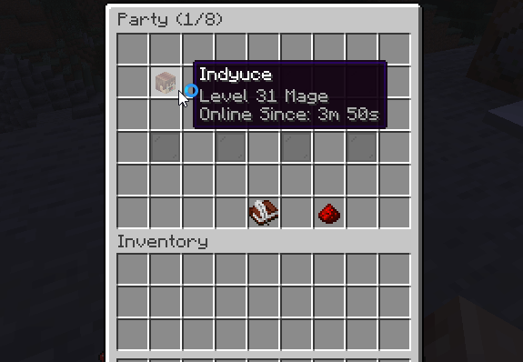
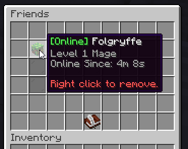

# 好友 {#👯‍♀️-friends}

MMOCore内置的好友系统是一个简单而有效的系统。当使用`/friends`命令时，它会弹出一个GUI，显示你当前的所有好友以及添加更多好友的选项。

将鼠标移到在线玩家上时，会显示其职业、等级和在线时长等属性。对于离线玩家，则会显示其已离线多久。

你可以通过简单地删除`commands.yml`配置文件中的`/friends`命令来禁用好友模块

---

原文：[👯‍♀️ Friends](https://docs.phoenixdevt.fr/mmocore/features/friends) · 原文归档：2026-10-19
