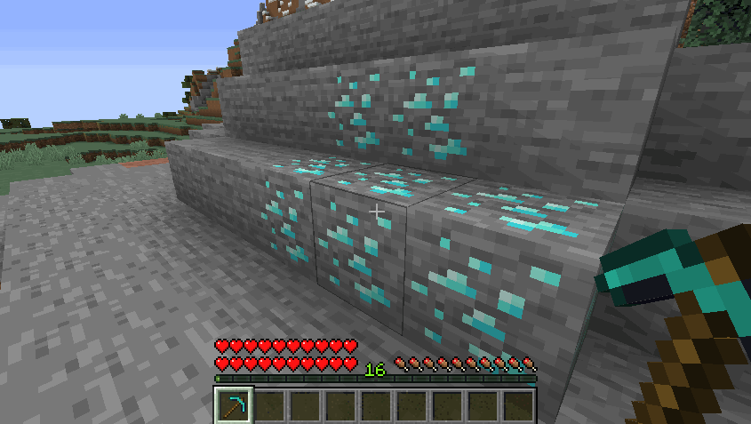

# 自定义挖矿 {#⛏️-custom-mining}

MMOCore具有针对RPG服务器进行微调的自定义挖矿系统。使用该系统，你可以：

- 防止玩家破坏方块和地形
- 配置挖掘块时获得的战利品
- 仅在设定的时间后才自然地重新生成块
- 保留或删除原版块删除表
- 让方块在被挖掘时提供副职业或主职业经验
- 需要玩家拥有特定工具才能打破方块



## 启用自定义挖掘 {#enabling-custom-mining}

前往`MMOCore/config.yml`配置文件并查找名为`custom-mining`的配置部分。

```yml
custom-mining:

  # Enable or disable the CUSTOM MINING feature.
  enable: true

  # The list of all conditions which must be met
  # for the CUSTOM MINING feature to apply.
  #
  # UNCOMMENT TO ENABLE CUSTOM MINING SERVERWIDE
  #conditions: []
  conditions:
  - 'world{name="world,world_nether,world_the_end"}'
  - 'region{name="example_region,example_region2,__global__"}'

  # Enable tool restrictions. See the following wiki page for more info
  # https://docs.phoenixdevt.fr/mmocore/misc/tool-restrictions.html
  # Players need specific tools to break specific blocks
  enable-tool-restrictions: false

  # Set to true to prevent vanilla blocks from being broken
  # "Vanilla blocks" refer to blocks with no config set in the
  # Mining profession config file.
  protect-vanilla-blocks: false
```

关闭`enable`选项以在服务器范围内禁用自定义挖掘。你还可以有选择地在启用自定义挖掘的特定世界/区域中启用它。在以下示例中，仅在名为`mmocore_custom_mining`的区域内启用世界`world`和`world_nether`中的自定义挖掘。

```yml
custom-mining:
  enable: true
  conditions:
  - 'world{name="world,world_nether"}'
  - 'region{name="mmocore_custom_mining"}'
```

最后但并非最不重要的一点是，切换`protect-custom-mine`选项将防止玩家破坏`on-mine`副职业配置部分中没有设置的块（见下文）。换句话说，默认情况下，任何没有丢弃/再生配置的块都会受到保护。

请注意，自定义挖掘不适用于创意模式。

## 挖矿经验来源 {#mining-experience-source}

```
mineblock{type=BLOCK_MATERIAL;silk-touch=true;crop=false;player-placed=false}
```

玩家通过挖掘特定类型的区块赚取经验。这些可以是农作物或矿石；有一些特定选项可以帮助你防止玩家滥用此经验源。所有农作物的列表可以在默认的农业副职业配置文件中找到。

|选项 |默认值 |描述 |
| --- | --- | --- |
| `material` | - | 你需要开采的区块 |
| `silk-touch` | true | 启用后，使用丝触时不会获得 EXP |
| `crop` | false | 启用后，除非农作物完全生长，否则玩家不会获得经验 |
| `player-placed` | false | 禁用时，玩家不会从玩家放置的方块中获取 exp |

## 工具限制 {#tool-restrictions}

工具限制（或*工具权限集*）定义特定物品可以挖掘哪些块。默认情况下此选项处于关闭状态，但你可以通过在MMOCore`config.yml`中切换以下选项来启用它：

```yml
custom-mining:
  #.......
  enable-tool-restrictions: false
```

请阅读此 [wiki 页面](../misc/tool-restrictions.md)，了解有关工具限制的更多信息。

## 钻石矿石示例 {#diamond-ore-example}

以下示例是默认`/professions/mining.yml`设置的一部分。

请注意，在此示例中，为矿石设置了自定义采矿（相对于 *采矿*副职业），但你也可以使用自定义采矿来设置掉落表和经验进行木材切割（木材，原木...）。

```yml
on-mine:

  # One rule for one type of block
  diamond:
    # The material you need to mine
    material: vanilla{type=DIAMOND_ORE}

    # The drop table/loot table used by the block.
    drop-table:
      items:
      - 'vanilla{type=DIAMOND} 1 1-3'
      # - 'mmoitem{type=material;id=RARE_DIAMOND} .1 1-3'
      # - 'droptable{id=other-drop-table} .1'
  
    # Triggers when destroying the block, can
    # be used to give exp to a player!
    triggers:
    - 'exp{profession=mining;amount=20}'
    
    options:
      # Set to false if you want to disable vanilla drops.
      vanilla-drops: false
    
    regen:
    
      # Ticks the block takes to appear again
      time: 2000
      
      # The temporary block which shows
      # during the block regen time.
      #
      # !! Warning !!
      # When using the temp-block option, make sure you choose
      # one temp block and don't use it anywhere else in the
      # configuration so that block regens do not affect each other
      temp-block: vanilla{type=STONE}
```

当原版钻石矿石被破坏时，此配置将执行以下操作：

- 除了原版方块掉落外，还会掉落1至3钻石
- 暂时用石块替换该块（100秒）
- 为矿工提供20*挖矿* 经验

## 目标块 {#target-block}

该参数确定受影响的块。`vanilla`对应的是块类型。共有三种built-in[MMOCore中的块类型](../misc/block-types.md)：原版块、MMOItems自定义块（仅在安装MMOItems时可用）和纹理玩家头/头骨。

```yml
on-mine:
    diamond_ore:
        material: vanilla{type=DIAMOND_ORE}
        # Other options:
        # material: vanilla{type=wheat;age=7}
        # material: mmoitems{id=10}
        # material: skull{value="........."}
        
        # .....
```

## 掉落表 {#drop-table}

这决定了当定义的块被破坏时要调用哪个删除表。它可以是全新的删除表，也可以是对`/drop-tables`文件夹中现有删除表的引用。请参考[这个wiki页面](drop-tables.md)来了解删除表的语法。

```yml
on-mine:
    diamond_ore:
        # .....
        drop-table:
            items:
            - 'vanilla{type=DIAMOND} 1 1-3'
            - 'vanilla{type=COBBLESTONE} 1 1-3'
           # - 'mmoitem{type=material;id=RARE_DIAMOND} .1 1-3'
           # - 'droptable{id=other-drop-table} .1'
```

## 原版掉落 {#vanilla-drops}

打开/关闭正在开采的区块的原版掉落。

```yml
on-mine:
    diamond:
        # ....
        options:
            # Set to false if you want to disable vanilla drops.
            vanilla-drops: false
```

## 阻止再生 {#block-regen}

`time` 表示方块被挖掘后，恢复原状所需的时间，单位为刻（tick）。`temp-block` 是用于暂时替换已挖掘方块的方块，让玩家知道该方块刚被挖过，仍在恢复中，因此暂时无法再次挖掘。

请注意，`temp-block`选项（放置什么临时块）遵循与上述`material`选项（目标块）完全相同的one-lineJSON语法。

```yml
on-mine:
    diamond_ore:
        # .....
        regen:
            time: 2000
            temp-block: 'vanilla{type=STONE}'
```

### 玩家头的已知问题 {#known-issue-with-player-heads}

在最近的Minecraft版本 (1.20+) 中，使用玩家磁头作为临时块时存在一个已知问题。如果满足以下所有条件，

- 原版子站已启用
- 临时块设置为带有纹理的玩家头
- 目标块不是带有纹理的玩家头部。

那么临时头骨块的头骨纹理将不会显示。

### 附加示例 {#additional-example}

```yml
on-mine:
    diamond_ore:
        # .....
    VOID_SHROOM:
        material: 'mushroom{type=BROWN_MUSHROOM_BLOCK;faces="SOUND,DOWN"}'
        conditions:
        - 'region{name=lapis,redstone}'
        drop-table:
            items:
            - 'mmoitem{type=QUEST;id=VOID_SHROOM} 1 1'
        options:
            vanilla-drops: false
        regen:
            time: 150
            temp-block: 'vanilla{type=BLACK_CONCRETE}'
        triggers:
        - 'exp{profession=mining;amount=4}'
```

---

原文：[⛏️ Custom Mining](https://docs.phoenixdevt.fr/mmocore/features/mining) · 原文归档：2026-10-19
