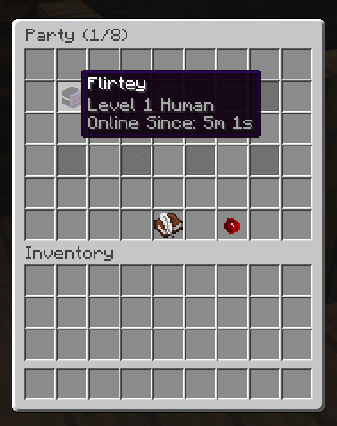
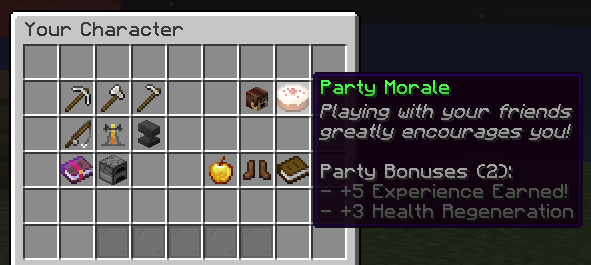

# 队伍 {#👯-parties}

队伍是任何RPG服务器的重要组成部分。他们通常向同一队伍内的成员提供传送福利或增益效果。

虽然MMOCore确实提供了一个不错的内置队伍系统，但它与以下插件完全兼容：

- 【神话地下城](https://mythiccraft.io/index.php?resources/mythic-dungeons.869/)推荐】
- [mcMMO](https://www.spigotmc.org/resources/official-mcmmo-original-author-returns.64348/)
- 【各方推荐](https://www.spigotmc.org/resources/parties-an-advanced-parties-manager.3709/)
- PartyAndFriends ([Spigot](https://www.spigotmc.org/resources/party-and-friends-extended-for-spigot-supports-1-7-1-19.11633/)& [代理](https://www.spigotmc.org/resources/party-and-friends-for-bungeecord-supports-1-7-x-to-1-19-x.9531/))
- [地下城XL](https://www.spigotmc.org/resources/dungeonsxl.9488/)
- [Heroes](https://www.spigotmc.org/resources/%E2%9A%94-heroes-premium-%E2%9A%94-best-minecraft-spigot-rpg-plugin-ever.24734/)
- [OBTeam](https://www.spigotmc.org/resources/obteam.108269/)([DungeonMMO](https://www.spigotmc.org/resources/%E2%AD%90-dungeonmmo-%E2%AD%90-dungeon-world-generator-%E2%9C%85-create-your-dungeons-%E2%AD%95-endless-possibilities.106150/))

## 选择你的队伍插件 {#choosing-your-party-plugin}

转到`MMOCore/config.yml`并将`party-plugin`设置为你要使用的任何插件。编辑此选项时请确保重新启动服务器。

```yml
# Choose the plugin handling parties here.
# Supported values (just copy and paste):
# - MMOCORE (Default built-in party system)
# - NONE (Used to fully disable parties)
# - DUNGEONSXL
# - HEROES
# - MCMMO
# - MYTHICDUNGEONS (Make sure `PartyPlugin` is set to `Default` in MythicDungeons)
# - MYTHICDUNGEONS_INJECT (Make sure `PartyPlugin` is set to `MMOCore` in MythicDungeons)
# - OBTEAM (Addon for DungeonMMO)
# - PARTY_AND_FRIENDS (When using Party and Friends (Extended) for Spigot)
# - PARTY_AND_FRIENDS_BUNGEECORD_VELOCITY ([When using Party and Friends (Extended) Edition for BungeeCord/Velocity. Requires https://www.spigotmc.org/resources/spigot-party-api-for-party-and-friends.39751/ to be installed])
# - PARTIES
party-plugin: MMOCORE
```

使用任何不是MMOCore的队伍插件都会禁用MMOCore中的所有队伍功能（主要是`/party`命令）。

#### 神话地下城 {#mythicdungeons}

你可以使用`MYTHICDUNGEONS`将 MythicDungeons 队伍系统注入到MMOCore中，或者使用`MYTHICDUNGEONS_INJECT`将MMOCore队伍系统注入到 MythicDungeons 中。

## MMOCore任务 {#mmocore-quests}

MMOCore具有基本的内置队伍系统，你和最多7的朋友可以通过队伍获得额外的提升和福利！

> **信息**
>
> 以下 wiki 部分介绍了内置MMOCore队伍模块。

首先，输入`/party`命令。如果你尚未进入队伍，它会询问你是否要创建一个。

之后，你将看到主要队伍GUI，你可以在其中查看当前的队伍成员并邀请新人。默认情况下，聚会会带来轻微的恢复和经验提升。你的队伍中的玩家越多，增益就越高（见下文）。



## 聚会聊天 {#party-chat}

玩家可以在消息开头使用`@`通过群组聊天进行交谈。可以在主MMOCore配置文件 (`party.chat-prefix`) 中编辑此聊天前缀：


## 队伍增益效果 {#party-buffs}

队伍增益效果是额外的属性，只要队伍中的成员超过2，队伍中的每个人都会获得。带有一个单独的玩家的队伍将不会获得任何增益效果。增益效果与队伍中玩家的数量成比例增加。例如，4玩家的队伍将获得3乘以配置的增益效果数量（因为第一个玩家不计入增益效果）。

这些增益可以在主MMOCore`config.yml`配置文件中进行配置。

```yml
party:

  # Edit party buffs here. You may
  # add as many stats as you want.
  buff:
    health-regeneration: 3
    additional-experience: 5
  
  # Prefix you need to put in the chat
  # to talk in the party chat.
  chat-prefix: '@'
```

当打开玩家属性菜单时，这些增益会显示在蛋糕图标上，你可以在`/gui/player-stats.yml`配置文件下进行配置：



```yml
  party:
    slots: [16]
    function: party
    item: CAKE
    name: '&aParty Morale'
    lore:
      - '&7&oPlaying with your friends'
      - '&7&ogreatly encourages you!'
      - ''
      - '&7Party Bonuses ({count}):'
      - '&8- +{buff_additional_experience}% Experience Earned!'
      - '&8- +{buff_health_regeneration}% Health Regeneration'
```

## 经验分割 {#exp-splitting}

自MMOCore1.9.3起，任何玩家获得的经验均分给所有党员。如果你的队伍共有4成员，你将只能获得25%的经验值，而你在没有队伍的情况下获得的经验值。这可以确保所有党员同时升级。

此功能造成了低等级玩家可以加入高等级玩家的队伍并获得大量经验的问题。这可以通过使用MMOCore主配置文件中的`max-level-difference`来修复。例如，将此选项设置为5将阻止level-1加入level-7或更多的队伍。队伍的等级由初始队伍所有者的等级决定。

即使你使用另一个队伍插件，该功能仍然可以运行。它还支持副职业经验。

## 使用其他方插件 {#using-other-party-plugins}

只需进入你的主MMOCore配置文件并将此选项更改为你已安装的任何插件：

```yml
# Edit the plugin handling parties here.
# Supported values (just copy and paste):
# - mmocore
# - dungeonsxl
# - parties
# - party_and_friends (Use this one if you are using Party and Friends Extended for Spigot)
# - party_and_friends_bungeecord_velocity (Use this one if you are using Party and Friends For Bungeecord, Party and Friends For Velocity or Party and Friends Extended Edition for Bungeecord/Velocity. This one requires https://www.spigotmc.org/resources/spigot-party-api-for-party-and-friends.39751/ to be installed)
# - mcmmo
# - obteam (addon for DungeonMMO)
# - mythicdungeons (only when using default party handler)
party-plugin: mmocore
```

对于列出的所有插件，经验拆分机制的工作方式与上述完全相同。队伍增益效果系统适用于除party-and-friends(PAF) 之外的所有系统。

---

原文：[👯 Parties](https://docs.phoenixdevt.fr/mmocore/features/parties) · 原文归档：2026-10-19
