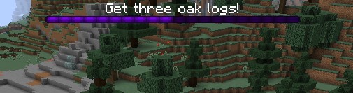
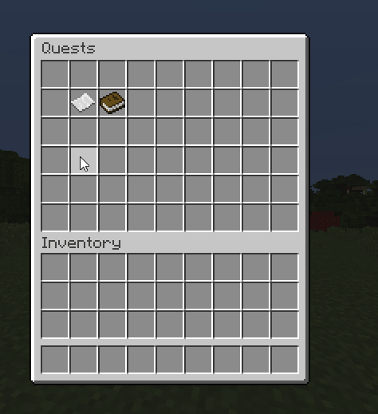

# 任务 {#📖-quests}

任务是任何RPG的重要组成部分。他们给玩家目标、挑战和奖励，同时引导他们穿越世界。MMOCore包含一个基本的任务模块，但它不像流行的Spigot任务插件那么完整。

对于更复杂的RPG服务器，我们建议坚持使用MMOCore完全支持的流行的、维护的任务插件：

- [TypeWriter](https://www.spigotmc.org/resources/typewriter-next-generation-questing.107748/)推荐
- 【BetonQuest](https://www.spigotmc.org/resources/betonquest-all-your-adventure-supplies-versatile-quests-in-depth-conversations.2117/)推荐
- [BeautyQuests](https://www.spigotmc.org/resources/beautyquests.39255/)
- [任务](https://www.spigotmc.org/resources/quests.3711/)
- [任务创造者](https://www.spigotmc.org/resources/questcreator-new-sqlite-support-and-data-conversion.38734/)

## 选择你的任务插件 {#choosing-your-quest-plugin}

转到`MMOCore/config.yml`并将`quest-plugin`设置为你要使用的任何插件。编辑此选项时请确保重新启动服务器。

```yml
# Edit the plugin handling quests here.
# Supported values (just copy and paste):
# - MMOCORE (Default, built-in quest system)
# - NONE (Used to fully disable quests)
# - BEAUTYQUESTS
# - QUESTCREATOR (https://www.spigotmc.org/resources/questcreator.38734/)
# - QUESTS (https://www.spigotmc.org/resources/quests.3711/)
quest-plugin: MMOCORE
```

使用任何不是MMOCore的任务插件都会禁用MMOCore的所有任务功能，包括任务注册表和`/quests`命令。对于任何MMOCore任务配置错误，你不会收到任何警告。

## MMOCore任务 {#mmocore-quests}

MMOCore提供了一个简单的objective-based任务解决方案，尽管它不提供带有条件事件、标签和变量的复杂分支故事情节，就像你可以使用 BetonQuest 或 Typewriter 实现的那样。

> **信息**
>
> 以下段落描述了built-inMMOCore任务模块。

MMOCore任务是玩家必须完成的一系列目标，才能获得一些战利品和经验。有多种类型的目标，例如前往特定位置、与 NPC 交谈、杀死 X 个小怪、将物品带回 NPC...其中一些目标需要额外的插件，例如 [Citizens](https://www.spigotmc.org/resources/citizens.13811/)用于 NPC 目标或 [MythicMobs](https://www.mythicmobs.net/index.php)用于额外的小怪目标。

## 家长任务 {#parent-quests}

任务可能需要玩家事先完成一些其他任务，因此你可以设置某种故事情节。

任务具有一组特定的操作（称为*触发器*），例如消息或命令，在玩家完成目标时执行。这些可以用来向玩家解释特定的事情，或者给他们任务物品或奖励。

## 进展 {#progression}

每当玩家开始任务时，他们都可以在任务GUI和 bossbar 中跟踪任务进度，bossbar 显示当前的任务目标。 bossbar 还显示玩家距完成任务的距离（已完成目标的比率）。



## 任务菜单 {#quest-menu}

玩家可以在任务菜单中查看可用和解锁的任务，他们可以使用`/quests`访问这些任务。



## 任务示例 {#quest-example}

以下部分使用默认MMOCore配置文件中的示例解释如何设置新任务。

```yml
# Levels players must have in
# order to unlock this quest.
level-req:
    main: 10
    mining: 5

# Quest name displayed in the quest menu.
name: 'A Whole New World'

# Quest lore displayed in the quest menu.
lore:
- 'This is the tutorial quest.'
- 'Lore example...'
- ''
- '&eRewards:'
- '&7► Wooden Tools'
- '&7► Leather Armor'
- '&7► 100 EXP'

# Quests the player must finish
# in order to unlock this one.
parent: []

# Cooldown in hours. Don't put any
# to make the quest a one-time quest.
# Put it to 0 to make it instantly redoable.
delay: 12

# Objectives the player needs to
# complete. Once they're all complete,
# the quest will end.
objectives:
    1:
        type: 'clickon{world="world";x=56;y=68;z=115;range=5}'
        lore: 'Head to the camp.'
        bar-color: PURPLE
        triggers:
        - 'message{format="&aGood job, now get some oak logs!"}'
        - 'sound{sound=ENTITY_EXPERIENCE_ORB_PICKUP}'
    2:
        type: 'mineblock{type="OAK_LOG";amount=3}'
        lore: 'Get three oak logs!'
        triggers:
        - 'message{format="&aGood job, now give these logs to the blacksmith."}'
        - 'sound{sound="ENTITY_EXPERIENCE_ORB_PICKUP"}'
    3:
        type: 'getitem{type="OAK_LOG";amount=3;npc=0}'
        lore: 'Give these oak logs to the blacksmith.'
        triggers:
        - 'message{format="&aGood job, now talk to the blacksmith again to claim your weapons!"}'
        - 'sound{sound=ENTITY_EXPERIENCE_ORB_PICKUP}'
    4:
        type: 'talkto{npc=0}'
        lore: 'Get your weapons from the blacksmith!'
        triggers:
        - 'message{format="&aNow go kill 5 skeletal knights to finish tutorial!"}'
        - 'sound{sound=ENTITY_PLAYER_LEVELUP}'
    5:
        type: 'killmythicmob{name="SkeletalKnight";amount=5}'
        lore: 'Kill 5 skeletal knights!'
        triggers:
        - 'message{format="&a&lYou have successfully finished the tutorial!"}'
        - 'sound{sound="ENTITY_PLAYER_LEVELUP"}'
        - 'mmoitem{type=SWORD;id=CUTLASS}'
```

### 配置细目 {#config-breakdown}

上面的配置是你可以在任务文件夹中设置的YAML文件之一（每个任务一个YAML配置）。第一个配置选项是`level-req`功能。这决定了玩家需要是什么等级才能解锁任务。我们的默认配置将其设置为等级10main 和等级5挖矿副职业。

之后，你可以设置任务菜单中显示的任务的**名称**。你之前设置的初始名称仅用于配置中的ID目的。

接下来，你可以设置任务菜单中显示的任务的**描述**。请注意，在这里添加奖励并不会真正授予它们；它只是为了显示。

下一个选项是 **parent** 选项，这确定玩家是否必须完成另一个任务才能解锁特定任务。

下一个选项是任务中的 **冷却时间**。如果你希望它成为one-time任务，则无需在选项中添加任何内容。如果你希望它立即可重做，请将其设置为0。否则，冷却时间的单位是小时。

### 目标 {#objectives}

接下来，任务文件允许你输入**目标**。任务是玩家必须完成的一系列目标才能获得一些奖励。目标内部有类型描述和触发器。

**类型**决定了玩家必须做什么，**描述**定义了任务告诉玩家要做的事情，而**触发器**决定了当玩家完成实际目标时会发生什么。

由于目标描述显示在主栏上，因此你可以使用`bar-color: <COLOR>`更改每个目标的栏颜色。所有可用颜色的列表可以在 [Spigotjavadocs](https://hub.spigotmc.org/javadocs/spigot/org/bukkit/boss/BarColor.html)] 中找到。

触发器可用于向玩家提供有关RPG故事情节的信息或下一个目标的说明，或者只是寻求奖励。

|目标 |描述 |格式|
| --- | --- | --- |
| clickon | 玩家必须单击地图中的某个位置。 | `clickon{world=<world-name>;x=<x>;y=<y>;z=<z>;range=<radius>}` |
| mineblock | 玩家必须开采 X 个相同类型的区块。 | `mineblock{type=<MATERIAL>;amount=<amount>}` |
| killmob | 玩家必须杀死 X原版生物。 | `killmob{type=<ENTITY_TYPE>;amount=<AMOUNT>}` |
| goto | 玩家必须去某个地点。 | `goto{world=<world-name>;x=<x>;y=<y>;z=<z>;range=<radius>}` |
| getitem | 玩家必须给公民 NPC物品。 | `getitem{type=<MATERIAL>;npc=<Citizen_ID>;amount=<AMOUNT>}` |
| getmmoitem | 玩家必须从MMOItems给公民 NPC 一个物品。 | `getmmoitem{type=<MI_TYPE>;id=<MI_ID>;npc=<Citizen-ID>;amount=<AMOUNT>}` |
| talkto | 玩家必须与 NPC 对话。 | `talkto{npc=<Citizen_ID>}` |
| killmythicmob | 玩家必须杀死 X 个神话小怪。 | `killmythicmob{name=<mythicMobsInternalName>;amount=<AMOUNT>}` |

### 触发类型 {#trigger-types}

可以找到与这些目标结合使用的可用触发器的完整列表[此处](../misc/triggers.md)。

---

原文：[📖 Quests](https://docs.phoenixdevt.fr/mmocore/features/quests) · 原文归档：2026-10-19
