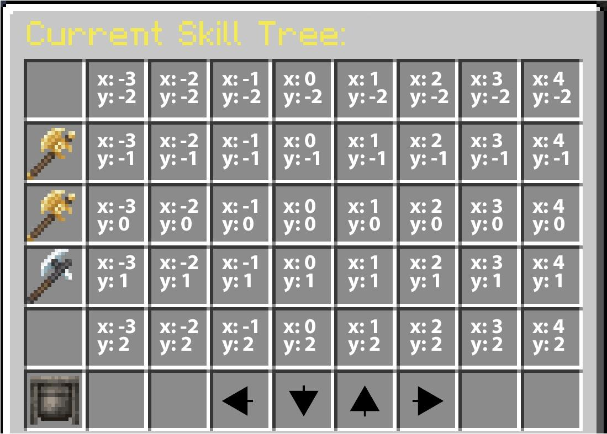
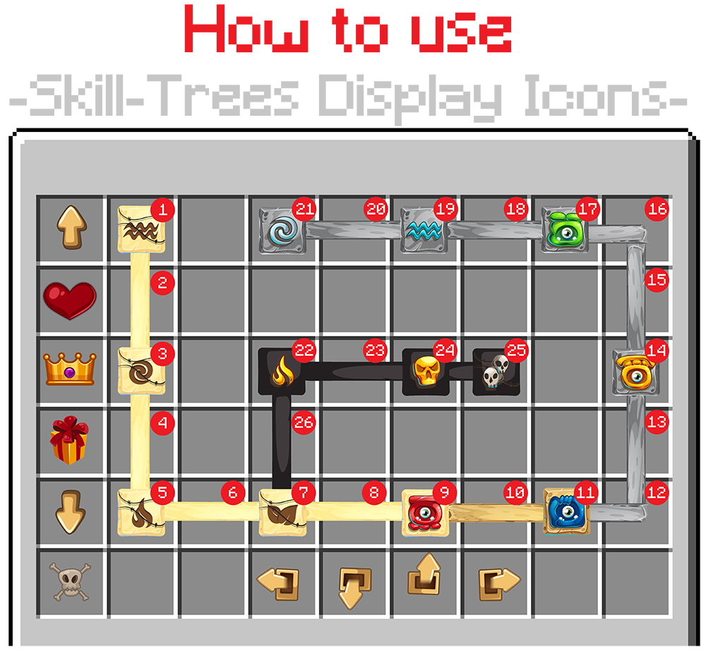

# 技能树 {#🌱-skill-trees}

技能树是可以使用技能树积分解锁/levelled-up的节点组合。升级技能树节点可以获得属性或可以为玩家运行一些触发器。你还可以重置技能树的进度，并通过使用技能树重新分配点来获得为其花费的技能树点。

<details markdown="1">

<summary>技能树基本配置示例</summary>

```yml
id: "custom_combat" # Unique Identifier for the Skill Tree
name: "Combat" # Name of the skill tree that will be displayed in the GUI
type: custom # See below for explanations
max-points-spent: 20 # Maximum amount of points spent in that skill tree
lore:
  - "&6This skill tree is used for combat abilities!"
icon: # The item representing the skill tree in the GUI.
  material: GOLDEN_AXE
  item_flags: [HIDE_ATTRIBUTES]
  #custom_model_data: 10
  #custom_model_data_string: 'test'
  #item_model: 'minecraft:dirt'

nodes:
  a1:
    name: "Mana Regeneration"
    coordinates: -3,-2
    paths:
      a2:
        path1: -2,-2
        path2: -1,-2

    max-level: 2
    is-root: true
    point-consumed: 1
    experience-table:
      first_table_item:
        level: 1
        triggers:
          - 'stat{stat="MANA_REGENERATION";amount=1;type="FLAT"}'
      second_table_item:
        level: 2
        triggers:
          - 'stat{stat="MANA_REGENERATION";amount=1;type="FLAT"}'
    lores:
      0:
        - "&eMana regen in pts/sec +1"
      1:
        - "&eMana regen in pts/sec +1"
      2:
        - "&eMana regen in pts/sec +1"
```

</details>

## 为职业关联技能树 {#linking-a-skill-tree-to-a-class}

技能树按职业划分：玩家能看到哪些技能树，以及各技能树的进度，都取决于当前[职业](classes.md)。玩家可以在当前职业关联的技能树中投入点数。在任意职业配置文件中使用以下语法，即可关联技能树：

```yml
# MMOCore/classes/mages.yml

skill-trees:
  - "skill-tree-id1"
  - "skill-tree-id2"
```

## 技能树积分 {#skill-tree-points}

你可以使用以下命令将技能树指向玩家。`id`代表你想要为其分配积分的技能树的标识符。这些积分仅适用于相应的技能树。如果你想为任何技能树提供可使用的技能树积分，请使用 id`global`。

```
/mmocore admin skill-tree-points give <player> <number> <id>
```

给予玩家技能树积分的主要方式之一是通过经验表中的命令触发器。在以下示例中，玩家将在每次升级时收到可用于技能树和ID`archerSkillTree`的1技能树积分。

```yml
# MMOCore/exp-tables/default_exp_tables.yml

example_archer_exp_table:
  give_one_skill_tree_point:
    period: 1
    triggers:
      - 'command{format="mmocore admin skill-tree-points give %player% archerSkillTree"}'
```

你还可以使用以下命令将技能树重新分配点赋予玩家。

```
/mmocore admin skill-tree-realloc-points give <player> <number>
```

### 最多花费积分 {#max-points-spent}

该字段对应于玩家可以在技能树中花费的最大积分数量。如果未指定，则玩家在技能树中可以花费的积分数量没有限制。

## 节点 {#nodes}

技能树由多个节点组成。节点是玩家与之交互的对象，以解锁新的技能和特权。这些节点可以通过路径、要求和不兼容性链接在一起，也可以独立升级。玩家在特定节点上花费技能树积分来解锁/升级它们。

技能树节点位于技能树YML 配置中的`nodes`小节下。

### 节点状态 {#node-states}

技能树节点可以处于以下五种状态之一。

|状态|描述 |
| --- | --- |
| 解锁 | 该节点至少为1等级且已解锁 |
| 已达到极限 | 该节点已达到其最大等级。 |
| 锁定 | 玩家尚无法访问该节点，但将来可能会访问 |
| 完全锁定 | 玩家做出了分支选择，除非执行重新规范，否则无法访问该节点 |
| 可解锁 | N个技能树点即可解锁该节点 |

你可以在`gui/skill-tree.yml`配置文件的`node-status`部分修改每个状态的显示名称。

### 坐标 {#coordinates}

为了在GUI中表示，每个技能树节点都有唯一的坐标定义其显示位置。坐标可以任意大（e.gx:15y:0）。你可能必须使用箭头在GUI中移动才能查看距离原点`(x=0,y=0)`更远的节点。

```yml
nodes:
  a1:
    name: '&6Extra Atk Damage'
    ...
    coordinates: 0,0
```



### 父母（强） {#parents-strong}

任何节点的所有强父节点都必须先解锁，然后才能解锁该节点。

<details markdown="1">

<summary>示例1</summary>

在以下示例中，`a2`、`a3`和`a4`是`a1`的强子级。为了解锁`a2`、`a3`或`a4`，玩家必须分别将`a1`升级到2、1或3。

```yml
nodes:
  a1:
    ...
    children:
      strong:
        a2:
          level: 2
        a3:
          level: 1
        a4:
          level: 3
  a2:
    ...
  a3:
    ...
  a4:
    ...
```

</details>

<details markdown="1">

<summary>示例2</summary>

在以下示例中，`a1`是`a2`和`a3`的强父级。为了解锁`a2`或`a3`，玩家必须分别将`a1`升级到2或1。

```yml
nodes:
  a1:
    ...
  a2:
    ...
    parents:
      strong:
        a1:
          level: 2
  a3:
    ...
    parents:
      strong:
        a1:
          level: 1
```

</details>

### 父母（软） {#parents-soft}

软父母与强父母类似，只不过你只需要解锁至少一个软父母，而不是全部。

<details markdown="1">

<summary>示例1</summary>

在以下示例中，达到`a1`的等级3足以解锁`a2`，达到`a1`的等级2足以解锁`a3`。

```yml
nodes:
  a1:
    ...
    children:
      soft:
        a2:
          level: 3
        a3:
          level: 2
  a2:
    ...
  a3:
    ...
```

</details>

<details markdown="1">

<summary>示例2</summary>

在下面的示例中，为了解锁`a3`，玩家可以达到`a1`的等级3或`a2`的等级2（一个就足够了）。

```yml
nodes:
  a1:
    ...
  a2:
    ...
  a3:
    ...
    children:
      soft:
        a1:
          level: 3
        a2:
          level: 2
```

</details>

如果一个节点同时具有强父节点和软父节点，则需求会叠加。玩家必须解锁所有强父节点，以及至少一个软父节点。

> **信息**
>
> 请注意，`children`和`parents`选项几乎是对称的。以下语法完全等效：
>
```yml
nodes:
  a1:
    ...
    children:
      strong:
        a2: 3
  a2:
    ...
```
>
```yml
nodes:
  a1:
    ...
  a2:
    ...
    parents:
      strong:
        a1: 3
```
>
> 你可以将`a2`定义为`a1`的子级，或将`a1`定义为`a2`的父级。这两种语法都会导致完全相同的行为。
>
> 对于每个节点配置，你可以定义`parents`和/或`children`，或不定义。

### 不兼容的节点 {#incompatible-nodes}

节点之间可能不兼容，这意味着如果其他节点已解锁，它们将永久锁定。

> **提示**
>
> 尽管这不是其最佳用例，但此功能可用于重新创建`max-children`选项（[在](skill-trees.md#maximum-children)下面进行描述）。它在特定情况下最有用，在这种情况下，你有两个遥远的节点，当一起使用时会引入不兼容性或错误。

在以下示例中，如果`a2`达到等级1，或者`a3`达到等级2，则`a1`永久锁定（直到重新规范）。

```yml
nodes:
  a1:
    name: '&6Extra Atk Damage'
    ...
    parents:
      incompatible:
        a2: 1
        a3: 2
```

### 描述 {#lore}

`lore`通过`gui/skill-tree.yml`中的`{node-lore}`占位符显示在skill-treeGUI中。如果要完全自定义每个节点具有的描述，你可以将用于`gui/skill-tree.yml`中的节点物品描述的所有占位符包含在其中（`{current-level}`、`{current-state}`、`{max-level}`...）。

### 根节点 {#root-nodes}

根节点是技能树中第一个解锁的节点。请注意，技能树应至少有一个根节点。要将节点标记为技能树根，请使用以下语法：

```yml
nodes:
  a1:
    name: '&6Some Node'
    ...
    root: true # Here!
```

> **提示**
>
> 如果你确保故事情节中的某些任务或事件通过使用命令等方式解锁第一个技能树节点，则技能树可能没有根节点。

### 权限必填 {#permission-required}

选项`permission-required`要求需要相应的权限才能解锁技能树节点。如果该选项不填，则权限晋级并解锁技能树节点将不受限制。

### 最大子女数 {#maximum-children}

节点在父/子系统下工作。一个节点只有在其所有（或至少 N 个）父节点都被解锁时才可用。`max-children`选项允许你限制父节点可以拥有的未锁定子节点的数量。

这具有在技能树中创建分叉的效果，其中玩家需要在两种不同的游戏风格之间进行选择。

在以下示例中，节点`a1`有两个子节点`a2`和`a3`。由于`max-children`设置为1，因此玩家只能解锁两者之一。一旦玩家解锁两者中的任何一个，另一个将被永久锁定（直到重新规范）。

```yml
nodes:
  a1:
    ...
    max-children: 1

  a2:
    ...
    parents:
      strong:
        a1:
          level: 1
  a3:
    ...
    parents:
        a1:
          level: 1
```

### 经验表 {#experience-tables}

每个节点都有一个与其关联的经验表。有关 [体验表](../level/tables.md)] 的更多信息。

### 节点显示选项 {#node-display-options}

可选字段`display`使你能够根据节点的状态获得特定的图标。

```yml
nodes:
  a1:
    #...
    display:
      unlocked: 'WHITE_CONCRETE:0'
      unlockable: 'BLUE_CONCRETE:0'
      locked: 'GRAY_CONCRETE:0'
      fully-locked: 'BLACK_CONCRETE:0'
```

### 最高等级 {#max-level}

这是此技能树节点可以达到的最高等级。

### 消耗积分 {#points-consumed}

可选字段`point-consumed`允许你设置升级此技能树节点所需的技能树点数。默认为1。

## 路径 {#paths}

“路径”是节点之间的连接。它们仅用于视觉表示，因为玩家无法直接与路径交互。

任何一对（节点，子节点）都可以有一条路径。路径由网格坐标列表组成，它应该占据箱子物品栏内。

### 州 {#states}

路径可以存在三种不同的状态，这将改变其外观。有关这些图标的更多信息可以在 [此处](skill-trees.md#node-display-options)] 找到。如果一条路径连接的两个节点也都未锁定，则该路径被视为“未锁定”。如果两个节点之一完全锁定，则该路径被视为“fully-locked”。否则，路径就被“锁定”。

### 示例 {#example}

在以下示例中，节点`a1`有两个子节点`a2`和`a3`。`a1`到`a2`路径占据这两个节点之间的所有网格坐标（对于`x=1,y=0`和`x=2,y=0`相同）。从`a1`到`a3`的路径相同。

```yml
nodes:
  a1:
    ...
    coordinates: 0,0
    children:
      strong:
        a2:
          level: 1
          paths: ['1 0', '2 0']
        a3:
          level: 1
          paths: ['-1 0', '-2 0']
  a2:
    ...
    coordinates: 3,0
  a3:
    ...
    coordinates: -3,0
```

路径可以轮流但不能分开。你不能使用单一路径将一个节点链接到多个其他节点。每对（节点、父节点）必须有一个路径。

## 图标 {#icons}

你可以通过为每个可能的节点或路径配置创建不同的显示来完全自定义技能树图形用户界面 (GUI) 的外观。要进行这些更改，你可以修改位于`gui/skill-tree.yml`中的文件，该文件将自动为每个节点或路径选择适当的显示。此配置也可以在每个skill-tree配置中完成，以便为每个skill-tree提供不同的GUI显示。如上所述，每个节点都可以通过填充其显示部分来拥有自己的外观。

以下是如何选择节点/路径的显示：

- 如果它是一个节点并且具有与其状态相对应的特定显示，那么这将是其显示。
- 否则，如果技能树配置中有显示，它将采用它。
- 否则它将采用`gui/skill-tree.yml`中指定的显示。

现在让我们深入了解显示部分在skill-tree配置和`gui/skill-tree.yml`中的工作原理：

节点/路径的显示取决于其邻域及其状态。例如，你可以通过位于nodes.unlocked.right-left中为处于解锁状态的每个节点定义显示，并在其左侧和右侧使用2路径。

对于每条路径具有4可能状态的路径，该过程完全相同：

- 如果其链接的2节点已解锁，则解锁。
- 如果一个节点已解锁，而另一节点也可解锁，则可解锁。
- 如果2节点之一被锁定，则锁定。
- 如果2节点之一完全锁定，则完全锁定。

邻域也会影响路径的显示。例如，如果一条路径有一个向上的分支和一个向右的分支，则它将采用与“向上”关联的物品，然后是“down-right”，最后是“向右”。这是一个对称的过程，因此如果路径向左然后向下，它看起来会是相同的。

同样的规则适用于节点。例如，如果一个节点被四个路径包围，它将显示“up-right-down-left”配置。或者，如果节点只有三个路径（上、左、右），它将自动选择“up-right-left”显示。

下面是一个完整的示例，展示了显示屏可以帮助你执行哪些操作：



这里节点1、3、5、7、9被解锁。这使得路径2、4、6、8的显示被解锁，因为每个路径链接的2节点都被解锁。节点11是可解锁的，使得路径10也可解锁。最后22、24、25被完全锁定，使得相应路径完全锁定显示。其余对应锁定状态。现在关于方向，这里是每个节点/路径的方向和状态的详细列表：

|没有 |显示图标|没有 |显示图标|没有 |显示图标|没有 |显示图标|
| --- | --- | --- | --- | --- | --- | --- | --- |
| 1 | unlocked:down | 8 | unlocked:right | 15 | locked:up | 22 | fully-locked:down-right |
| 2 | 解锁：向上（与向下相同，因为这是对称的） | 9 | unlocked:right-left | 16 | locked:down-left | 23 | fully-locked:right |
| 3 | unlocked:up-down | 10 | unlockable:right | 17 | locked:right-left | 24 | fully-locked:right-left |
| 4 | unlocked:up | 11 | 可解锁：right-left | 18 | locked:right | 25 | fully-locked:left |
| 5 | unlocked:up-right | 12 | locked:up-left | 19 | locked:right-left | 26 | fully-locked:up |
| 6 | unlocked:right | 13 | locked:up | 20 | locked:right |  |  |
| 7 | unlocked:up-right-left | 14 | locked:up-down | 21 | locked:right |  |  |

```yml
# Example config in skill-tree.yml or in skill-tree configs.
display:
  paths:
    unlocked:
      up: "WHITE_DYE:0"
      up-right: "WHITE_DYE:0"
      up-left: "WHITE_DYE:0"
      down-right: "WHITE_DYE:0"
      down-left: "WHITE_DYE:0"
      right: "WHITE_DYE:0"
      default: "WHITE_DYE:0"
    locked: ...
    unlockable: ...
    fully-locked: ...
  nodes:
    unlocked:
      up-right-down-left: "WHITE_CONCRETE:0"
      up-right-down: "WHITE_CONCRETE:0"
      up-right-left: "WHITE_CONCRETE:0"
      up-down-left: "WHITE_CONCRETE:0"
      down-right-left: "WHITE_CONCRETE:0"
      up-right: "WHITE_CONCRETE:0"
      up-down: "WHITE_CONCRETE:0"
      up-left: "WHITE_CONCRETE:0"
      down-right: "WHITE_CONCRETE:0"
      down-left: "WHITE_CONCRETE:0"
      right-left: "WHITE_CONCRETE:0"
      right: "WHITE_CONCRETE:0"
      left: "WHITE_CONCRETE:0"
      up: "WHITE_CONCRETE:0"
      down: "WHITE_CONCRETE:0"
      no-path: "WHITE_CONCRETE:0"
    locked: ...
    unlockable: ...
    fully-locked: ...
```

## 技能树GUI {#skill-tree-gui}

打开技能树UI 的2方式有：

第一个选项是使用`/skilltrees`，它将使用`gui/skill-tree.yml`配置文件打开GUI。它允许你浏览GUI中的每个技能树。你可以通过修改`config.yml`文件中的`enable-global-skill-tree-gui`字段来启用或禁用此功能。

第二种选择是使用`/skilltrees`打开特定的技能树，而无法在技能树之间进行浏览。这将利用`gui/specific-skill-tree/specific-skill-tree-<skill-tree-id>.yml`中的GUI配置文件。确保你的技能树ID 遵循YAML格式，以避免出现任何问题。如果没有找到配置，它将从`gui/specific-skill-tree/specific-skill-tree-default.yml`加载GUI。你还可以通过修改`config.yml`文件中的`enable-specific-skill-tree-gui`字段来打开或关闭此功能。

## 技能树类型 (MMOCore1.21.1+) {#skill-tree-types-mmocore-1-21-1}

目前有两种型号的技能树。使用某种类型不会添加或删除技能树中的任何功能，它只会使在某些情况下设置技能树变得更容易，因为技能树配置文件很快就会变大。

### 定制技能树 {#custom-skill-trees}

如果你没有为技能树指定`type`选项，则默认情况下它将设置为`CUSTOM`。当使用自定义技能树时，你需要手动提供技能树节点之间的所有关系，以及节点之间所有路径的位置。为了创建自定义技能树，只需使用以下语法：

```yml
id: "sample_skill_ree"
name: "&6My Skill Tree"
type: CUSTOM # <<==== Here
...
```

MMOCore将自动推断没有父节点的技能树节点是根节点。

### 接近技能树 {#proximity-skill-trees}

Proximity技能树是自定义技能树的简化版本，有时你不需要提供节点之间的父子关系。为了创建邻近技能树，请将技能树配置文件中的`type`配置选项更改为`PROXIMITY`。

```yml
id: "sample_skill_ree"
name: "&6My Skill Tree"
type: PROXIMITY # <<==== Here
...
```

任何两个相邻节点都会自动标记为软父节点。换句话说，升级任何节点都会自动解锁相邻节点。每个技能树节点有四个直接邻居（上、下、左、右邻居）。

一些示例（点击展开）：

<details markdown="1">

<summary>这两个节点是父节点，因为它们是直接邻居。</summary>

```yml
nodes:
  a1:
    name: 'Cooldown Reduction I'
    ...
    coordinates: 2,1

  a2:
    name: 'Cooldown Reduction II'
    ...
    coordinates: 2,2
```

</details>

<details markdown="1">

<summary>这些2节点不是父节点，因为它们不是直接邻居。</summary>

```yml
nodes:
  a1:
    name: 'Cooldown Reduction I'
    ...
    coordinates: 2,1

  a2:
    name: 'Cooldown Reduction II'
    ...
    coordinates: 2,4
```

</details>

设置邻近技能树时，你仍然可以使用自定义软/硬/不兼容节点父子关系规则以及路径。使用邻近技能树可以简单地为你提供技能树的骨架，并为你节省一些语法。

<details markdown="1">

<summary>定义邻近区域内的父项技能树</summary>

```yml
nodes:
  a1:
    name: 'Cooldown Reduction I'
    ...
    coordinates: 2,1
    children: # This syntax still works.
      strong:
        a1: 1

  a2:
    name: 'Cooldown Reduction II'
    ...
    coordinates: 2,4
```

</details>

MMOCore不可能从链接的技能树推断出技能树根，因为每个non-isolated技能树节点至少有一个父/子节点。因此，你需要在你的附近手动指定至少一个根节点技能树！提醒一下，这是使用以下选项完成的：

```yml
nodes:
  a1:
    name: '&6Some Node'
    root: true # This option
    ...
```

---

原文：[🌱 Skill Trees](https://docs.phoenixdevt.fr/mmocore/features/skill-trees) · 原文归档：2026-10-19
