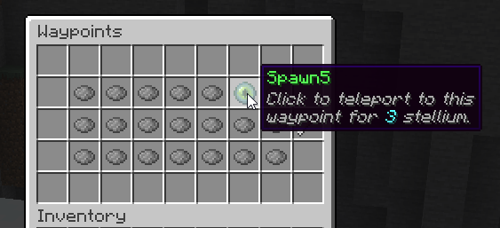

# 传送点 {#📌-waypoints}

航点是玩家保存世界探索进度的一种方式。航路点是你世界中的可配置点，当玩家解锁它们时，它们可以连接在一起以创建一种快速旅行系统。他们可以蹲着站在上面解锁。每个航点都与其他航点链接，并具有相应的成本。如果2航路点已链接​​并且你已解锁，则你可以在它们之间旅行。

默认情况下，玩家没有解锁航点，但当玩家探索世界并发现航点 A、B 和 D 时，玩家可能会在这些航点之间**快速旅行**。如果玩家尚未发现航路点 C，则玩家将看不到它或无法快速行进至该航点。当站在航点上/附近时，你只需移动即可打开快速旅行菜单。

使用路径点旅行需要花费 **Stellium**，这是一种类似于魔力的资源，但再生速度要慢得多。 Sttellium 用于平衡航路点。

## 航点列表 {#waypoint-list}

玩家可以使用`/waypoints`打开航点菜单。该菜单显示所有注册的航点，包括锁定的航点。解锁的航路点使用末影之眼显示。此菜单只能用于可视化航路点，实际上航路点只能在站在航路点上并蹲下时使用：将打开相同的菜单，但你所站立的航路点将突出显示（使用原版发光效果），并且你将能够使用你的星群传送到任何航路点。



还有一个**很酷的动画**，用于解锁和传送到现有的路径点，并带有声音效果。

## 禁用航点 {#disabling-waypoints}

MMOCore航路点是可选功能。如果你不想使用它，请按照下列步骤操作：

- 清空`/waypoints`文件夹（不要删除它，否则它将重新生成），
- 注释掉`MMOCore/commands.yml`内的`/waypoints`命令部分以禁用 waypoint UI 命令。

## 航点配置示例 {#waypoint-config-example}

你可以在`/waypoints`文件夹中放置任意数量的 YML 文件/子文件夹，以注册新的航路点。

<details markdown="1">

<summary>完整配置示例</summary>

```yml
# Waypoint identifier, used as reference for admin commands.
# Make sure all the waypoints have different identifiers.
spawn:

  # Name of waypoint displayed in the waypoint GUI.
  name: Spawn

  # Location of waypoint: <world> <x y z> <yaw> <pitch>
  # Yaw and pitch represent where the player will be looking at when teleported.
  location: 'world 69 71 136 136 0'

  # Radius of waypoint around the specified location.
  radius: 2.0

  # Time it takes to warp to target location when using
  # the waypoint through the GUI.
  warp-time: 100

  cost:
    # Cost when not standing on any waypoint to dynamically teleport to this one.
    dynamic-use: 5

  option:

    # When enabled, players can unlock the waypoint
    # by sneaking on it (true by default)
    unlockable: true

    # When enabled, opens up the teleportation menu
    # when sneaking (true by default)
    enable-menu: true

    # When set to true (false by default) players don't
    # have to be standing on any waypoint to teleport
    # to that waypoint. This could be a nice option for
    # spawn waypoints alongside with the 'default' option.
    dynamic: false

    # Should the waypoint be unlocked by default?
    default: true
  
  # All the waypoints you can teleport to when standing
  # on that waypoint. Each value is associated with the cost of the travel.
  linked:
    spawn1: 2
    spawn2: 3
    forest: 4
```

</details>

|选项 |描述 |
| --- | --- |
| 名称 | `/waypoints`菜单中显示的航路点名称。这与仅用于配置目的的内部ID不同。 |
| 地点 | 你可以在此处定义航路点块的位置。你的选项有世界、X、Y、Z、俯仰、偏航。偏航和俯仰定义了玩家的相机方向。 |
| 半径 | 这定义了玩家必须距离源航路点块多近才能移动和解锁它。半径以块为单位，5块意味着如果玩家在航路点的5块内移动任何位置，它们将解锁它。它应该接近纪念碑/神殿/.. 直径的一半，作为物理路径点。 |
| 默认 | 该航点是否默认解锁。 |
| 动态 | 参见[下面的](waypoints.md#dynamic-waypoints)。 |
| 启用菜单 | 当设置为`true`时，潜行在航点上将打开航点传送菜单。 |
| 可解锁 | 当设置为`true`时，玩家将通过蹲伏在航路点位置来解锁该航路点。 |
| 目的地 | 当你站在航点上时可以跳转到的其他航点列表。每个相邻航路点都与 A -> B 航路点行程的成本（以星群为单位）相关联。 |

### 动态航路点 {#dynamic-waypoints}

打开航点菜单时，可以在地图上的任何位置使用动态航点。任何玩家都可以随时传送到动态路径点，它们不需要站在任何路径点上。

### 航点链接互易 {#waypoint-link-reciprocity}

默认情况下，航点 A 链接到航点 B 并不意味着 B 链接到 A。换句话说，航点连接不是相互的，除非你在MMOCore`config.yml`内切换以下选项：

```yml
waypoints:
  # ...
  link_reciprocity: true
```

此选项适用于所有航点。

## 航点书籍 {#waypoint-books}

可以使用以下命令将航点书籍提供给玩家。

```
/mmocore waypoints item <waypointId> <playerName>
```

右键单击时，书籍将被消耗，解锁指定的路径点。你可以在`items.yml`配置文件中更改物品的外观。

```yml
WAYPOINT_BOOK:
  item: BOOK
  name: '&6Waypoint Book: {waypoint}'
  lore:
    - '&7Click to unlock {waypoint}'
```

## 航点路径计算 {#waypoint-path-calculation}

当在主MMOCore插件配置文件中启用此选项时，MMOCore将在玩家收集的航路点上执行自动路径计算。

```yml
waypoints:
  # ...
  auto_path_calculation: false
```

让我们考虑以下场景：

- 玩家正站在航点 A。他们想要传送到航点 C
- 航点 A 未直接连接至航点 C
- 航点 A 连接到中间航点 B，B 连接到 C

即使航点 A 没有直接链接到航点 C，MMOCore也会遍历整个航点地图并找到路径 A -> B -> C，从而使航点 C 可访问。MMOCore始终找到航路点之间的最短路径，并考虑动态航路点。

## 禁用航路点 {#disabling-waypoints-1}

如果你不打算使用MMOCore航路点系统，可以执行以下操作来禁用它：

- 清空`waypoints`文件夹，
- 注释掉`commands.yml`配置文件中的`waypoints`命令。

---

原文：[📌 Waypoints](https://docs.phoenixdevt.fr/mmocore/features/waypoints) · 原文归档：2026-10-19
