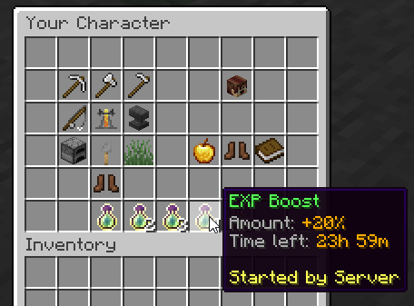

# 经验加成 {#⭐-experience-boosters}

管理员可以使用[命令](../general/commands.md)来创建适用于服务器上所有玩家的经验增强器！使用`/mmocore booster create`命令，你可以指定经验玩家将获得多少额外百分比，甚至可以指定助推器适用于哪个副职业**。

## 兼容性选项 {#compatibility-options}

这种类型的 EXP 助推器符合100%EULA 标准。利用这些助推器的最佳方法是创建物品并将此命令绑定到右键单击，以便消耗品为当前连接的所有玩家应用 EXP 助推器！

`/mmocore booster create`命令有一个可选的`player`参数，你可以使用该参数指定助推器创建者。这样，其他玩家就可以看到谁激活了 EXP 增强器。

创建助推器后，会在整个服务器中广播一条消息。可以在`messages.yml`配置文件中进行编辑。

## 目前活跃的助推器 {#currently-active-boosters}

活动助推器显示在玩家属性菜单中，你可以使用`/player`访问该菜单，如以下屏幕截图所示。玩家可以看到助推器到期前剩余的时间、谁创建了该助推器，以及可能是该助推器申请的副职业。

---

原文：[⭐ Experience Boosters](https://docs.phoenixdevt.fr/mmocore/level/boosters) · 原文归档：2026-10-19
