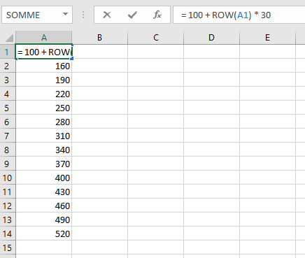
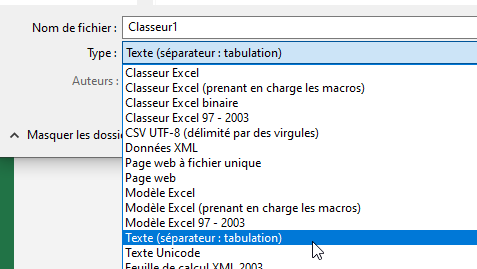

# 经验曲线 {#📈-experience-curves}

经验曲线允许你定义玩家需要多少经验才能增加等级。 [副职业](../profession/intro.md)和 [职业](../features/classes.md)都有经验曲线。

## 基本配置 {#basic-config}

所有exp曲线都可以在`/MMOCore/exp-curves`文件夹下找到。你可以通过创建具有以下格式的`.txt`文件来设置 exp 曲线：

```
200
400
600
800
1000
1200
1400
1600
1800
2000
2200
2400
2600
[...]
```

第一行表示玩家需要多少经验才能达到2等级，第二行表示3等级，依此类推。经验曲线**不是累积的**，它们表示升级所需的经验量，无论玩家已经达到多少等级。

如果你的经验曲线文件名为`exp-curves/levels.txt`，你可以使用以下语法将其分配给职业或副职业。这适用于副职业和职业：

```yml
# MMOCore/class/mages.yml
# MMOCore/profession/mining.yml

exp-curve: levels
```

## 使用 Excel 生成 EXP 曲线 {#generating-an-exp-curve-using-excel}

使用 Excel（你可以在 Microsoft 网站上免费在线使用它），你可以轻松生成MMOCoreexp 曲线**如果你有所需 exp 的公式作为玩家等级的函数**。



在 Excel 上，你可以使用`ROW(CELL_NAME)`函数检索单元格行号。因此，例如，你可以使用以下公式：`= 100 + ROW(A1) * 30`并一直向下复制单元格以生成与达到n-th等级所需的经验量相对应的数字列表。

完成此设置后，使用`Text (tab separator)`文件类型将文件保存/导出为`.txt`文件。确保只有一列，以便生成的文本文件中不会出现分隔符。



## 曲线作为公式 {#curves-as-formulas}

你还可以使用数学公式定义 exp 曲线，以减少所需的文件数量，而不是使用位于`/MMOCore/exp-curves`文件夹中的文本文件。

在职业/副职业配置内部，使用以下语法：

```yml
exp-curve-formula: "min(100 + {level} * 50, 1000)"
```

计算所需经验值时，`{level}`占位符将被替换为目标等级数。此公式还支持 PAPI占位符。支持基本数学函数，如`min`、`max`、`sqrt`...。如果公式恰好返回小数，则会向下舍入到最接近的整数。

## 经验值溢出 {#exp-level-overflow}

如果玩家在达到新等级时拥有超过所需的经验值，则剩余的经验值将被保留并应用于下一个等级。因此，如果有足够的经验值，玩家可以一次性升级多次。

---

原文：[📈 Experience Curves](https://docs.phoenixdevt.fr/mmocore/level/curves) · 原文归档：2026-10-19
