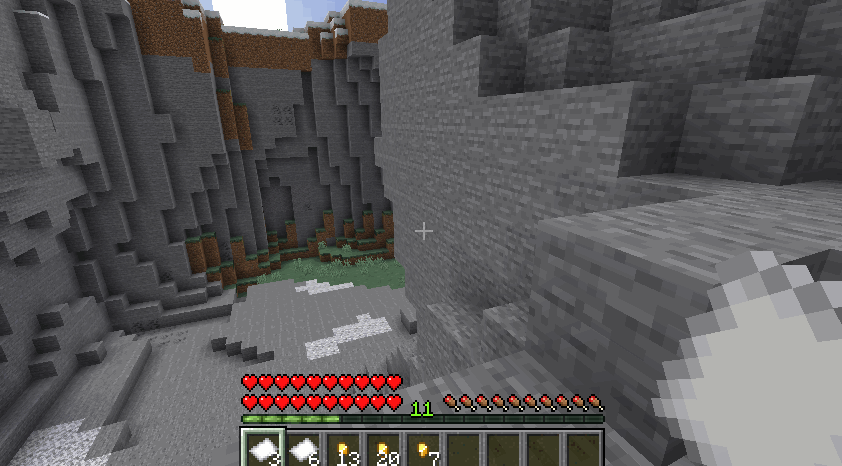
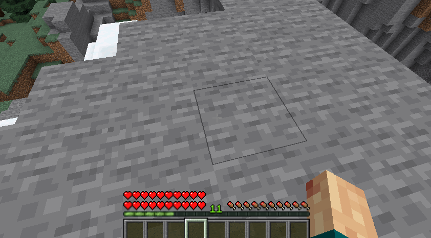

# 经济 {#💸-economy}

MMOCore附带RPG风格的物理货币系统，其中包含两种类型的物品：**纸币**和**金币**。金币总是价值1黄金，但纸币可以值任何东西。这个货币系统不仅可以为你的服务器添加一些RPG气氛，因为它们可以用于交易，而且还可以使用MythicMobs将它们添加到生物掉落表e.g中，以使掉落金币变得更容易。

## 押金 {#deposit}

玩家可以将他们的实物纸币和金币直接存入他们的Vault账户。例如，这可以像银行保险箱一样使用，你可以在其中释放一些物品栏空间，但仍然可以通过 NPC 使用你的数字Vault现金。

你可以使用`/deposit <player>`强制打开存款GUI，或者简单地要求玩家使用`/deposit`（如果他们有`mmocore.currency`权限）。使用额外的插件，你还可以将此命令绑定到right-click上的特定块（对于e.g渲染箱），甚至可以使用Citizens插件将此命令绑定到 NPC 以制作Vault守护者 NPC。

## 撤回 {#withdraw}

提现使玩家可以提取部分Vault现金并获得实物货币用于交易或支付其他玩家。你可以使用`/withdraw <player>`命令启动玩家的提款请求，或者要求他们使用`/withdraw`（如果他们有`mmocore.currency`权限）。

当提款请求开始时，玩家被要求在聊天中输入他们想要提款的金额。当提取$54时，玩家将获得每枚价值$1的4金币，以及一张$50钞票：`withdraw = <gold-coins> * 1 + <bank-notes> * 10`。

---

原文：[💸 Economy](https://docs.phoenixdevt.fr/mmocore/misc/economy) · 原文归档：2026-10-19
