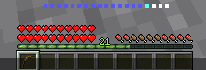
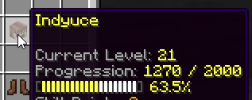

# 原版经验 {#🌟-vanilla-exp}

这个简单的RPG选项可让你在原版经验栏上显示玩家的当前主职业等级。玩家还可以通过查看实际的经验进度条来了解他们距离下一个等级有多近/多远。可以在`config.yml`中启用此选项：

```yml
# Enable this open to override vanilla EXP and display
# level progress on the vanilla experience bar.
# Requires a SERVER reload when changed.
override-vanilla-exp: true
```



与`/p`菜单中显示的经验进度和等级相匹配。



## 原版EXP重定向 {#vanilla-exp-redirection}

启用后，你通过经验球获得的经验的一部分将被重定向到你的主MMOCore职业经验。你可以在`config.yml`中更改此选项。

```yml
# Redirects vanilla experience obtained to MMOCore
# class experience. You can define the % of the vanilla
# experience that is being transfered as MMOCore exp.
# Requires a SERVER reload when changed.
vanilla-exp-redirection:
  enabled: false
  ratio: 0.8
```

此功能对于生存或简单的RPG服务器非常有用，这些服务器不想花时间设置[经验源](../level/sources.md)，并且可以依赖小怪和方块掉落的原版exp。

---

原文：[🌟 Vanilla Exp](https://docs.phoenixdevt.fr/mmocore/misc/vanilla-exp) · 原文归档：2026-10-19
