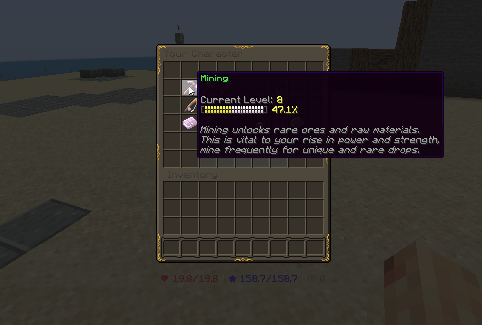

# 介绍 {#introduction}

MMOCore 目前自带 7 个副职业，也可以自行创建更多副职业，丰富等级系统。副职业可以有各自的[经验来源](../level/sources.md)，也就是玩家为了获得该副职业经验而执行的操作。

一旦玩家在其副职业中获得足够的经验，其副职业等级就会上升，授予一些奖励，例如主职业经验、技能积分、访问技能...



## 示例：农业副职业 {#example-farming-profession}

```yml
# Display options
name: Farming

# Must match an existing exp curve filename from the 'exp-curves' folder
exp-curve: levels

# How to get exp in that profession
exp-sources:
- 'mineblock{type=CARROTS;amount=1-3;crop=true;player-placed:true}'
- 'mineblock{type=POTATOES;amount=1-3;crop=true;player-placed:true}'
- 'mineblock{type=WHEAT;amount=1-3;crop=true;player-placed:true}'

# The maximum profession level
max-level: 10

# See below for full explanation
exp-table: example_exp_table

# Experience given to the main level
# when leveling up this profession
experience:
    base: 10
    per-level: 2
```

所有副职业配置文件都保存在`/MMOCore/profession`插件文件夹中。你可以配置副职业显示名称，以及 **主职业经验** 每当升级这个特定的副职业时，玩家就会获得奖励。

## 经验曲线 {#experience-curve}

这决定了玩家需要多少经验才能到达下一个副职业等级。有关经验曲线的更多信息，请访问 [此 wiki 页面](../level/curves.md)。

## 经验表 {#experience-tables}

有关体验表的更多信息，请参见此 [wiki 页面](../level/tables.md)。

## 经验来源 {#experience-sources}

经验来源定义了玩家必须执行哪些操作才能在你的副职业中赚取经验。更多信息请参阅 [此 wiki 页面](../level/sources.md)。

---

原文：[Introduction](https://docs.phoenixdevt.fr/mmocore/profession/intro) · 原文归档：2026-10-19
