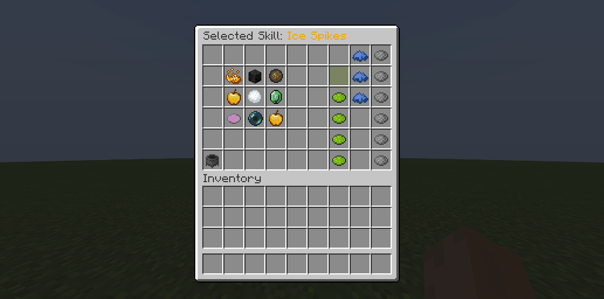
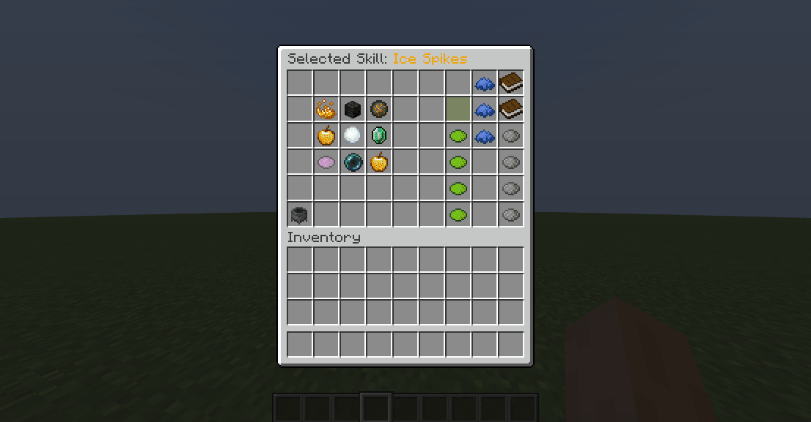

# 绑定技能 {#🔗-binding-skills}

为了进行施放，技能需要绑定到特定的技能插槽。 1个技能槽位最多绑定1个技能。每个技能插槽对应不同的按键绑定或按键组合。绑定技能的方式有多种：

- 你可以让玩家通过`/skills`GUI选择其按键绑定，
- 启用/禁用按键绑定和hard-code按键绑定的编辑（例如在 Wynncraft 上），
- 完全启用/禁用特定被动技能的绑定，
- 或者使用命令将技能绑定到技能槽位。

例如，绑定到技能插槽 n1 的技能可以通过按 [1] 键（或组合 *Left-Right*）来施放，而绑定到技能插槽 n2 的技能可以通过按 [2]（或执行组合 *）来施放。Left-Right*)。

## 技能槽位 {#skill-slots}

技能插槽是class-specific，这意味着职业可以具有不同数量的技能插槽，以及不同的技能插槽属性。例如，像法师、巫师或圣骑士这样的magic-oriented职业可能比像战士或野兽这样的melee-oriented职业有更多的技能插槽。

要编辑职业的技能插槽，请打开职业配置文件并查找/创建`skill-slots`部分。此配置部分下的每个条目对应于一个技能插槽。

```yml
# classes/mage/mage.yml

skill-slots:

  # First skill slot
  '1':
    name: "Skill Slot I"
    lore:
      - "&eReduces by &610% &ethe cooldown of"
      - "&ethe skill bound to it."
    can-manually-bind: true
    unlocked-by-default: true
    formula: "<ACTIVE>" # Can only be bound to active skills.
    # This decreases by 10% cooldown of bound skill
    skill-buffs:
      - 'skill_buff{modifier="cooldown";amount=-10;type="RELATIVE"}'
  
  # Second skill slot
  '2':
    name: "Skill Slot II"
    lore: 
      - "&eGives &640 &eadditional damage to"
      - "&ethe skill bound to it!"
      - "&eThis slot is for Aqua/Fire active skills."
    can-manually-bind: true
    unlocked-by-default: true
    formula: "(<AQUA> && <ACTIVE>) || (<FIRE> && <ACTIVE>)"
    # This gives +40 Damage to bound skill
    skill-buffs:
      - 'skill_buff{modifier="damage";amount=+40;type="FLAT"}'
  #........
```

让我们一一讨论每个参数。

### 姓名和描述 {#name-and-lore}

选项`name`和`lore`用于定义技能插槽的物品名称和描述，如`/skills`菜单中所示。

### 其他选项 {#other-options}

`can-manually-bind`决定是否允许玩家手动绑定技能到该槽位。默认设置为`true`。当设置为`false`时，将技能绑定到此插槽的唯一方法是使用管理命令。

`unlocked-by-default`默认设置为`true`。当设置为`false`时，此技能插槽需要[解锁](binding.md#unlocking-skill-slots)，就像技能一样才能使用。在解锁之前，玩家无法绑定任何技能。

### 公式 {#formula}

每个插槽还有一个公式（由`formula`条目指定），该公式确定可以与其绑定的技能集合（*兼容技能* 集合）。

> **提示**
>
> 注释掉此行或将其设置为`"true"`以禁用此选项。如果未指定公式，则所有技能都将与此技能插槽兼容。

此选项可用于创建诸如“被动技能插槽”之类的内容，其中玩家只能绑定被动技能。如果其他技能插槽为 *Active-only*，则可以确保玩家最多有一个被动技能。

唯一的限制是你的想象力。以下是你可以使用的一些公式示例。

|公式|用途 |
| --- | --- |
| `<passive>` | 仅无源技能 |
| `<active>` | 仅活动技能 |
| `<active> && <fire>` | 仅有效技能类别`fire` |
| `<active> && (!<fire>)` | 任何没有类别`fire`的技能 |
| `<passive> \|\| <fire>` | 仅无源技能类别为`fire` |
| `(<passive> && <fire>) \|\| <active>` | 仅具有类别`fire`的无源技能或有源技能 |
| `<firebolt> \|\| (!<water>)` | 仅名为`firebolt`的技能或任何不具有类别`water`的技能 |

这些公式支持 [技能类别](../../mythiclib/skills/custom/mythic.md#skill-categories)并支持布尔代数运算符：`!<aaa>`（逻辑非）、`<aaa> && <bbb>`（逻辑与）、`<aaa> || <bbb>`（逻辑或）。

以下代码定义了一个技能插槽，其中玩家只能绑定名为`FIRE_STORM`的技能。请注意，这是技能ID，而不是技能名称。

```yml
skill-slots:
  '1':
    ...
    formula: "<FIRE_STORM>" # Only targets skill "Fire Storm"
```

以下代码片段定义了一个插槽，其中玩家只能绑定处于活动状态且类别为`fire`的技能：

```yml
skill-slots:
  '1':
    ...
    # Same as "<active> && <fire>"
    # Only targets skills with category "fire", that are active
    formula: "!<passive> && <fire>"
```

以下代码片段可用于定义技能的类别。请注意，此语法将在MythicLib技能配置内部使用。请阅读[此MythicLibwiki 页面](../../mythiclib/skills/custom/mythic.md#skill-categories)以了解如何定义技能的类别。

```yml
MY_CUSTOM_SKILL:
  ...
  categories:
  - "CATEGORY_1" #Referened with <CATEGORY_1> in a formula
  - "CATEGORY_2"
```

### 技能增益 {#skill-buffs}

技能增益效果也可以授予技能插槽。技能增益效果是应用于一组技能的一个特定参数的特定增益效果，例如 *+10%Damage* 或 *-10%冷却时间*。这些技能增益效果将仅适用于绑定到该技能插槽的技能。在 [此 wiki 页面](intro.md#skill-buffs)中查找有关技能增益效果的更多信息。

例如，此功能可用于创建*火槽*或*水槽*，它们为较低的冷却时间到一组特定的技能（可以使用技能公式指定，见上文）提供额外的伤害。

技能插槽提供的技能buff 应放置在技能插槽配置的`skill-buffs`配置条目下。

## 硬编码按键绑定 {#hardcoded-keybinds}

如果你计划每个职业的技能数量有限，你可能不需要为你的玩家提供选择其技能键绑定的选项。在某些RPG服务器上，技能键绑定或组合是硬编码的，不能由玩家更改。

在这种情况下，请转到职业配置文件并编辑其技能插槽：

```yml
# classes/mage/mage.yml

skill-slots:
  '1':
    name: "Skill Slot I"
    lore: []
    #...
    hardset: FIREBALL # <========================
  
  # other skill slots....
```

通过将`hardset`参数设置为技能ID，例如`FIREBALL`（或你拥有的任何技能[为职业配置](config.md)），你可以强制将该技能绑定到此技能插槽适用于所有玩家。

## 解锁技能插槽 {#unlocking-skill-slots}

默认情况下，所有技能插槽均已解锁。如果没有，可以使用以下命令解锁它们，其中`<slot_number>`从1（不是0）开始。

```
/mmocore admin slot lock <player> <slot_number>
/mmocore admin slot unlock <player> <slot_number>
```

锁定的技能插槽在技能GUI中不可见。

<details markdown="1">

<summary>技能插槽的默认配置</summary>

```yml
# classes/mage/mage.yml

skill-slots:
  '1':
    name: "&aSkill Slot I"
    unlocked-by-default: true
  '2':
    name: "&aSkill Slot II"
    unlocked-by-default: true
  '3':
    name: "&aSkill Slot III"
    unlocked-by-default: true
  '4':
    name: "&aSkill Slot IV"
    unlocked-by-default: true
  '5':
    name: "&aSkill Slot V"
    unlocked-by-default: true
  '6':
    name: "&aSkill Slot VI"
    unlocked-by-default: true
```

</details>

## 绑定活动技能 {#binding-active-skills}

主动技能由玩家主动[施放](casting.md)，因此使用前都必须绑定到指定技能槽位。

玩家可以从`/skills`GUI内部将技能绑定到技能插槽。在技能GUI中，可用的技能显示在左侧。单击你要绑定的技能（GUI名称应更新），然后在右侧单击你要绑定技能的技能插槽。一旦绑定了活跃的技能，你就可以[施放](casting.md)它。



## 无源技能 {#passive-skills}

## 绑定被动技能 {#binding-passive-skills}

根据定义，[被动技能](config.md#passive-skills)不需要玩家施放任何主动动作。为此，你可以选择解锁后自动生效，无需绑定技能槽位。

可以使用MMOCore`config.yml`文件中的以下选项在所有技能的插件等级定义此行为：

```yml
# When set to true, passive skills must be bound in order to take effect.
# When set to false, unlocked skills will take effect right away.
# This is only the default behavior for skills but can be overridden by specifying true/false to
# the needs-bound field in the class skills section.
passive-skill-need-bound: true
```

对于职业配置文件中的特定技能，可以使用`needs-bound`字段覆盖此默认行为。如果`needs-bound`设置为`false`，则这个被动的技能将是永久的，也就是说一旦解锁就会一直生效，不需要绑定。相反，如果`needs-bound`设置为`true`，则此被动技能将需要绑定才能生效。

以下取自`classes/mage/mage.yml`配置文件的示例中，技能`POWER_MARK`是被动技能，不需要绑定即可生效。

```yml
# classes/mage/mage.yml

skills:
  POWER_MARK:
    level: 5
    max-level: 30
    ...
    needs-bound: false # Does not need to be bound to apply its effects
```

*Mage*职业的默认MMOCore配置文件具有三个 *被动技能插槽*，其中玩家只能绑定被动技能。



## 使用命令 {#using-commands}

如果你不希望玩家绑定其技能和按键绑定，则可以使用以下命令将技能绑定到特定插槽。

```cmd
/mmocore admin slot bind <player> <slot_number> <skill>
/mmocore admin slot unbind <player> <slot_number>
```

即使指定的技能或技能插槽未被玩家解锁，绑定命令也将起作用。如果指定的技能没有被玩家解锁，则技能将被绑定，但技能将保持锁定状态，并且玩家在尝试投射时会收到一条友好的错误消息。如果指定的技能插槽未解锁，则技能将可施放，但技能插槽将保持锁定状态。

---

原文：[🔗 Binding Skills](https://docs.phoenixdevt.fr/mmocore/skills/binding) · 原文归档：2026-10-19
